# RE:BORN 리본

> 폐업을 결정한 개인 카페 사장님에게 **지금 할 일 하나**와 **챙길 서류**를 알려주는 폐업 준비 도우미

카카오테크 캠퍼스 4기 강원대 4팀 · 2026.08 ~ 2026.11

[](.github/workflows/be-agent-ci.yml) [](.github/workflows/frontend-ci.yml) [](.github/workflows/e2e.yml)

| 바로가기 | 주소 |
|---|---|
| 서비스 | https://ktc4-kangwon-4.vercel.app |
| 시연 영상 | [reborn-demo.mp4 (1분 41초)](docs/presentation/reborn-demo.mp4) |
| 발표 자료 | [최종 발표 PDF (21쪽)](docs/presentation/reborn-final-presentation.pdf) |
| API 명세 (Swagger) | https://reborn-ktc.duckdns.org/docs |
| 서버 상태 확인 | https://reborn-ktc.duckdns.org/health |
| 개발 문서 | https://ktc4-kangwon-4.vercel.app/developers/ |
| 안심가이드 | https://ktc4-kangwon-4.vercel.app/safety |

> 리본은 폐업 준비를 돕는 안내 도구입니다. 지원금 자격을 확정하지 않고, 기관에 대신 신청하거나 제출하지 않습니다.

<table>
  <tr>
    <td>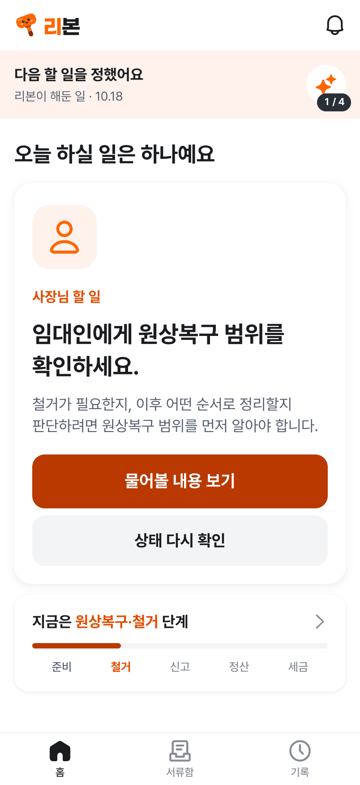</td>
    <td></td>
    <td>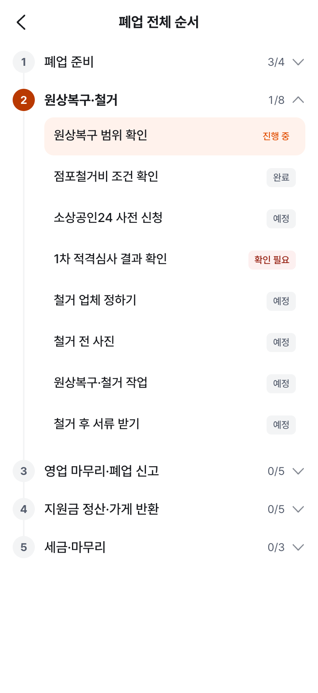</td>
    <td>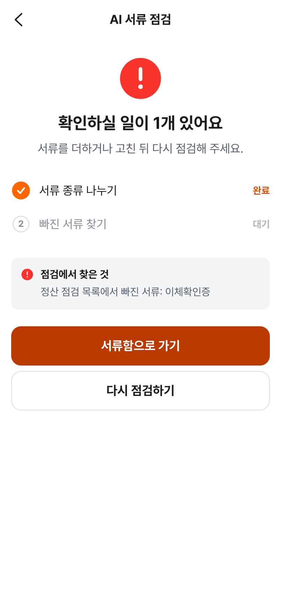</td>
  </tr>
  <tr>
    <td align="center">오늘 할 일은 하나</td>
    <td align="center">AI가 이해한 내용 확인</td>
    <td align="center">5단계 폐업 순서</td>
    <td align="center">빠진 서류 찾기</td>
  </tr>
</table>

<sub>화면은 로컬에서 미리보기 데이터로 찍은 것입니다. 전체 화면은 <a href="docs/final-guide/설명서.md">서비스 설명서</a>에 있습니다.</sub>

## 목차

1. [문제 정의](#문제-정의)
2. [타겟 사용자](#타겟-사용자)
3. [핵심 시나리오 예시](#핵심-시나리오-예시)
4. [주요 기능](#주요-기능)
5. [시스템 구조](#시스템-구조)
6. [기술 스택](#기술-스택)
7. [왜 이렇게 만들었나](#왜-이렇게-만들었나)
8. [문제 해결 기록](#문제-해결-기록)
9. [검증](#검증)
10. [배포와 운영](#배포와-운영)
11. [로컬 실행](#로컬-실행) · [폴더 구조](#폴더-구조)
12. [한계와 다음 과제](#한계와-다음-과제)
13. [문서](#문서)
14. [협업](#협업) · [팀](#팀)

## 문제 정의

폐업을 결정한 사장님은 임대차, 원상복구, 직원 정산, 폐업 신고, 지원금 서류를 직접 챙겨야 합니다. 안내는 여러 기관과 계약서에 흩어져 있고, 내 가게에 무엇이 해당하는지와 무엇을 먼저 해야 하는지는 스스로 연결해야 합니다. 그래서 안내를 읽어도 다음 행동으로 이어지기 어렵습니다.

중소벤처기업부가 2026년 6월 30일 발표한 조사에서, 최근 1년 안에 폐업하고 정부 사업에 참여한 소상공인 1,500명 중 26.1%가 폐업에 시간이 걸린 항목으로 "폐업 절차 파악"을 꼽았습니다.

리본은 이 연결을 대신합니다. 가게 상황을 버튼으로 받고, 지금 할 일 하나를 정해 주고, 사장님이 실제로 하고 온 결과를 받아 다음 할 일을 다시 정합니다.

<details>
<summary>사장님이 겪는 부담과 화면 설계의 연결</summary>

| 사용자 부담 | 적용한 설계 |
|---|---|
| 긴 안내에서 내 할 일을 골라야 함 | 홈에는 다음 행동 하나, 전체 순서는 로드맵으로 분리 |
| 작은 글자·복잡한 화면에서 핵심을 찾아야 함 | 홈 할 일 제목 26px, 주요 버튼 글자 18~19px·높이 56~60px |
| 한꺼번에 여러 조건을 기억하고 입력해야 함 | 질문을 한 장씩 나눠 보여주고 버튼으로 응답 |
| 모르는 내용까지 확정해서 답할 수 있음 | "모름"과 직접 입력을 두고, 기존 기록과 다르면 따로 확인 |
| 실행 뒤 무엇이 바뀌었는지 놓칠 수 있음 | 반영 결과 화면, 다시 정한 할 일, 작업 기록 |

자세한 내용은 [대표 사용자 흐름](docs/hero-scenario.md)에 있습니다.

</details>

## 타겟 사용자

폐업은 이미 결정했지만 임대차·원상복구·철거·직원 정산·신고·세무를 직접 챙겨야 하는 **40~50대, 1~5인 규모의 비프랜차이즈 개인 카페 사장님**. 대표 흐름은 가게를 빌려 쓰는 경우입니다.

- 지금은 개인 카페만 지원합니다. 프랜차이즈 카페와 일반 음식점은 "지원 준비 중"으로 안내합니다.
- 연령은 설계 기준이며, 서비스 이용을 제한하는 조건은 아닙니다.

## 핵심 시나리오 예시

**봄날 개인카페** 사장님의 흐름입니다. 리본은 "할 일 하나 → 사장님이 직접 실행 → 결과 알려주기 → 다시 정하기"를 폐업이 끝날 때까지 반복합니다.

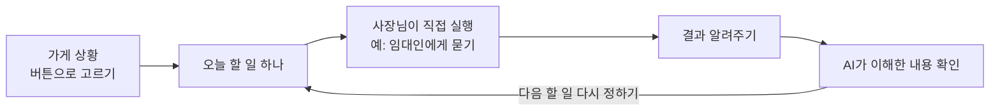

1. 사장님이 버튼으로 가게 상황(빌린 가게·직원·대출·배달앱 계약, 계약서의 원상복구 조항, 폐업 시기)을 고릅니다.
2. 5단계 폐업 순서가 만들어지고, 첫 할 일로 **"임대인에게 원상복구 범위 확인하기"**가 나옵니다.
3. 사장님이 임대인에게 물어보고 답을 알려줍니다. 예: "카운터랑 싱크대는 빼고, 간판도 떼야 한대요. 바닥 타일은 그대로 둬도 된대요"
4. 리본은 이해한 내용을 **"이렇게 이해했어요"**로 보여주고 다음 할 일을 다시 정합니다. 다르게 이해했으면 사장님이 바로잡습니다.
5. 이후 점포철거비 사전 신청 → 1차 적격심사 결과 → 영업 마무리 → 철거 → 통합 폐업 신고 → 정산 서류 점검·제출 → 가게 반환 → 부가세 신고까지 같은 방식으로 이어집니다.

아래 주요 기능에서 화면별로 볼 수 있습니다.

## 주요 기능

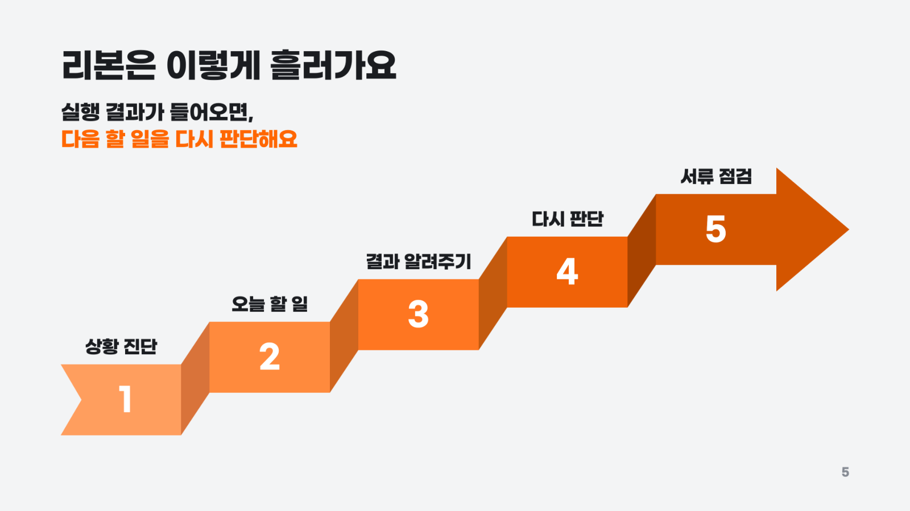

### 1. 버튼으로 가게 상황 진단

업종, 임차·직원·대출·배달앱 계약 여부, 원상복구 조항, 폐업 시기를 한 장씩 버튼으로 답합니다. 모르는 것은 "모름"으로 남기고, 앞 답에 따라 필요 없는 질문은 빠집니다. 어떤 절차가 필요한지는 화면이 아니라 서버가 판단합니다.

<table>
  <tr>
    <td>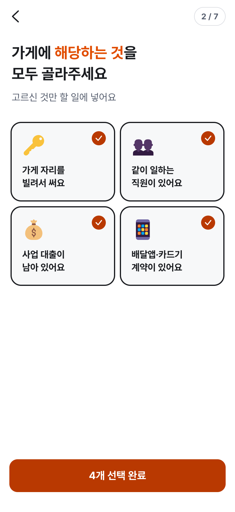</td>
    <td>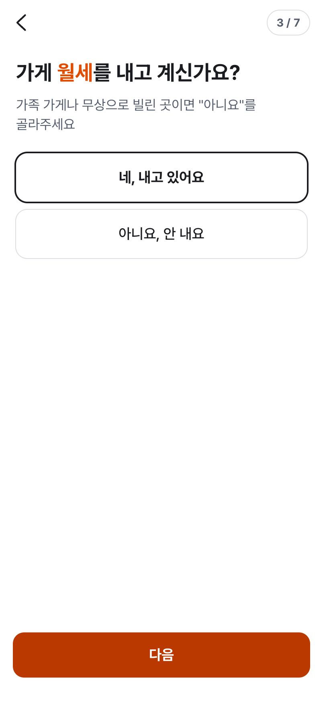</td>
    <td>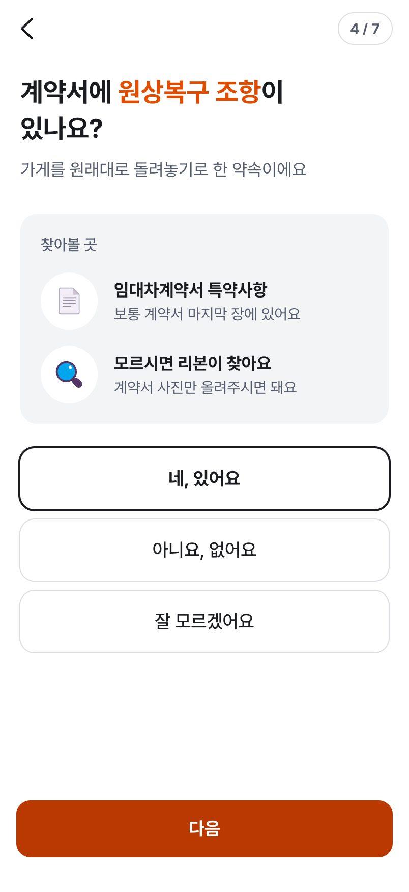</td>
  </tr>
  <tr>
    <td align="center">가게 상황 고르기</td>
    <td align="center">임차 여부</td>
    <td align="center">원상복구 조항</td>
  </tr>
</table>

### 2. 오늘 할 일 하나

홈에는 지금 진행을 막고 있는 것 하나와, 그것을 풀 행동 하나만 보여줍니다. 할 일 상세에는 누구에게 무엇을 물어볼지까지 적어서 "확인하세요"에서 멈추지 않게 합니다. 임대인에게 대신 연락하지는 않습니다.

<table>
  <tr>
    <td></td>
    <td>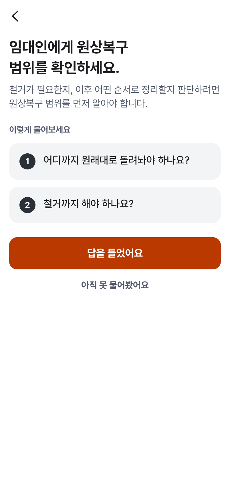</td>
  </tr>
  <tr>
    <td align="center">홈: 오늘 할 일 하나</td>
    <td align="center">할 일 상세: 물어볼 내용</td>
  </tr>
</table>

### 3. 결과 알려주기와 다시 정하기

임대인 답변처럼 하고 온 결과를 보기로 고르거나 글로 씁니다. 리본은 이해한 내용(예: 원상복구 범위 미확인 → 전체 철거)과 새로 생긴 할 일, 다음 할 일을 함께 보여줍니다. 글로 받은 내용은 "이렇게 이해했어요"로 확인받습니다.

<table>
  <tr>
    <td>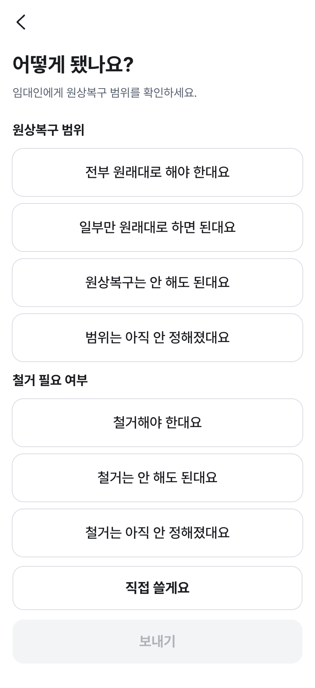</td>
    <td></td>
    <td>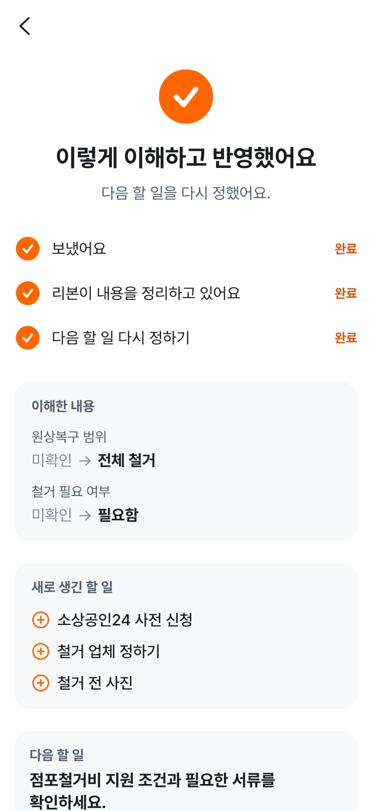</td>
  </tr>
  <tr>
    <td align="center">결과를 보기로 고르기</td>
    <td align="center">이해한 내용 확인</td>
    <td align="center">다음 할 일 다시 정하기</td>
  </tr>
</table>

### 4. 기존 기록과 다르면 되묻기

새로 알려준 내용이 기존 기록과 다르면 자동으로 덮어쓰지 않습니다. 어느 쪽이 맞는지 사장님이 고른 뒤에 다시 판단합니다. 잘못 이해한 값이 사실로 굳는 것을 막기 위해서입니다.

<table>
  <tr>
    <td>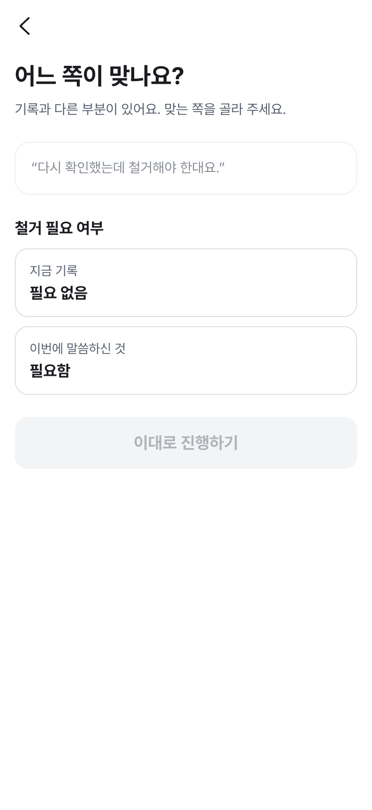</td>
    <td>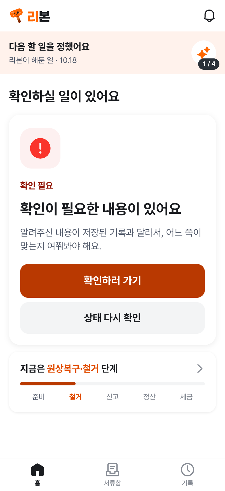</td>
  </tr>
  <tr>
    <td align="center">어느 쪽이 맞는지 고르기</td>
    <td align="center">확인 전 홈</td>
  </tr>
</table>

### 5. 5단계 폐업 로드맵

폐업 준비부터 세금 마무리까지 26개 할 일의 진행 상태를 한 화면에서 봅니다. 증빙이 필요한 일은 체크와 함께 자료를 남깁니다.

<table>
  <tr>
    <td></td>
    <td>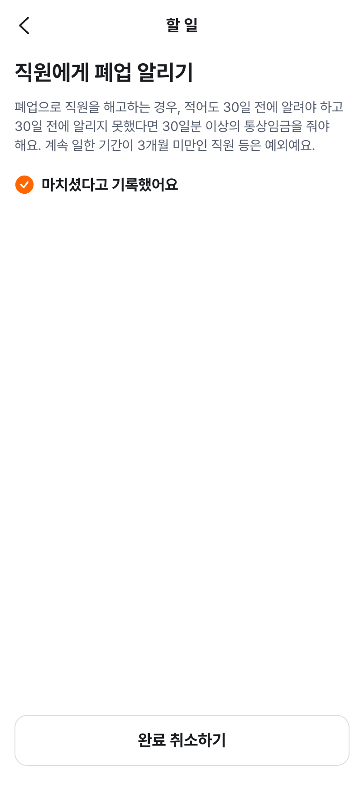</td>
  </tr>
  <tr>
    <td align="center">5단계 폐업 순서</td>
    <td align="center">체크 작업과 증빙</td>
  </tr>
</table>

### 6. 서류 점검과 제출 준비

점포철거비 정산 서류를 올리면 종류를 나누고, 빠진 서류와 금액 불일치를 찾고, 제출용 ZIP을 만듭니다.

<table>
  <tr>
    <td>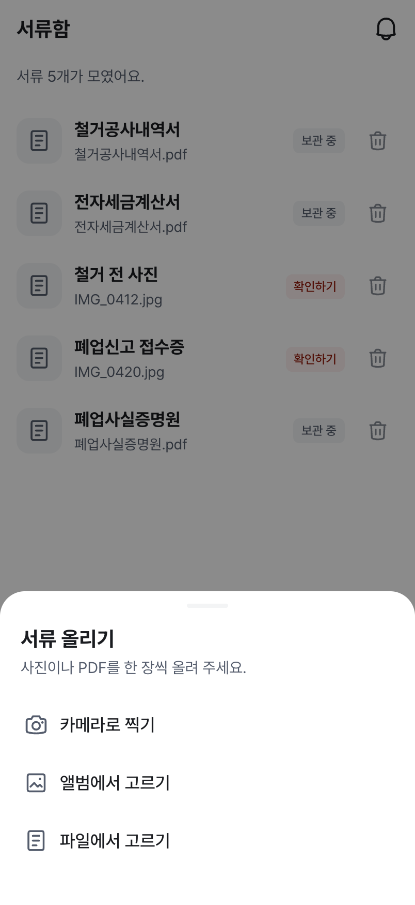</td>
    <td></td>
    <td>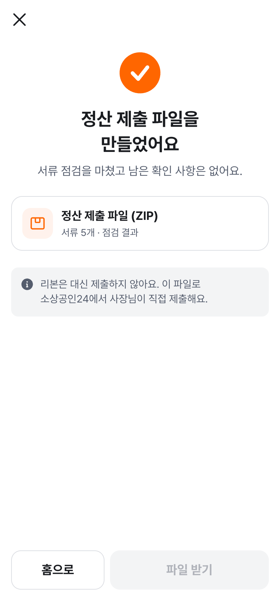</td>
  </tr>
  <tr>
    <td align="center">서류 올리기</td>
    <td align="center">빠진 서류 안내</td>
    <td align="center">제출용 ZIP</td>
  </tr>
</table>

### 7. 멈춰도 이어서 쓰기

판단이 실패하면 검수를 통과하지 못한 초안은 보여주지 않습니다. 가게 정보는 그대로 둔 채 같은 내용으로 다시 판단할 수 있고, 지금까지 무엇을 했는지는 기록 화면에서 다시 볼 수 있습니다.

<table>
  <tr>
    <td>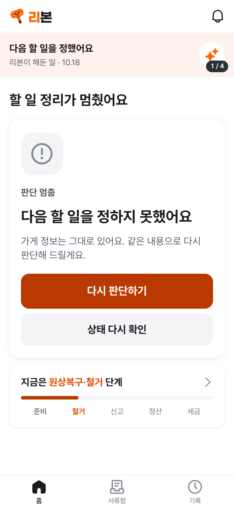</td>
    <td>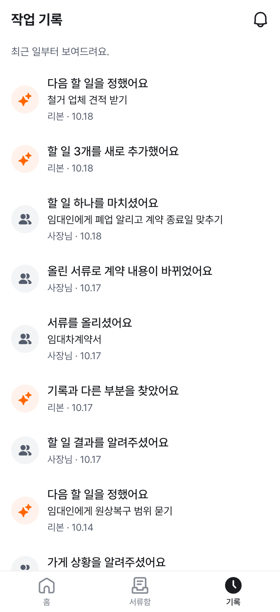</td>
  </tr>
  <tr>
    <td align="center">실패 후 다시 판단하기</td>
    <td align="center">작업 기록</td>
  </tr>
</table>

## 시스템 구조

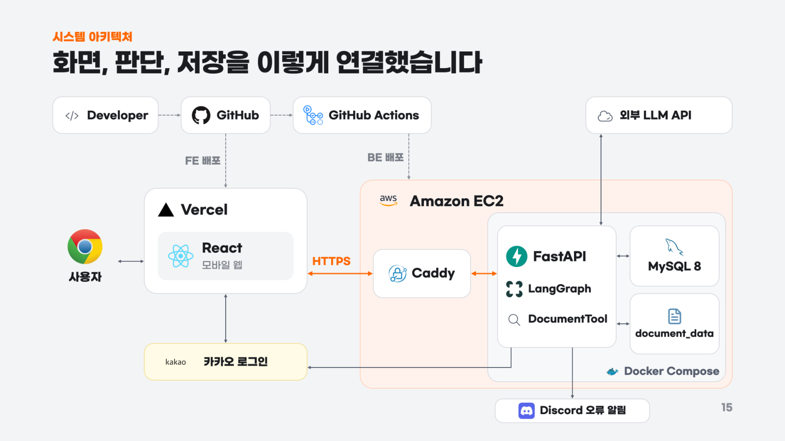

<details>
<summary>텍스트 다이어그램</summary>

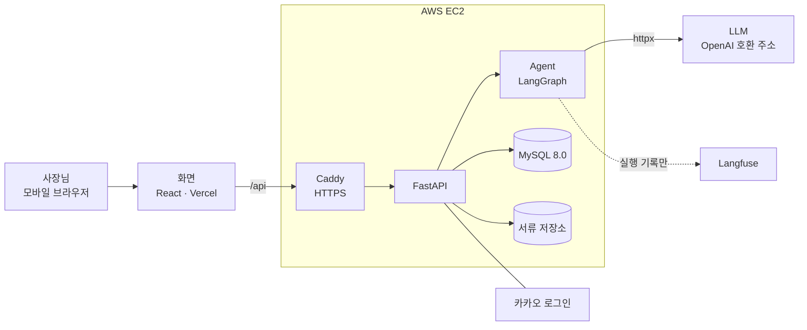

</details>

화면은 판단하지 않고 입력 전달과 결과 표시만 합니다. Agent는 DB를 직접 읽거나 쓰지 않고, 저장과 권한 확인은 BE가 맡습니다.

### 판단 한 번이 지나가는 길

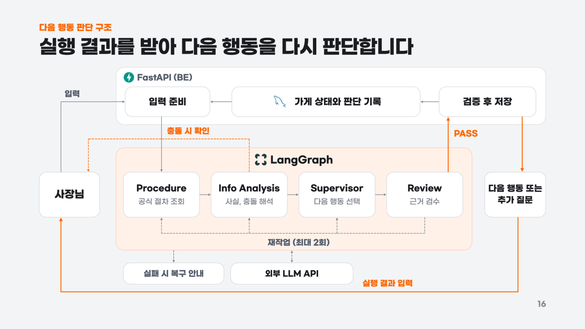

<details>
<summary>텍스트 다이어그램</summary>

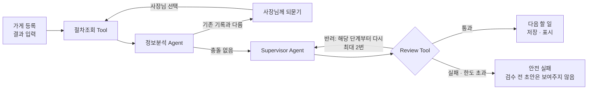

</details>

| 구성요소 | 맡은 일 |
|---|---|
| 절차조회 Tool | 사람이 검수한 폐업 절차 자료에서 원문과 출처를 찾습니다. 순서나 할 일을 정하지 않습니다 |
| 정보분석 Agent | 사장님 글에 실제로 있는 값만 꺼내고, 기존 기록과 다른 점을 찾습니다 |
| Supervisor Agent | 다음 할 일을 정하는 유일한 곳입니다. 코드가 만든 후보 중에서 고릅니다 |
| Review Tool | 모든 판단을 내보내기 전에 따로 검사합니다. 직접 고치지 않고 반려 사유만 돌려줍니다 |

### 검수한 결과만 저장

판단 초안은 코드 검사를 먼저 거치고, 모델이 쓴 내용이 들어간 경우에만 모델 검토를 한 번 더 합니다. 저장 직전에 검수 결과와 현재 값을 다시 대조한 뒤에만 진행에 반영합니다.

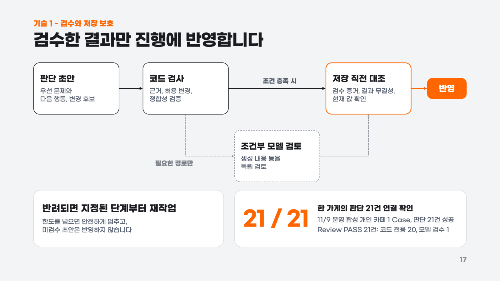

자세한 구조는 [Agent 아키텍처](docs/agent/architecture.md), DB는 [ERD](docs/schema/ERD.png)에 있습니다.

## 기술 스택

| 영역 | 사용 기술 |
|---|---|
| 화면 | React 19, TypeScript, Vite, Tailwind CSS, React Router, Zustand |
| 서버 | Python 3.12, FastAPI, SQLModel, MySQL 8.0, PyJWT, 카카오 로그인 |
| AI | LangGraph(실행 순서), Pydantic(입출력 검증), httpx(모델 호출), PyMuPDF(서류 읽기), Langfuse(실행 기록) |
| 테스트 | pytest, testcontainers(MySQL), Vitest, Testing Library, Playwright |
| 배포 | Vercel(화면), AWS EC2 + Docker Compose + Caddy(서버), GitHub Actions |

설치만 되어 있고 쓰지 않는 패키지까지 구분한 목록은 [기술 스택 문서](docs/tech-stack.md)에 있습니다.

## 왜 이렇게 만들었나

| 결정 | 다른 선택지 | 이렇게 한 이유 |
|---|---|---|
| 다음 할 일은 Supervisor 한 곳에서만 정한다 | Agent 여러 개가 각자 판단 | Agent가 늘면 모델 호출, 대기 시간, 비용, 원인 추적이 모두 어려워집니다 |
| 화면에 나가는 문장은 사람이 검수한 절차 자료에서 코드가 가져온다 | 모델이 문장을 새로 작성 | 금액, 기한, 자격을 근거 없이 단정하는 문장이 나갈 길을 줄입니다. 모델은 후보 중에서 고르기만 합니다 |
| 검수를 코드 검사와 모델 검토 두 겹으로 둔다 | 모든 판단을 모델이 검수 | 모델이 쓴 내용이 들어가는 판단만 모델이 검수합니다. 나머지는 코드 검사로 충분하고 훨씬 빠릅니다 |
| 절차 자료는 사람이 검수해서 넣는다 | 요청할 때마다 인터넷 검색 | 출처와 검수 상태, 최신 여부를 지킬 수 있습니다. 자료가 없으면 없다고 답합니다 |
| 입력은 버튼 위주, 글은 임대인 답변 한 곳만 | 처음부터 자유롭게 글로 입력 | 글 해석에 드는 시간과 오해를 줄입니다. 글로 받은 내용은 "이렇게 이해했어요"로 확인받습니다 |
| 기존 기록과 다르면 사장님이 고른다 | 새 값으로 자동 덮어쓰기 | 잘못 이해한 값이 사실로 굳는 것을 막습니다 |
| 배포는 사람이 버튼으로 실행한다 | develop에 합쳐질 때마다 자동 배포 | 서버가 재시작되면 진행 중이던 판단이 실패로 바뀝니다. 시연과 QA 도중 재시작을 피합니다 |

왜 AI가 필요했는지, 어디까지 AI에 맡기고 어디서 사람에게 묻는지, 그 대가가 무엇인지는 [왜 이렇게 설계했나](docs/agent/why-this-design.md)에 문제부터 순서대로 정리했습니다.

## 문제 해결 기록

### 1. 첫 할 일을 받는 데 2분이 걸렸다

- **문제:** 시연에서 첫 할 일이 나오기까지 5분 30초가 걸린 적이 있었습니다. 서버 기록 9건의 중간값은 180.5초였고, 그 시간의 83%를 정보분석 Agent가 썼습니다.
- **원인:** 첫 판단의 입력은 버튼 값뿐이라 글에서 꺼낼 내용이 없는데도 모델을 불렀습니다. 모델은 매번 같은 절차 원문 8건을 다시 읽고 정리하고 있었습니다.
- **시도 1, 실패:** 모델만 바꿔 봤습니다. 304초 뒤 실패해서 채택하지 않았고, "모델 교체가 아니라 하는 일을 줄여야 한다"는 근거가 됐습니다.
- **시도 2:** 절차 원문을 사람이 검수한 정리본으로 미리 만들어 두고 첫 판단의 정보분석에서는 모델을 부르지 않게 했습니다([#189](https://github.com/kakaotechcampus-4/ktc4-kangwon-4/pull/189)). 이어서 원상복구 답변을 선택형으로 받고([#197](https://github.com/kakaotechcampus-4/ktc4-kangwon-4/pull/197)), 모델이 쓴 내용이 없는 판단은 코드 검사만 하게 했습니다([#203](https://github.com/kakaotechcampus-4/ktc4-kangwon-4/pull/203)).
- **결과:** 같은 입력을 같은 구간에서 3번씩 쟀습니다.

  | 같은 첫 판단 | 평균 시간 | 모델 호출(3회 합계) | 정상 완료 |
  |---|---:|---:|---:|
  | 바꾸기 전 | 120.3초 | 9번 | 2/3 |
  | 바꾼 뒤 | 3.0초 | 3번 | 3/3 |

  정해진 다음 할 일은 전후가 같았습니다. 화면에 다음 할 일이 보이기까지는 중간값 3.2초였습니다(10회).

  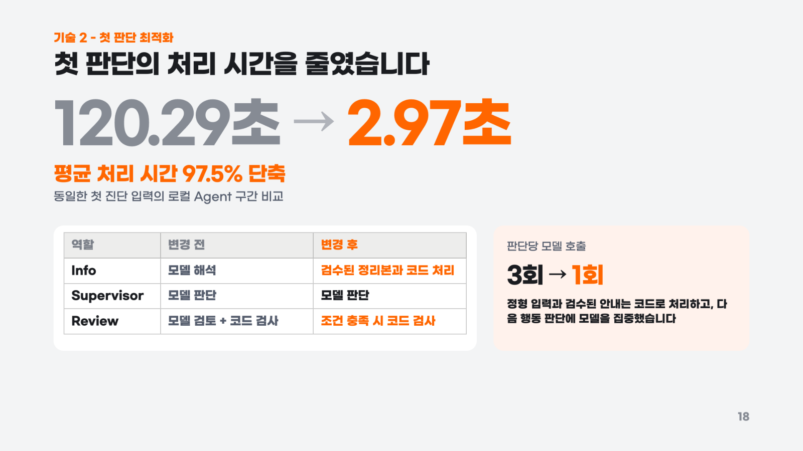
- **배운 점:** 처음에는 서버 기록 180초와 로컬 3초를 나란히 놓고 "3분에서 3초"라고 썼습니다. 멘토 리뷰에서 측정 대상이 같은지 확인하라는 지적을 받았고, 같은 입력과 같은 구간끼리 다시 쟀습니다. 위 수치는 3회짜리 표본이라 서비스 전체의 속도로 일반화하지 않습니다.
- **남은 것:** 글로 쓴 답변은 모델이 읽어야 해서 중간값 36.6초가 걸립니다.

### 2. 규칙을 지워도 테스트가 통과했다

- **문제:** 모델 검수를 줄이면 코드 검사가 그만큼 믿을 만해야 합니다. 멘토 리뷰에 따라 검수 규칙을 한 곳씩 꺼 보고 테스트를 돌렸더니 24곳 중 3곳만 테스트가 실패했습니다.
- **원인:** 기존 테스트는 "반려됐는가"만 확인했습니다. 위험한 초안 하나는 규칙 여러 개에 동시에 걸려서, 규칙 하나를 지워도 다른 규칙 때문에 계속 반려됐습니다.
- **해결:** "막혀야 하는 초안"과 "조건 하나만 바꿔 통과해야 하는 초안"을 짝으로 두고, 반려 여부가 아니라 어느 규칙이 막았는지를 확인하게 했습니다([#220](https://github.com/kakaotechcampus-4/ktc4-kangwon-4/pull/220)).
- **결과:** 테스트가 지키는 규칙이 3/24에서 22/24로 늘었습니다. 남은 2곳은 입력 형식 검사가 먼저 막아서 만들 수 없는 경우입니다.

### 3. 대표 시나리오에 실제 사례가 없었다

- **문제:** 처음 대표 장면은 "인수자를 기다리는 중에 임대인이 말을 바꾼다"였습니다. 사례를 찾아보니 이 장면을 뒷받침하는 실제 사례를 확인하지 못했습니다.
- **해결:** 실제로 반복되는 모습인 "원상복구 범위가 처음에는 정해지지 않고 임대인 요구가 조금씩 늘어난다"로 대표 장면을 바꿨습니다. 공고 원문도 다시 읽어 절차 순서를 고쳤습니다. 점포철거비는 철거 전에 신청해 1차 적격심사를 받는 것이 기본 흐름이고, 영업 마무리가 철거보다 먼저입니다.
- **결과:** 근거를 확인하지 못한 장면은 보조로 내리고, 서류 점검과 5단계 로드맵을 중심에 두었습니다. 바뀐 내용은 [대표 사용자 흐름 9~10절](docs/hero-scenario.md)에 남겼습니다.

## 검증

| 무엇을 | 결과 |
|---|---|
| 자동 검사 | PR에서 [BE·Agent](.github/workflows/be-agent-ci.yml), [화면](.github/workflows/frontend-ci.yml), [브라우저 E2E](.github/workflows/e2e.yml) 검사가 돕니다. 11월 7일 기록 기준 BE 1,098개, 화면 658개 통과 |
| 실제 모델 평가 (11/7) | 미리 정답을 정해 둔 24건 중 22건 통과, 1건 실행 실패, 1건 기대값과 불일치. 결과에 맞춰 정답을 고치지 않았습니다 |
| 운영 서버 확인 (11/9) | 개인 카페 1건을 끝까지 진행. 판단 21건 모두 성공, 서류 6종 점검과 ZIP 내려받기 확인 |
| 비용 (11/9) | 위 1건에 모델 36번 호출, 약 230원(사용량 기준 추정) |
| 폭주 방지 | 판단 한 번에 모델 호출 40번, 실행 7분을 넘으면 멈춥니다 |

평가 입력은 실제 고객 자료가 아니라 만들어 낸 사례입니다. 조건과 한계는 [모니터링 기록](docs/agent/monitoring-results.md)에 그대로 적었습니다. 개인정보와 근거 없는 단정을 막는 장치는 [가드레일 문서](docs/agent/guardrails.md)에 있습니다.

| 테스트 층 | 무엇을 확인하나 | 어디서 도나 |
|---|---|---|
| 단위 | Agent 규칙, Review 검사, 화면 컴포넌트 (pytest, Vitest) | [BE·Agent CI](.github/workflows/be-agent-ci.yml), [Frontend CI](.github/workflows/frontend-ci.yml) |
| 통합 | MySQL 컨테이너(testcontainers)를 띄워 API와 DB 저장까지 확인 (14개 파일) | [BE·Agent CI](.github/workflows/be-agent-ci.yml) |
| 브라우저 E2E | 가게 등록, 임대인 답변, 충돌 확인, 서류 점검, 실패 후 재시도 등 9개 파일 (Playwright). 모델 자리에만 가짜를 끼운 테스트 서버에 붙습니다 | [E2E](.github/workflows/e2e.yml) |

## 배포와 운영

| 항목 | 내용 |
|---|---|
| 구성 | 화면은 Vercel, 서버는 AWS EC2에서 Docker Compose로 Caddy(HTTPS) → FastAPI → MySQL 8.0 |
| CI | PR마다 BE·Agent 테스트, 화면 테스트, 브라우저 E2E를 GitHub Actions로 검사합니다 |
| 배포 | GitHub Actions의 **Deploy BE**를 사람이 실행합니다. 백업 → 반영 → `/health` 확인 순서로 돌고, 실패하면 멈췄던 서버를 다시 켠 뒤 실패로 끝납니다. 액세스 키 없이 역할로 접속하고 22번 포트를 열지 않습니다 |
| 되돌리기 | 배포 때 남긴 이전 커밋과 백업 폴더로 되돌립니다 |
| 환경 분리 | 개발은 `ENVIRONMENT=dev`(서버를 켤 때 DB 표 초기화), 운영은 `ENVIRONMENT=prod`(표를 건드리지 않고 `backend/sql/`의 SQL로만 변경). 설정도 `.env.example` / `.env.prod.example`, `docker-compose.yml` / `docker-compose.prod.yml`로 나눕니다 |
| 상태 확인 | `/health`가 DB까지 확인하고, 지금 올라간 커밋을 돌려줍니다 |
| 실행 기록 | 판단 실행 기록을 Langfuse에 남깁니다(키가 설정된 경우) |
| 오류 알림 | 서버 ERROR 로그를 Discord로 알립니다. 위치·오류 종류·버전·시각만 보내고 예외 내용은 보내지 않습니다(웹훅이 설정된 경우) |
| 폭주 방지 | 판단 한 번에 모델 호출 40번, 실행 7분을 넘으면 멈춥니다 |

자동 배포를 하지 않는 이유는 [왜 이렇게 만들었나](#왜-이렇게-만들었나)에, 절차 전체는 [배포 문서](docs/deploy.md)에 있습니다.

## 로컬 실행

필요한 것: Node.js 20.19 이상, Python 3.12, Docker

```bash
# 1. DB (개발용 MySQL만 뜹니다)
docker compose up -d db

# 2. 서버
cd backend
pip install -r requirements.txt
python scripts/setup_agent_ocr.py      # 서류 기능을 쓸 때만
uvicorn app.main:app --reload          # http://localhost:8000

# 3. 화면 (새 터미널)
cd frontend
npm ci
npm run dev                            # http://localhost:5173
```

- 환경변수는 [`.env.example`](.env.example)(AI 연결)과 [`backend/.env.example`](backend/.env.example)(인증·DB)을 복사해 채웁니다. 화면을 로컬 서버에 붙이는 방법은 [Frontend README](frontend/README.md)에 있습니다.
- **`ENVIRONMENT=dev`는 서버를 켤 때마다 DB 표를 초기화합니다.** 개발 전용 DB에서만 씁니다.
- 실제 모델을 부르는 평가는 돈이 듭니다. 1건을 먼저 돌려 금액을 확인한 뒤 실행합니다.
- 운영 서버 배포는 [배포 문서](docs/deploy.md)를 따릅니다.

## 폴더 구조

```text
backend/app/agent/     판단 로직 (Supervisor, 정보분석, 절차조회, Review, 서류 Tool)
backend/app/be/        API, DB 모델, 인증
backend/app/common/    BE와 Agent가 주고받는 데이터 모양, 검수한 절차 자료
backend/sql/           운영 DB에 넣는 SQL
backend/tests/         서버·Agent 테스트
frontend/src/          화면
frontend/e2e/          브라우저 E2E 테스트
frontend/public/       안심가이드·개발 문서 (정적 HTML이 원본)
docs/                  구조, 배포, 평가 기록, 발표 자료
```

## 한계와 다음 과제

- 비프랜차이즈 개인 카페만 지원합니다. 프랜차이즈 카페와 일반 음식점은 "지원 준비 중"으로 안내합니다.
- 지원금 Agent는 구현되어 있지만 지금 판단 경로에서는 부르지 않습니다.
- 40~50대 사장님을 대상으로 한 인터뷰와 사용성 확인은 아직 하지 못했습니다. 큰 글자와 버튼, 한 번에 하나의 할 일은 설계 의도이고 효과를 확인한 것은 아닙니다.
- 글로 쓴 답변의 판단 시간(중간값 36.6초)을 더 줄여야 합니다.
- 실제 고객 서류로 서류 분류의 정확도를 확인하지 못했습니다.

## 문서

| 문서 | 내용 |
|---|---|
| [개발 문서 사이트](https://ktc4-kangwon-4.vercel.app/developers/) | 서비스 흐름, 화면, API, 테스트 |
| [리본 안심가이드](https://ktc4-kangwon-4.vercel.app/safety) | 서류 보호와 AI 검수 설명 |
| [Agent 문서](docs/agent/README.md) | Supervisor·정보분석·절차조회·Review 구조, [가드레일](docs/agent/guardrails.md), [모니터링 기록](docs/agent/monitoring-results.md) |
| [왜 이렇게 설계했나](docs/agent/why-this-design.md) | AI가 필요한 이유, AI에 맡긴 범위와 사람에게 묻는 지점 |
| [대표 사용자 흐름](docs/hero-scenario.md) | 봄날 개인카페 시나리오와 화면 흐름 |
| [배포](docs/deploy.md) · [기술 스택](docs/tech-stack.md) · [ERD](docs/schema/ERD.png) | 운영 절차, 실제로 쓰는 패키지, DB 구조 |
| [서비스 전체 설명서 PDF](docs/final-guide/리본_서비스_전체_설명서.pdf) | 화면별 설명, 11월 7일 기준 보관본 |
| [최종 발표 자료](docs/presentation/reborn-final-presentation.pdf) · [시연 영상](docs/presentation/reborn-demo.mp4) | 2026년 11월 11일 발표본 |

## 협업

- 2026-11-11 기준 합쳐진 PR 271개 중 221개(82%)가 작성자가 아닌 팀원의 리뷰를 받았습니다.
- 팀원 리뷰 402건: 승인 298, 변경 요청 41, 코멘트 62
- 한 번에 기능 하나씩, 대신 화면부터 서버, AI까지 다 이어지게 만들었습니다.
- 파트끼리 주고받는 데이터 모양은 문서가 아니라 코드(FastAPI, 파이썬 클래스)로 정했습니다.
- PR에는 왜 이 구조를 골랐는지와 고르지 않은 방법을 적고, 리뷰어를 2명 이상 지정하는 것을 원칙으로 했습니다.
- AI 도구를 함께 썼습니다. 기준은 하나였습니다. **담당자가 남에게 설명할 수 없는 코드는 올리지 않는다.** 팀 규칙은 [CLAUDE.md](CLAUDE.md)와 [Git 컨벤션](docs/git-convention.md)에 있습니다.

## 팀

| 이름 | GitHub | 파트 |
|---|---|---|
| 최다물 | [@healthy27](https://github.com/healthy27) | PM · AI |
| 정승준 | [@tokengeoji](https://github.com/tokengeoji) | AI |
| 이현종 | [@leehyunjong12](https://github.com/leehyunjong12) | BE |
| 정현석 | [@Louie-03](https://github.com/Louie-03) | BE |
| 박시우 | [@blackwellSW](https://github.com/blackwellSW) | FE |
