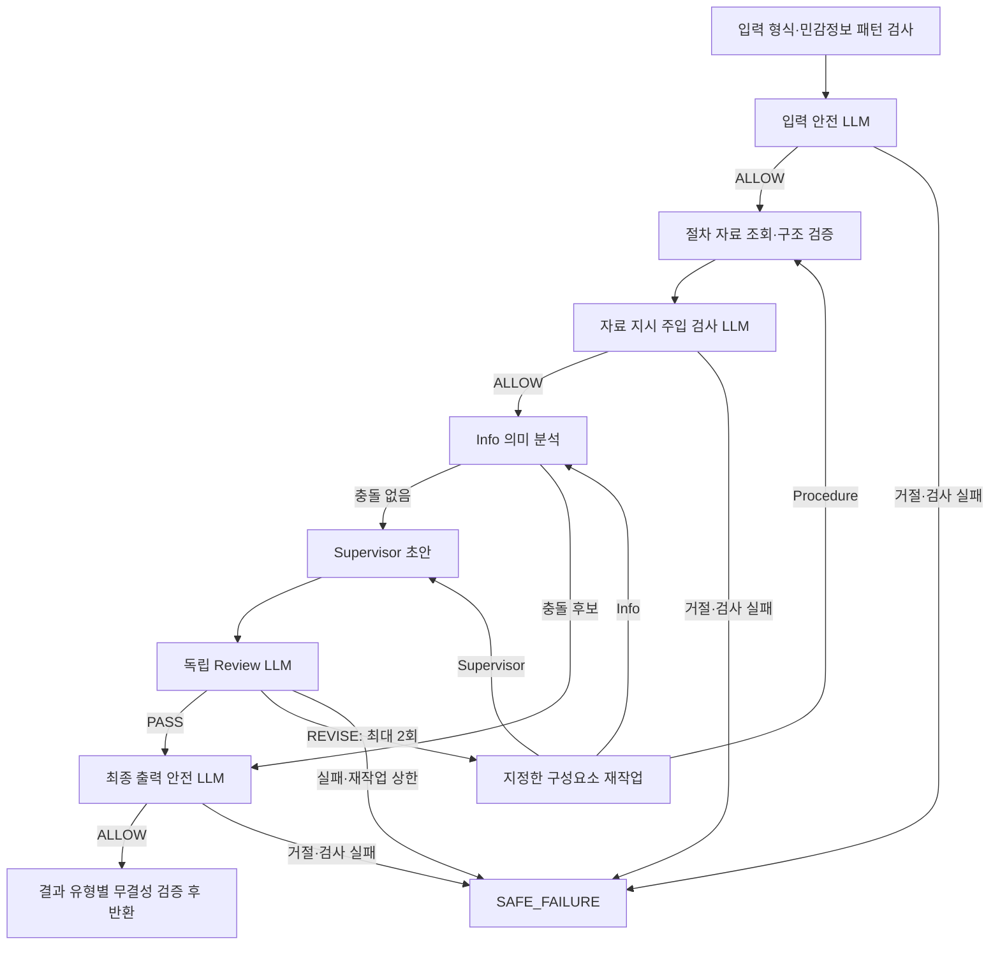

# RE:BORN Agent 아키텍처

Agent는 확인된 Case와 근거로 다음 행동을 판단한다. 실행 경로는 LangGraph가 연결하고,
최종 Blocker·Next Action은 Supervisor 한 곳에서 결정한다.
범위와 코드 색인은 [Agent 범위](./README.md)를 따른다.
동작 규칙의 기준은 문서가 아니라 `backend/app/agent/`의 검증자와 prompt다.

최신 실제 모델·서비스 API 검증은 미완료다. 검증 기준과 현재 BE 연결 상태는
[Agent 범위](./README.md#검증-기준과-서비스-연결-상태)를 따른다.

## LLM 가드레일 하네스 설계 — 2026-10-16

하네스는 모델 호출·검사·분기·도구 실행·반환을 통제하는 실행 코드다.
**문장의 의미는 LLM이 판단하고, 허용 범위와 통과 조건은 코드로 강제한다.**
가드레일은 기존 코드 검증과 LLM 검사 하네스를 함께 적용한다. 하네스가 검사 순서·중단을 보장하고,
검사 LLM의 ALLOW/PASS도 타입·권한·근거 참조·상태·검수 일치 같은 코드 제약을 해제하지 않는다.
입력·자료·최종 출력 안전 검사와 Info·Review 의미 검사를 실행한다.



Procedure가 재작업 대상이면 자료 조회·검사부터,
Info면 의미 분석부터, Supervisor면 초안부터 다시 실행하고 반드시 Review로 돌아온다.
충돌 후보는 자동 반영하지 않고 출력 안전 검사 뒤 `CONFLICT`로 반환한다.
정상 결과는 ReviewProof와 검수 대상 일치를 대조한다. 충돌 확인 입력도 입력 검사와 원본·현재값 검증을 거친다.

| 단계 | 모델에 전달하는 자료와 판단 | 코드의 통과 조건 |
|---|---|---|
| 입력 안전 검사 | 비식별 현재 입력·필요한 Case 문맥. 유해 조력·역할 사칭·지시 우회 판단 | 기존 내부 `SafetyDecision`의 `ALLOW`만 통과 |
| 자료 검사 | Info·Review가 읽을 조회 발췌와 snapshot의 필요한 근거/부모 근거 본문·참조. Agent 역할·목표 변경, 비밀 공개·검수 생략 지시 판단 | 정해진 분류만 수용. 거절·판정 불능이면 원문을 조용히 제외하거나 수정해 계속하지 않음 |
| Info | 현재 발화·사용자 절차 상태 선택·읽기 전용 Case·검사한 공식 자료. 사실·반전·불확실성 해석 | 허용 필드·타입·enum·정확 인용·근거 ID·상태 조합 검증. 변경은 후보로만 구성 |
| Supervisor | 검증된 구성요소 결과·등록된 절차·변경 후보. Blocker·다음 행동 판단 | 등록된 대상·조건·선후 관계와 기존 출력 조합 검사 |
| 독립 Review | 현재 원문·필요한 원문 근거·변경 후보·초안. 해석 오류·근거의 뒷받침·과신·업무 정합성 판단 | 기존 `ReviewResult`의 참조·대상·판정 조합을 검증. PASS가 같은 초안을 가리킬 때만 통과 |
| 최종 출력 검사 | 새 권고·변경 이유·Info 생성 질문·충돌 후보. 유해 조력·누출 판단 | `ALLOW`만 반환 허용. 위험 초안을 수정해 검수 증명 없이 반환하지 않음 |

Info는 사실을 추출하고 사용자 enum 선택에서 절차 진행을 구성한 뒤 현재 확인·실행 가능한 절차,
이번 진행 변경 대상을 상세 분석한다. 이미 완료한 세무 절차는 전체 종료 시 후속 안내에 필요할 때 추가한다.
새 세무 진행 보고는 전체 종료 전에도 검수한다. 상세 호출은 주제 한 개씩 최대 두 개 병렬이다.
막힌 절차도 전체 추적·추가 질문에서 유지하며, Case 저장과 원 snapshot은 바꾸지 않는다.
유효한 CONFIRMED 범위·철거 두 사실로 끝난 범위확인 상세는 생략하되,
새 범위 진행 관찰의 근거 분석과 UNKNOWN/CLEAR 상태의 필요한 분석은 유지한다.

자료 검사는 **필요한 조회 발췌·저장 근거 본문을 묶어 Info가 읽기 직전** 수행한다.
Review가 참조할 snapshot 근거와 부모 근거도 포함한다. 뒤 단계나 재작업에서 새 본문이 추가되면
해당 모델이 읽기 전에 검사한다. 같은 실행에서 같은 정책으로 검사한 동일 본문을 다시 검사하지 않는다.
자료 없음은 기존 경로를 유지한다. 정상적인 신고 방법·법령의 지시를 Agent를 조종하는 지시로 취급하지 않는다.
지원사업은 현재 MVP 실행에서 제외하며 Tool 자율 선택은 기존 후속 과제로 유지한다.

### LLM으로 옮길 판단과 남길 검증

- Info의 표현 목록·문장 반전·단정 여부·진행 표현 해석은 Info LLM에 맡기고 Review가 원문과 대조한다.
- 금액·법률·세무 주장 분류, 과신·주의 문구의 충분성, 다른 행동까지 함께 지시하는지는 Review LLM에 맡긴다.
  Supervisor와 Review가 같은 자연어 정규식으로 중복 판정하는 경로를 제거한다.
- Supervisor가 기존 `grounded_claims`를 선언하고 Review는 모든 노출 문장과 대조해 누락·오분류를
  기존 `ReviewIssue`와 REVISE로 반송한다. Supervisor가 다시 작성하며 Review가 claim을 직접 수정하지 않는다.
- 타입·enum·숫자 범위·허용 필드·실제 인용 위치·근거 참조·공식 근거 종류·신선도와
  선언된 claim의 경로/문장 일치·자격 확인 필수 조합·절차 ID/조건·상태 전이·snapshot/검수 digest는 코드에 남긴다.
  인용이 실제 있다는 검사와 그 인용이 주장을 뒷받침한다는 의미 판단을 구분한다.
- `claim_safety.py`나 Review 검증 함수를 통째로 삭제하지 않는다. 근거 계보 해석 등 구조 검증에 쓰는
  공용 기능을 보존하고 언어 판정 호출부만 분리한다. 모델의 ALLOW/PASS가 코드 제약을 해제하지 않는다.

### 중단·예산·데이터 경계

- 안전 거절·공급자 거절은 재작업으로 우회하지 않는다. 검사 장애·잘못된 JSON·시간/호출 한도 소진도
  허용으로 바꾸지 않는다. 안전 검사는 자동 재시도 0회, 업무 Review만 기존 최대 2회 재작업한다.
- 기존 공용 모델과 실행당 예산(기본 40회)·제한시간을 공유한다. 현재 안전 검사는 정상 실행당 2회이며,
  자료 검사에는 비어 있지 않은 미검사 본문 묶음마다 1회 추가된다. 기본 자료 묶음을 한 번 읽는
  정상 경로는 안전 검사 통상 3회다. 뒤 단계·재작업의 새 본문은 추가 검사하며 자료가 없으면 2회다.
- 결과 캐시는 사용하지 않는다. 동일 실행의 같은 본문 검사만 중복을 제거한다.
- 입력 비식별화는 BE 선처리를 전제로 하며 기존 민감정보 패턴 검사를 유지한다. 새 검사가 원문 개인정보를
  추가 수집하지 않는다. 각 모델에는 그 역할에 필요한 문맥만 주고 trace에는 원문·자유로운 판단 이유를 남기지 않는다.
- 정책은 실제 시스템 메시지·도구 설명으로 전달한다. 일반 함수 docstring에 적기만 한 지시는 검사로 취급하지 않는다.
  사용자·자료·Tool 본문은 지시보다 낮은 신뢰의 데이터로 전달하고 모델에게 인증정보·DB 쓰기 권한을 주지 않는다.
- 모델의 의미 판정은 기존 내부 DTO로 검증한다. 실행 ID·시각·digest는 코드가 만들고,
  모델이 선택한 근거·대상·검수 경로는 제공한 범위 안에 있는지 다시 대조한다.
- Agent DTO를 코드로 확장하되 BE·DB 구현은 직접 변경하지 않는다. 정상/충돌/실패는 구분해 반환하고 DB 반영은 BE가 검사한다.
  복수 충돌의 원본·기준 복원과 최종 저장 전 재검사는 BE 연동 사항이다.

완료 기준은 정상·예방·피해 신고 허용, 유해 조력/자료 지시 주입 차단, 의미 반전과 정상 접속문 구분,
모델 오류·검수 우회 차단이다. 모의 검증은 제어 흐름, 실제 모델 평가는 의미 판정의 근거로 기록한다.
과거 모의 회귀·실제 모델 성공은 변경된 하네스의 완료 근거로 대신하지 않는다.

## 구성요소

| 구성요소 | 책임 |
|---|---|
| Supervisor Agent | 절차·사실을 종합해 전체 Blocker·우선 1개·Next Action 또는 확인 질문·완료 안내와 변경 후보 생성 |
| 정보분석 Agent | 비식별 입력에서 근거가 있는 사실·진행·충돌 후보를 추출하고 Case에 맞는 절차를 분석한다 |
| 지원금 Agent | 기존 구현을 보존하되 MVP 실행 경로에서는 호출하지 않는다 |
| 절차조회 Tool | 주입된 절차 자료에서 원문·출처·검수 상태를 조회한다. 우선순위나 Next Action을 결정하지 않는다 |
| Review Tool | 초안·변경 후보·근거를 독립 검수해 `PASS` 또는 사유와 재작업 대상이 있는 `REVISE`를 반환한다 |
| 안전 검사 | 기존 공용 모델로 입력·최종 생성 문구의 유해 조력을 검사하고, 거절·검사 실패 시 결과 반환을 막는다 |

`AgentGraph`는 실행기이며 별도 Agent가 아니다. 하위 Agent·Tool은 서로 직접 호출하지 않는다.
Review는 검색·초안 수정·저장을 수행하지 않는다.

## MVP 실행 경로

```text
CASE_CREATED | RESULT_SUBMITTED
  → 입력 안전 검사 → Procedure → Info
      ├─ 확정 사실과 충돌 → 출력 안전 검사 → CONFLICT
      └─ 충돌 없음 → Supervisor → Review

CONFLICT_CONFIRMED
  → 입력 안전 검사 → 선택 후보·현재값 검증 → 확인된 fact_overlays
  → Procedure → Info(절차 분석: input=None, fact_overlays)
  → Supervisor → Review

Review
  ├─ PASS → 검수 대상과 일치하는 ReviewProof → 출력 안전 검사 → REVIEWED_PLAN
  ├─ REVISE → 해당 단계부터 재작업 → Review
  └─ 실패·상한 소진 → SAFE_FAILURE
```

MVP는 위 경로를 사용하며 일반화된 자율 Tool 선택 계획을 추가하지 않는다.
안전 검사에서 차단되거나 검사가 실패해도 기존 `SAFE_FAILURE`로 종료한다.
입력·출력 검사와 새 자료 본문 검사는 기존 호출 예산·시간 제한을 공유한다.
충돌 확인 뒤에도 변경된 사실을 바탕으로 폐업 절차를 다시 확인한다.
새 사용자 입력이 없는 실행을 위해 발화를 만들지 않는다. Info는 전달된 확인 후보로 절차만 분석한다.
확인된 후보는 Procedure·Info부터 다시 실행하는 재작업에서도 유지하며 LLM이 교체하지 못한다.
독립 Review 모델에도 실제 원본 충돌과 승인/거절 선택을 canonical 경로로 전달한다.
사용자 승인으로 코드가 만든 변경을 단순한 기존값 불일치로 반려하지 않도록 검수 문맥을 제공하며,
승인되지 않은 변경·원본 변조·오래된 확인을 거부하는 코드 검증은 그대로 유지한다.

## 실행 자료와 수명

BE가 실제 절차 ID 목록·절차 store를 `build_runtime`에 주입한다.
지원 catalog 인자는 기존 호출 계약에 남지만 MVP에서는 지원 분석을 실행하지 않는다.
공용 runtime을 여러 요청에 사용하되 호출 예산·사용량·deadline은 실행마다 분리한다.
환경변수는 [`.env.example`](../../.env.example), 한도·자원 정리는
[`runtime.py`](../../backend/app/agent/runtime.py)를 따른다.


Case snapshot은 한 실행 동안 바꾸지 않는다. 추출·사용자 확인으로 얻은 변경 후보는
`fact_overlays`로 별도 전달하고, 저장 전까지 snapshot의 확정 사실로 덮어쓰지 않는다.
절차·정책 자료는 요청 중 인터넷에서 수집하지 않으며 검수 상태와 최신성을 보존한다.
자료가 없으면 없는 상태를 반환하고 다른 문서·지원사업·조건으로 채우지 않는다.

## 검수와 반환

| 결과 | 규칙 |
|---|---|
| `REVIEWED_PLAN` | 같은 Case·선행 결과·초안을 검수한 PASS와 증명을 반환한다. DB 저장 완료를 뜻하지 않는다 |
| `CONFLICT` | 실행을 멈추고 사용자 선택을 요청한다. 기존 사실을 자동 변경하지 않는다 |
| `SAFE_FAILURE` | 오류·검증 실패·예산 소진을 알리고 검수 전 초안을 반환하지 않는다 |

`NEEDS_MORE_INFO`는 Review를 거치는 정상 판단이다. Blocker와 확인 질문을 반환하며
없는 Next Action이나 확정값을 만들어 넣지 않는다.

`ACTION`과 `NEEDS_MORE_INFO`는 전체 `blockers`와 우선 `blocker`를 반환한다.
`COMPLETED`는 Blocker·행동 없이 세금 후속 안내를 반환한다. 전체 카페 절차의 적용·완료를 검증하며
미확인 절차가 있으면 종료하지 않는다. 모든 정상 판단은 Review와 출력 안전 검사를 거친다.

초안·선행 결과가 달라지면 이전 Review PASS를 재사용하지 않는다.
허용된 단계부터 재작업하되 `runtime.py`·`llm.py`의 호출·시간·재작업 상한을 넘기지 않는다.

## 상태와 저장 경계

- 사용자 확인은 사실 선택이며 이후 계획의 정확성을 보증하지 않는다. 선택 뒤에도 필수 Review를 적용한다.
- 오래된 충돌 확인은 `STALE_CONFLICT_CONFIRMATION`으로 거부한다.
- ID·타입·근거 참조·digest·허용 상태 전이는 코드로 검증한다.
- 미확인·오래된 근거로 날짜·금액·법률·세무·지원 자격을 단정하지 않는다.
- 공식 절차 문서나 자유문장만으로 절차 진행·완료를 확정하지 않는다. 사용자 명시적 상태 선택을 검증하는 A안을 적용하며, FE 선택·BE 전달과 저장 연동은 별도 작업이다.
- Agent는 SQL·ORM으로 Case를 직접 읽거나 쓰지 않는다. BE가 권한·현재값을 확인하고 저장·재조회한다.
- 사용자 원문·근거 본문·비밀값을 trace에 기록하지 않는다.

호출자가 맡는 저장과 충돌 확인 경계는 [실행 경계](./README.md#실행-경계)를 따른다.
절차 실행 가능 판정은 `procedure_tool/rules.py`, 후보 우선순위는 `blocker_candidates.py`가 기준이다.
