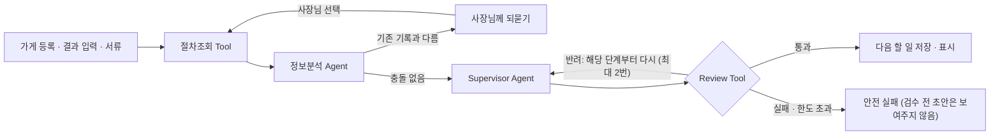

# 왜 이렇게 설계했나 — 문제에서 구조까지

> 리본의 AI 구조를 "어떤 문제를 풀려고 이렇게 만들었는가" 순서로 설명합니다.
> 규칙과 필드의 기준은 코드입니다. 이 문서는 결정의 이유와 대가를 남기는 용도입니다(11-11 develop 기준).

## 한 줄 요약

**AI는 사람 말과 서류를 이해하고 다음 할 일을 고르는 곳에만 쓰고, 순서·상태·검사처럼 틀리면 안 되는 곳은 코드가 맡습니다.**
판단 한 번 안에서는 AI가 검토·반려·재작업까지 스스로 돌립니다. 사람에게 묻는 곳은 틀리면 되돌리기 어려운 곳뿐입니다.

## 1. 풀어야 했던 문제

### 사장님의 문제

폐업을 결정한 카페 사장님은 임대차, 원상복구, 직원 정산, 폐업 신고, 지원금 서류를 직접 챙깁니다.
안내는 여러 기관과 계약서에 흩어져 있고, 내 가게에 무엇이 해당하는지와 무엇을 먼저 할지는 스스로 연결해야 합니다.

실제 사례를 찾아보니 상황은 한 번에 정해지지 않았습니다. **원상복구 범위가 처음에는 정해지지 않고, 임대인 요구가 조금씩 늘어나는 모습**이 반복됐습니다([대표 사용자 흐름 9~10절](../hero-scenario.md)).

### 기술 문제로 바꾸면

| | 사장님 쪽에서 본 문제 | 그래서 시스템이 해야 하는 일 |
|---|---|---|
| A | 계획이 한 번에 끝나지 않는다. 임대인 답변, 서류처럼 결과가 현실에서 돌아온다 | 결과를 받을 때마다 **다시 판단**한다 |
| B | 입력이 버튼만이 아니다. 임대인 답변은 사람 말이고, 서류는 양식이 제각각이다 | 사람 말과 서류에서 **값을 꺼낸다** |
| C | 금액·기한·자격을 틀리게 말하면 사장님이 돈과 시간을 잃는다 | 근거 없는 단정을 막고, **내보내기 전에 검사**한다 |
| D | 사장님은 화면 앞에서 기다리고, 모델 호출마다 돈이 든다 | **빠르고 싸게** 판단한다 |

아래 구조는 모두 이 네 가지 중 하나를 풀기 위한 것입니다.

## 2. 왜 AI가 필요했나 — 규칙만으로는 안 되는 곳

처음부터 "AI를 쓰자"로 시작하지 않았습니다. 코드로 할 수 있으면 코드로 하고, 코드로 하면 깨지는 곳에만 AI를 넣었습니다.

| 하는 일 | 코드(규칙)만으로 하면 | 그래서 맡긴 곳 |
|---|---|---|
| 임대인 답변 이해 (B) | "카운터랑 싱크대는 빼고, 간판도 떼야 한대요" 같은 말을 규칙으로 읽으면 예외가 너무 많아 정상 답변까지 잘못 읽습니다. 멘토 리뷰(#82)에서도 사람 말은 규칙으로 해석하지 말라는 지적을 받았습니다 | **정보분석 Agent**가 글에 실제로 있는 값만 꺼내고, 꺼낸 값마다 근거 문장을 붙입니다 |
| 서류 읽기 (B) | 공사내역서, 세금계산서, 이체확인증, 사진은 업체마다 양식이 다르고 스캔·사진도 섞여 있습니다 | **서류 Tool**이 모델로 종류를 나누고 값을 꺼냅니다. 빠진 서류 찾기와 금액 비교는 코드가 합니다 |
| 다음 할 일 고르기 (A) | 막힌 것이 여러 개일 때 지금 이 가게에 무엇이 먼저인지, 행동을 시킬지 질문을 할지는 상황마다 다릅니다 | **Supervisor Agent**가 코드가 추려 준 후보 중에서 고릅니다 |
| AI 결과 검사 (C) | 모델이 꺼낸 값이 원문과 맞는지는 글자 비교만으로 다 볼 수 없습니다 | **Review Tool**이 코드 검사에 더해, 모델이 쓴 내용이 들어간 판단은 모델로 한 번 더 검토합니다 |
| 결과가 기존 기록과 다를 때 (A) | 새 값으로 덮어쓰면 잘못 읽은 값이 사실로 굳습니다 | 정보분석 Agent가 다른 점을 찾고, **사장님이 고르게** 합니다 |

일반 폐업 체크리스트와 다른 점은 A입니다. 체크리스트는 결과를 받아 다음 할 일을 다시 정하지 못합니다.
리본은 "할 일 → 사장님이 현실에서 실행 → 결과 입력 → 다시 판단"을 반복합니다. 이 반복 때문에 상태를 기억하고 단계를 이어 가는 Agent 구조가 필요했습니다.

## 3. 왜 AI에게 전부 맡기지 않았나 — 경계를 그은 이유

AI가 스스로 도구를 고르고 계획을 세우는 구조도 생각했습니다. 하지만 이 서비스에서 틀린 안내는 돈과 법 문제로 이어집니다(C).

| 결정 | 고르지 않은 방법 | 이유 |
|---|---|---|
| 순서·상태·필수 조건은 코드가 정한다 | 모델이 절차 순서를 판단 | 선후 관계와 상태 변경은 답이 정해져 있습니다. 코드로 하면 매번 같고, 테스트로 지킬 수 있습니다 |
| 다음 할 일은 Supervisor 한 곳에서만 정한다 | Agent 여러 개가 각자 판단 | Agent가 늘면 모델 호출, 기다리는 시간, 비용, 원인 추적이 모두 어려워집니다 |
| 모델은 코드가 만든 후보 안에서만 고른다 | 모델이 할 일을 새로 만듦 | 근거 없는 행동이 나갈 길을 줄입니다. 목록 밖의 행동은 코드가 거절합니다 |
| 화면 문장은 사람이 검수한 절차 자료에서 가져온다 | 모델이 안내문을 새로 작성 | 금액·기한·자격을 단정하는 문장이 나갈 길을 줄입니다 |
| 절차 자료는 사람이 검수해서 넣는다 | 요청할 때마다 인터넷 검색 | 출처, 검수 상태, 최신 여부를 지킬 수 있습니다. 자료가 없으면 없다고 답합니다 |
| AI는 대신 신청·제출하지 않는다 | 기관에 자동 신청 | 되돌릴 수 없는 행동은 사장님이 합니다 |

정리하면 **"AI가 혼자 다 한다"가 아니라 "AI가 혼자 해도 되는 곳까지는 혼자 한다"** 입니다.

## 4. 판단 한 번의 구조 — 어느 장치가 어떤 문제를 푸나

| 단계 | 하는 일 | 푸는 문제 |
|---|---|---|
| 절차조회 Tool | 검수한 절차 자료에서 원문과 출처를 찾음. 순서나 할 일은 정하지 않음 | C |
| 정보분석 Agent | 사람 말에서 값을 꺼내고 기존 기록과 비교. 첫 판단처럼 버튼 입력뿐이면 모델을 부르지 않음 | B, A, D |
| 사장님께 되묻기 | 기존 기록과 다르면 멈추고 사장님이 고름 | A, C |
| Supervisor Agent | 코드가 추린 후보 중 지금 할 일 하나를 고름 | A |
| Review Tool | 근거·허용된 행동·상태 변경을 코드로 검사. 모델이 쓴 내용이 있으면 모델로도 검토. 직접 고치지 않고 반려 사유만 돌려줌 | C |
| 재작업·안전 실패 | 반려되면 해당 단계부터 다시. 판단 1회당 모델 호출 40번·7분을 넘으면 멈추고 초안을 버림 | C, D |

실행 순서는 LangGraph로 연결했습니다. 각 단계는 서로 직접 부르지 않고, 다음 단계는 앞 단계의 결과로 정해집니다([`graph.py`](../../backend/app/agent/graph.py)).

## 5. 사람이 끼어드는 곳과 그 이유

판단 한 번 안에서는 사람이 끼어들지 않습니다. 절차 조회 → 값 꺼내기 → 할 일 고르기 → 검사 → 반려되면 다시 하기 → 통과하면 저장까지 AI와 코드가 끝냅니다.

사람이 하는 곳은 세 군데이고, 모두 **틀리면 되돌리기 어려운 곳**입니다.

| 사람이 하는 곳 | 왜 AI가 하지 않나 |
|---|---|
| 임대인 연락, 기관 신청, 철거 같은 현실 행동 | AI가 할 수 없는 일이고, 대신 하게 해서도 안 되는 일입니다 |
| AI가 이해한 내용이 기존 기록과 다를 때 고르기 | 잘못 읽은 값이 사실로 굳으면 이후 판단이 모두 틀립니다 |
| AI가 꺼낸 값 확인 ("이렇게 이해했어요", 서류 종류·값 확인) | 사람 말과 서류 해석은 틀릴 수 있습니다. 확인 한 번으로 그 위험을 막습니다 |

## 6. 대가 — 얻은 것과 잃은 것

| 결정 | 얻은 것 | 잃은 것 |
|---|---|---|
| 첫 판단에서 모델을 부르지 않고 검수한 정리본을 씀 (#189) | 같은 첫 판단 평균 **120.3초 → 3.0초**, 모델 호출 3회 합계 9번 → 3번, 정상 완료 2/3 → 3/3 | 정리본을 사람이 만들고 검수해야 함. 원문이 바뀌면 다시 검수 |
| 모델은 후보 안에서만 고름 | 근거 없는 행동이 나가지 않음 | 후보에 없는 새 할 일은 제안하지 못함. 지원 범위가 등록한 할 일 26개와 개인 카페로 한정 |
| 검수를 코드와 모델 두 겹으로, 모델 검토는 필요할 때만 (#203) | 모델이 쓴 내용이 없는 판단은 빠르게 통과 | 코드 검사를 믿을 수 있어야 함. 그래서 규칙별 테스트를 보강해 테스트가 지키는 규칙을 3/24 → 22/24로 늘림 (#220) |
| Supervisor 한 곳에서만 판단 | 호출 수·비용·원인 추적이 단순함 | 지원금처럼 따로 찾고 비교해야 하는 일은 넣기 어려움 |
| 지원금은 "찾아 주기"가 아니라 "놓치지 않고 받게 돕기"에 집중. 지원금 Agent는 만들었지만 연결하지 않음([설명](./support-agent.md)) | 지원사업 찾기는 보조금24·기업마당·소상공인24가 이미 함. 리본은 찾은 다음의 어려움을 맡음: 철거 전에만 만들 수 있는 증빙을 미리 안내해 순서 실수를 막고, 정산 서류의 누락·금액 불일치는 제출 전에 찾음. 자격은 AI가 단정하지 않음 | "어떤 지원금을 받을 수 있나요?"에는 바로 답하지 못함 |
| 입력은 버튼 위주, 글은 임대인 답변 한 곳만 | 버튼으로 받는 판단은 몇 초 안에 끝남 | 자유롭게 말하지 못함. 글로 쓴 답변은 아직 중간값 36.6초 |
| 기록이 다르면 사장님이 고름 | 잘못 이해한 값이 굳지 않음 | 사장님이 한 번 더 눌러야 함 |

## 7. 이 구조로 확인한 것

| 무엇을 | 결과 |
|---|---|
| 운영 서버 한 가게 끝까지 (11-09) | 판단 21건 모두 성공, 서류 6종 점검과 ZIP 내려받기 확인. 모델 36번 호출, 약 230원 |
| 실제 모델 평가 (11-07) | 미리 정답을 정한 24건 중 22건 통과, 1건 실행 실패, 1건 기대값과 불일치. 결과에 맞춰 정답을 고치지 않음 |
| 첫 판단 속도 | 화면에 다음 할 일이 보이기까지 중간값 3.2초(10회) |

조건과 한계는 [모니터링 기록](./monitoring-results.md)에 있습니다. 평가 입력은 실제 고객 자료가 아니라 만들어 낸 사례이고, 표본이 작아서 서비스 전체 정확도로 일반화하지 않습니다.

## 8. 다시 정해야 할 것

- **글로 쓴 답변의 속도.** 모델이 사람 말을 읽어야 해서 중간값 36.6초가 걸립니다. 위 구조에서 가장 큰 대가입니다.
- **지원금 Agent 연결 조건.** 검수한 지원사업 자료가 갖춰지고, 따로 찾고 비교하는 반복이 필요해지면 그때 별도 Agent로 연결할지 다시 정합니다. 그전까지 지원금은 찾기가 아니라 받기를 돕습니다. 공고 확인, 철거 전 증빙 안내, 심사 결과 기록, 정산 서류 점검으로 다룹니다.
- **안전장치의 다음 단계.** 결과 글 안전 검사, 하루 사용 상한, 공격 입력 시험은 [가드레일 문서](./guardrails.md#알고-있는-한계와-대응)에 지금 대신 막는 장치와 함께 적었습니다.
- **실제 사용자 확인.** 큰 글자, 버튼, 한 번에 할 일 하나는 설계 의도입니다. 40~50대 사장님에게서 효과를 확인하지는 못했습니다.
