# 리본 서비스 전체 설명서

2026년 11월 7일 · develop 4e64e0e

PDF와 HTML에는 화면 사진이 포함되어 있습니다. 사진은 저장소의 미리보기 데이터로 실행한 최신 React UI입니다.

> **보관본 안내** — 이 설명서와 PDF·HTML은 `develop 4e64e0e` 시점의 기록입니다. 그 뒤 바뀐 아래 내용은 [개발 문서](../developers/README.md)(`/developers/`)와 코드가 기준입니다.
> - 서류 점검 직전에 **가게 이름**도 함께 받아 Case에 저장하고 서류와 대조합니다(#251).
> - `/health`는 DB 연결까지 확인해 정상 200, DB 오류 503을 반환합니다(#219).
> - 로드맵 철거 작업 이름은 "영업 마무리 후 원상복구·철거 작업"입니다(#248).
> - 결과·충돌 확인 화면은 가려진 개인정보를 원래 글자로 되돌리지 않습니다(#274).
> - 서류 응답에 항목 표시 이름과 고를 수 있는 서류 종류가 함께 옵니다(#260).

## 목차

1. 리본 서비스 전체 설명서

2. 누구의 어떤 문제를 푸는가

3. 처음부터 끝까지의 사용자 흐름

4. 화면 지도와 읽는 순서

5. 로그인과 서비스 소개

6. 진단에서 업종과 가게 상황 고르기

7. 진단에서 임차와 원상복구 조항 확인

8. 진단에서 직원과 보험 이력 확인

9. 답에 따라 달라지는 진단 질문

10. 폐업 시기와 Case 생성

11. 홈에서 지금 해야 할 일 하나 보기

12. 할 일 상세와 현실에서의 실행

13. 임대인 답변을 보기로 고르기

14. 임대인 답변을 글로 전달하기

15. 반영한 내용 확인과 바로잡기

16. 기존 기록과 다를 때 충돌 확인

17. 5단계 로드맵으로 전체 흐름 보기

18. 체크 작업과 증빙이 필요한 작업

19. 철거비 1차 심사 결과 기록

20. 통합 폐업 신고를 위한 정보 기록

21. 보증금 반환 결과 남기기

22. 서류함에서 사진과 PDF 모으기

23. 서류에서 읽은 값 확인과 재판단

24. 정산 서류를 점검하고 누락 찾기

25. 점검 통과와 정산 제출 파일 받기

26. 기록에서 진행의 맥락 복원

27. 판단 대기와 추가 정보 요청

28. 실패의 이유에 맞는 복구 경로

29. 미지원 업종과 서비스 완료

30. 알림 화면과 아직 연결되지 않은 경험

31. 전체 기술 구조와 책임 분리

32. 긴 AI 판단을 요청과 분리하는 방법

33. AI 구성요소가 각각 하는 일

34. 데이터와 근거를 남기는 이유

35. 문서 처리의 기술 흐름

36. 성능과 신뢰성을 위해 바꾼 점

37. UI와 접근성의 설계 의도

38. 완성 범위와 남은 과제

39. 10분 발표 진행 대본

40. 멘토 예상 질문과 답변

41. 시연 준비와 실패했을 때 이어가기

42. 전체 작업 목록 1부터 13

43. 전체 작업 목록 14부터 26

44. API와 화면 연결 첫 번째

45. API와 화면 연결 두 번째

46. 이번 버전의 검증 결과

47. 테스트 시나리오 1부터 8

48. 테스트 시나리오 9부터 16

49. 테스트 시나리오 17부터 24

50. 테스트 시나리오 25부터 32

51. 테스트 시나리오 33부터 40

52. 테스트 시나리오 41부터 48

53. 테스트 시나리오 49부터 56

54. 테스트 시나리오 57부터 64

55. 테스트 시나리오 65부터 72

56. 테스트 시나리오 73부터 80

57. 테스트 시나리오 81부터 88

58. 테스트 시나리오 89부터 92

59. 참조 자료와 최신화 기록

## 01 리본 서비스 전체 설명서

멘토 최종 점검용   2026년 11월 7일   develop 4e64e0e

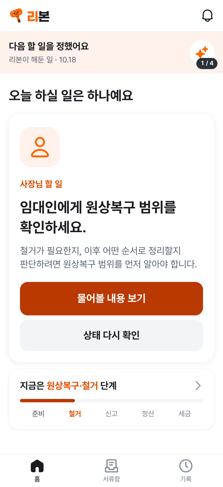

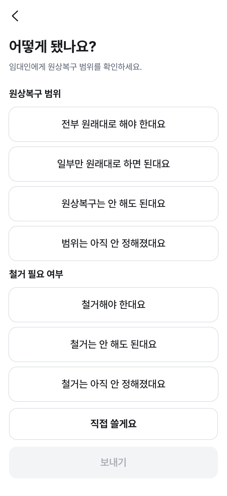

### 우리 서비스 한 문장

폐업을 결심한 개인 카페 사장님이 가게 상황과 실행 결과를 알려주면, 지금 해야 할 일 하나와 그 이유를 다시 안내하는 서비스입니다.

### 이 설명서에서 볼 것

문제와 대상 → 처음부터 끝까지의 사용자 흐름 → 화면별 동작과 설계 이유 → FE·BE·AI 처리 구조 → 테스트와 한계 → 발표 순서와 예상 질문을 정리했습니다.

### 핵심 시연

임대인에게 원상복구 범위를 묻기 → 답변 입력 → 이해한 내용 확인 또는 바로잡기 → 달라진 할 일 확인. 여기에 서류 누락 발견과 보완, 충돌 보호를 연결합니다.

### 읽는 기준

사진은 최신 로컬 React 화면을 저장소의 미리보기 데이터로 실행한 캡처입니다. 실제 사용자나 운영 DB 자료가 아닙니다. 사진의 날짜·금액·할 일 문구는 UI 예시이며 최신 정책이나 AI 정확도 검증 결과를 뜻하지 않습니다.

근거: `frontend/src/routes.tsx` · `backend/app/main.py`

## 02 누구의 어떤 문제를 푸는가

대상과 서비스 가치

### 대상

폐업 의사는 정했지만 임대차, 원상복구, 직원 정산, 신고, 서류를 직접 챙겨야 하는 소규모 개인 카페 사장님입니다. 현재 로드맵 지원 범위는 개인 카페입니다. 프랜차이즈 카페와 일반 음식점은 지원 준비 중으로 안내합니다.

### 문제

할 일 목록을 모두 알아도 내 상황에서 무엇부터 해야 하는지 판단하기 어렵습니다. 임대인 답변, 철거 여부, 직원·보험 이력처럼 아직 모르는 값이 있고, 실제로 알아본 뒤에는 계획이 바뀝니다. 서류도 종류가 맞는지와 서로의 금액이 맞는지를 따로 확인해야 합니다.

### 해결 방법

한 가게의 상태를 Case로 모읍니다. 확인된 사실과 미확인 사실을 나누고, 다음 행동 하나를 제시합니다. 현실에서 실행한 결과를 다시 받아 상태와 로드맵을 갱신합니다. 서류함은 자료를 모으고, 정산 점검은 누락·불일치를 찾아줍니다.

### 왜 대화창만 두지 않았나

업종·임차·직원처럼 정형적인 답은 버튼으로 받아 누락과 입력 부담을 줄입니다. 임대인 답변처럼 표현이 다양한 곳에는 자유 입력을 둡니다. 전체 진행은 로드맵, 지금 할 일은 홈, 증빙은 서류함, 변화는 기록에서 볼 수 있습니다.

### 현재 확인한 범위

화면 구조와 자동 테스트가 있다는 사실은 확인했습니다. 실제 사장님의 사용성 개선, 비용 절감, 폐업 성공률 향상은 이번 작업에서 실험하지 않았습니다. UI/UX 이유는 설계 의도로 설명합니다.

근거: `docs/hero-scenario.md` · `frontend/src/lib/diagnosisSteps.ts` · `backend/app/agent/roadmap.py`

## 03 처음부터 끝까지의 사용자 흐름

발표의 중심 줄기

### 1 로그인과 진단

소개를 보고 카카오로 시작합니다. 업종·임차·직원·보험·폐업 시기를 답합니다. 서버가 회원당 가게 하나를 만들고 첫 판단을 뒤에서 실행합니다. 홈에서 처리 중인 상태를 확인합니다.

### 2 지금 할 일 실행

홈의 할 일 하나를 확인하고 상세에서 질문할 말을 봅니다. 예를 들어 임대인에게 원상복구 범위와 철거 필요 여부를 실제로 묻습니다. 이 연락과 외부 신청은 사장님이 직접 합니다.

### 3 결과 입력과 재판단

정해진 보기 또는 글로 답합니다. 모르는 내용은 다시 묻고, 기존 확정값과 다른 내용은 충돌 확인을 거칩니다. 검수를 통과한 결과만 저장해 바뀐 내용·새로 열린 할 일·다음 행동을 보여줍니다.

### 4 로드맵과 증빙 준비

5단계 로드맵에서 해당하는 작업을 확인합니다. 체크, 사진 첨부, 심사 결과, 폐업 정보, 보증금 기록 등 작업 성격에 맞는 입력을 받습니다. 체크와 공식 절차 완료는 구분합니다.

### 5 서류 점검과 마무리

정산 서류를 올리고 추출값을 확인합니다. 누락·금액·이름·날짜를 점검해 문제를 보완합니다. 통과하면 ZIP을 받아 외부 기관에 직접 제출합니다. 마지막 세금 관련 체크 이후 서비스의 완료 화면을 봅니다.

근거: `frontend/src/routes.tsx` · `backend/app/be/routers/case.py` · `backend/app/be/routers/document.py`

## 04 화면 지도와 읽는 순서

16개 경로 패턴   진입과 콜백을 포함

### 시작

/login 서비스 소개와 로그인 · /login/callback 인증 처리 · / 로그인·Case 유무에 따른 진입 분기 · /cases/new 질문 한 장씩 상황 진단

### 판단 반복

/case 현재 Case 홈 · /task 할 일 상세 · /results 실행 결과 또는 추가 질문 답변 · /confirm 기존 값과 새 값 충돌 확인 · /replan 반영 결과

### 진행과 증빙

/roadmap 전체 순서 · /roadmap/:taskId 할 일별 입력 · /docs 서류함 · /docs/check 서류 점검 · /docs/done 정산 제출 파일 · /log 작업 기록 · /notifications 알림

### 탭과 뒤로가기

홈·서류함·기록은 하단 탭에 둡니다. 로드맵과 개별 작업은 탭 밖에서 열고 뒤로 돌아옵니다. 로그인 두 화면을 제외한 서비스 경로는 인증 가드 아래에 있습니다. /confirm은 정상 순서 중간이 아니라 충돌이 있을 때의 예외 분기입니다.

### 이 설명서를 사용하는 방법

사진 옆에서 사용 흐름, 왜 필요한지, 기술 연결, 확인할 테스트, 발표할 말을 차례로 읽으면 됩니다. 뒤쪽에는 기술 구조, API 표, 시연 대본, 테스트 목록과 검증 결과가 있습니다.

근거: `frontend/src/routes.tsx`

## 05 로그인과 서비스 소개

/login   /login/callback

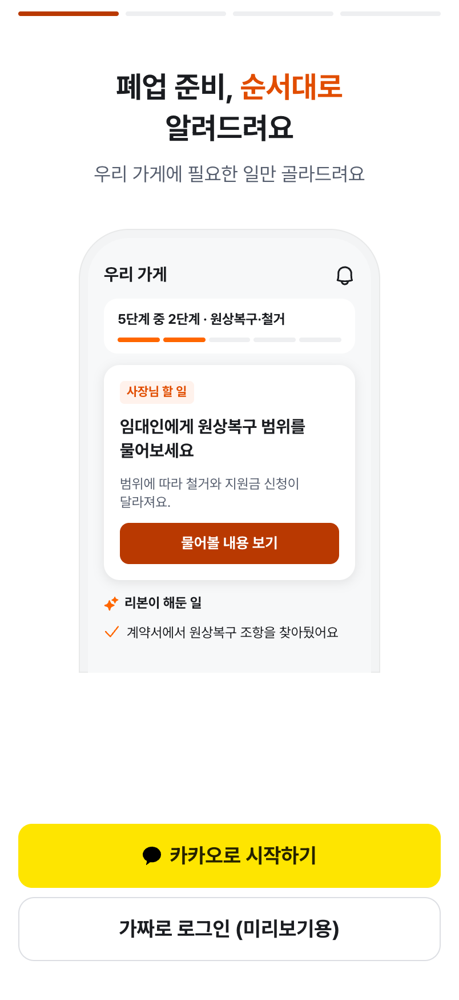

### 사용 흐름

소개 4장을 보고 카카오로 시작합니다. 인증이 끝나면 Case 유무에 따라 진단 또는 홈으로 이동합니다. 개발용 가짜 로그인은 로컬·허용된 Preview에서만 보입니다.

### 필요한 이유와 UI/UX 의도

진단 결과를 가게별로 저장하려면 인증이 필요합니다. 시작 위치에 로그인 방법 하나를 둡니다. 인증 가드를 라우트에 걸어 보호를 화면마다 빠뜨리지 않게 합니다.

### 기술 연결

FE가 OAuth state를 생성·일회 검증합니다. BE가 카카오 code를 교환하고 자체 Access·Refresh JWT를 발급합니다. 토큰은 탭의 sessionStorage에 둡니다. API 401에서는 공유 재발급 요청으로 처리하고 실패하면 세션을 끝냅니다.

### 테스트 포인트

state 누락·불일치·재사용 차단, 이미 로그인한 사용자 분기, 가짜 로그인 운영 비활성화, 동시에 온 401의 재발급 중복 방지, 로그인 취소·실패를 확인합니다.

### 발표할 말

“저장할 가게의 주인을 먼저 확인합니다. 카카오 로그인 이후에는 기존 Case가 있는지 서버에 물어 이어서 시작합니다.”

근거: `frontend/src/pages/LoginPage.tsx` · `frontend/src/pages/LoginCallbackPage.tsx` · `frontend/src/lib/auth.ts` · `frontend/src/lib/api.ts` · `backend/app/be/routers/auth.py`

## 06 진단에서 업종과 가게 상황 고르기

/cases/new   biz · situ

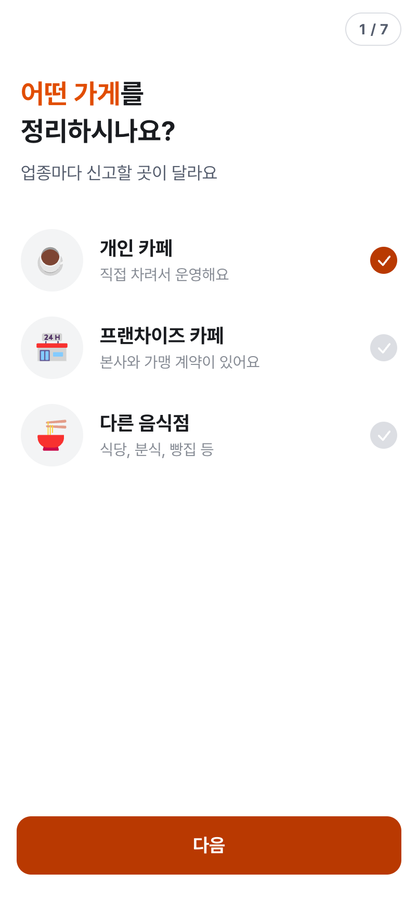

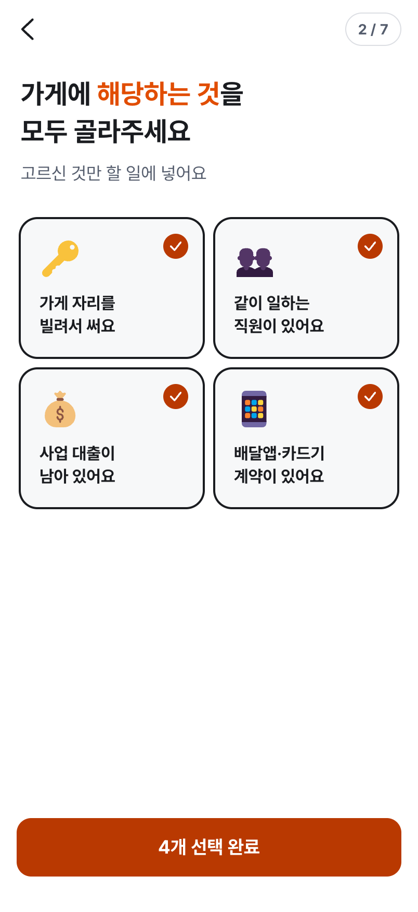

### 사용 흐름

개인 카페·프랜차이즈 카페·다른 음식점 중 업종을 고릅니다. 임차·직원·대출·배달앱/카드기 계약 여부는 여러 개 선택합니다. 하나도 해당하지 않는 것도 명시적인 답입니다.

### 필요한 이유와 UI/UX 의도

질문을 한 장씩 보여주고 사용자가 알 수 있는 값만 받습니다. 업종과 상황은 이후 절차의 해당 여부를 판단하는 재료입니다. 일반 음식점은 프랜차이즈 여부를 한 번 더 묻습니다.

### 기술 연결

diagnosisSteps가 답에 따라 질문을 구성합니다. Zustand에는 진단 답만 저장합니다. 질문 순서 제어는 FE가 하지만 어떤 폐업 절차가 필요한지는 서버가 판단합니다. 현재 업종 선택지가 있다고 모든 업종의 로드맵을 지원하는 것은 아닙니다.

### 테스트 포인트

업종 미선택이면 다음 잠금, 해당 없음 저장, 다중선택 토글, 앞 답을 바꿨을 때 필요 없는 질문 제외, 주소로 뒷 질문에 직접 들어갈 때 첫 미응답 질문으로 이동을 확인합니다.

### 발표할 말

“가게마다 필요한 일이 달라서, 먼저 상황을 버튼으로 받습니다. 여기서는 질문만 걸러내고 할 일 판단은 서버에 맡깁니다.”

근거: `frontend/src/pages/CaseCreatePage.tsx` · `frontend/src/lib/diagnosisSteps.ts` · `frontend/src/stores/useDiagnosisStore.ts`

## 07 진단에서 임차와 원상복구 조항 확인

/cases/new   rent · restore

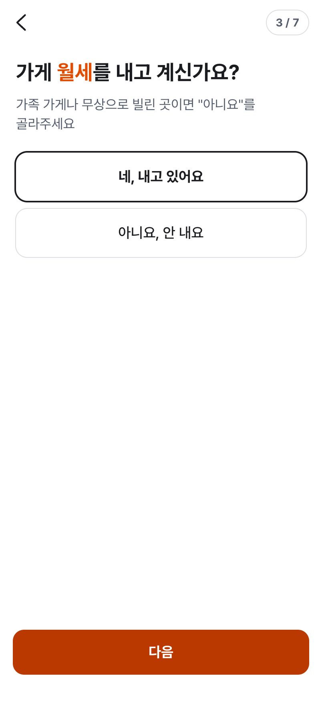

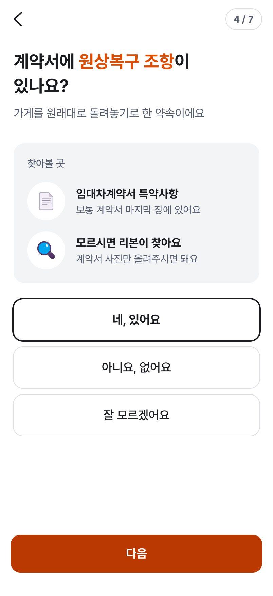

### 사용 흐름

가게를 빌려 쓴다고 답했을 때만 월세 여부와 원상복구 조항을 묻습니다. 조항은 있음·없음·모름으로 답할 수 있습니다. 계약서 업로드는 가입 후 서류함에서 합니다.

### 필요한 이유와 UI/UX 의도

자가 점포에 월세를 물으면 답할 수 없는 질문이 됩니다. 무상 임차와 유상 임차도 구분합니다. 모름을 별도 값으로 남겨 불확실한 사실을 억지로 확정하지 않게 합니다.

### 기술 연결

FE 답은 adapter에서 LEASED_PAID·LEASED_FREE·OWNED와 restoration_clause로 바뀝니다. 조항 존재 여부와 실제 원상복구 범위는 다른 필드입니다. 조항이 있다고 전체 철거로 단정하지 않습니다.

### 테스트 포인트

자가일 때 두 질문 생략, 무상 임차 저장, 모름을 false로 바꾸지 않기, 앞 답을 임차에서 자가로 바꾼 뒤 오래된 임차 답을 전송하지 않기, 계약서 조항과 구체 범위 혼동 방지를 확인합니다.

### 발표할 말

“계약서에 원상복구 약속이 있는지와 실제 어디까지 복구할지는 다릅니다. 지금 모르는 내용은 이후 임대인 확인이나 서류 확인으로 채웁니다.”

근거: `frontend/src/adapters/case.ts` · `frontend/src/lib/diagnosisSteps.ts` · `backend/app/be/schemas/case.py`

## 08 진단에서 직원과 보험 이력 확인

/cases/new   staff · hadStaff · insurance

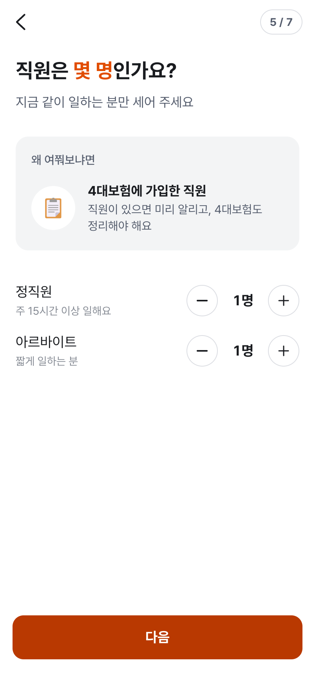

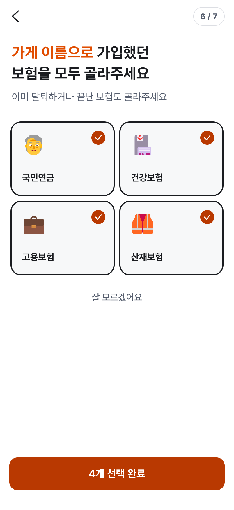

### 사용 흐름

현재 직원이 있으면 인원을 받고, 없으면 예전에 고용한 적이 있는지 묻습니다. 사업장 이름으로 가입했던 국민연금·건강보험·고용보험·산재보험 이력을 받습니다. 보험을 모른다는 답도 받습니다.

### 필요한 이유와 UI/UX 의도

직원이 지금 0명이어도 정산이나 신고가 남아 있을 수 있습니다. 개인의 보험 가입과 사업장 보험을 혼동하지 않도록 “가게 이름으로”를 강조합니다. 예전 이력까지 받는 이유를 설명할 수 있어야 합니다.

### 기술 연결

인원은 현재 코드에서 합계 1,000명까지 받는 스키마입니다. 현재 직원 유무와 고용 이력은 별도 값입니다. 보험 null은 미확인, false는 미가입으로 구분하며 미확인을 해당 없음으로 축소하지 않습니다.

### 테스트 포인트

직원 있음인데 0명 진행 금지, 인원 하한·상한, 현재 직원 0명·과거 직원 있음, 보험 일부만 확인한 경우, 가게 보험과 개인 보험 구분, 다시 로그인해도 진단 답 보존 여부를 확인합니다.

### 발표할 말

“현재 직원 수만 물으면 이미 그만둔 직원의 일이 빠집니다. 그래서 과거 고용과 사업장 보험 이력을 따로 받았습니다.”

근거: `frontend/src/pages/CaseCreatePage.tsx` · `frontend/src/adapters/case.ts` · `backend/app/be/models/case.py` · `backend/app/agent/procedure_tool/rules.py`

## 09 답에 따라 달라지는 진단 질문

/cases/new   franchise · hadStaff

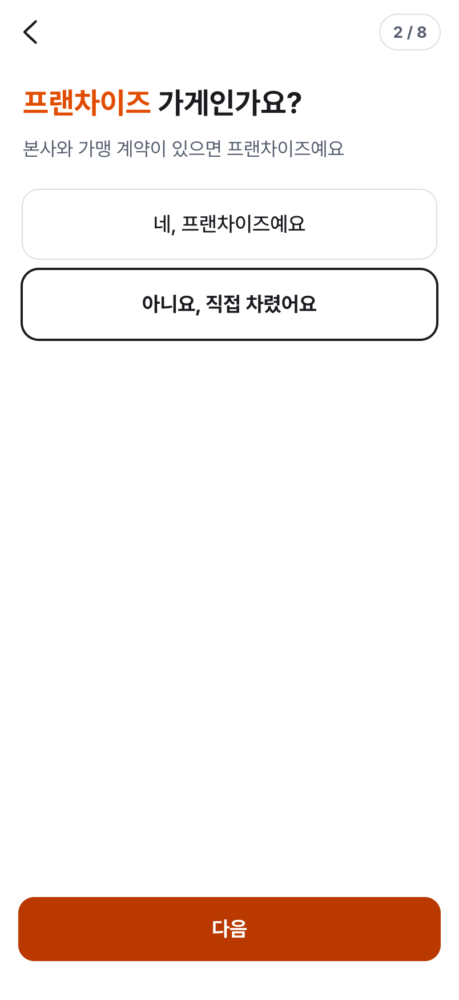

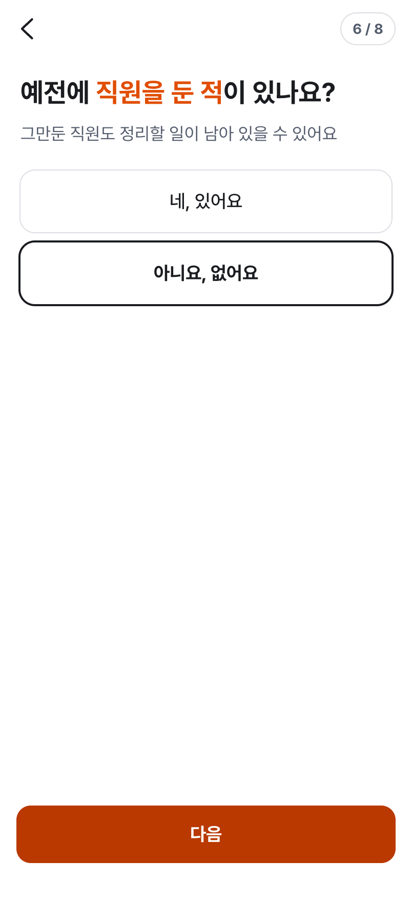

### 사용 흐름

다른 음식점을 고르면 프랜차이즈 여부를 추가로 묻습니다. 지금 직원이 없다고 답했으면 과거 고용 여부를 묻습니다. 개인 카페를 골랐거나 현재 직원이 있다면 각각의 추가 질문은 생략합니다.

### 필요한 이유와 UI/UX 의도

이미 알고 있는 답을 다시 묻거나 서로 어긋나는 답을 만들지 않으려는 분기입니다. 현재 직원이 있는데 과거에도 없었다고 답하게 만드는 조합을 줄이고, 가게마다 필요한 질문만 남깁니다.

### 기술 연결

질문 분기는 diagnosisSteps와 reachableStep이 관리합니다. 현재 직원이 있으면 고용 이력도 있는 것으로 adapter가 조립합니다. 다른 음식점의 업종 정보를 저장할 수 있는 것과 그 업종의 폐업 로드맵을 지원하는 것은 별개입니다.

### 테스트 포인트

다른 음식점일 때만 프랜차이즈 질문, 직원 없음일 때만 과거 고용 질문, 앞 답 변경 후 미사용 답 정리, 주소 직접 접근 시 불필요한 질문 건너뛰기, 새로고침 후 일관된 질문 순서를 확인합니다.

### 발표할 말

“질문을 줄이는 것만이 목적은 아닙니다. 지금 직원이 있다는 답과 고용 이력이 없다는 답이 충돌하지 않도록, 앞에서 이미 확인한 내용은 재사용합니다.”

근거: `frontend/src/lib/diagnosisSteps.ts` · `frontend/src/adapters/case.ts` · `frontend/src/pages/CaseCreatePage.test.tsx`

## 10 폐업 시기와 Case 생성

/cases/new   date · creating

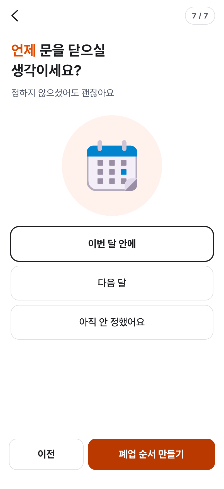

### 사용 흐름

이번 달 안에·다음 달·아직 안 정했어요로 폐업 시기를 답합니다. 제출하면 Case를 만들고 홈에서 첫 판단을 기다립니다. 저장 실패나 인증 만료 때에는 진단 답을 유지합니다.

### 필요한 이유와 UI/UX 의도

예정일을 모르는 사장님에게 특정 날짜를 강요하지 않습니다. 저장 중에는 실제 처리 상태를 표시합니다. 시간에 맞춰 가짜 단계 완료 표시를 만들지 않습니다.

### 기술 연결

POST /cases는 Case와 PENDING 이력을 저장하고 첫 판단을 BackgroundTasks로 넘깁니다. 월만 알면 planned_closure_month로 두며 실제 폐업일과 분리합니다. 회원당 Case 하나 제약이 있습니다.

### 테스트 포인트

예상 달과 실제 날짜 구분, 월 형식·날짜 동시 입력 검증, 중복 생성 409 처리, 생성 응답이 끊긴 뒤 재진입, 생성 후 진단 답 비우기, 생성 실패 시 답 유지와 재전송을 확인합니다.

### 발표할 말

“언제쯤 폐업할지는 계획이고 실제 폐업일은 나중에 확인합니다. Case 저장과 AI 판단을 나눠 긴 요청 때문에 시작 자체가 끊기지 않게 했습니다.”

근거: `frontend/src/pages/CaseCreatePage.tsx` · `frontend/src/adapters/case.ts` · `backend/app/be/routers/case.py` · `backend/app/be/services/case.py`

## 11 홈에서 지금 해야 할 일 하나 보기

/case

### 사용 흐름

홈에서 다음 행동과 이유를 보고 “물어볼 내용 보기”로 상세에 들어갑니다. 단계 카드로 전체 순서, 하단 탭으로 서류함·기록에 갑니다. “상태 다시 확인”은 최신 값을 다시 조회합니다.

### 필요한 이유와 UI/UX 의도

전체 목록은 로드맵에 두고 홈에서는 지금 행동 하나를 강하게 보여줍니다. 무엇이 막혔는지는 그 행동의 이유로 설명합니다. 많은 작업을 동시에 강조해 우선순위를 사용자가 다시 계산하게 하지 않으려는 의도입니다.

### 기술 연결

GET /cases 응답을 adapter가 화면 타입으로 바꿉니다. Case 조회 성공과 AI 판단 완료는 별도 상태입니다. 재조회가 실패하면 마지막 화면은 보존하되 최신이 아닐 수 있다고 알리고 변경 동작을 막습니다.

### 테스트 포인트

DONE·PENDING·NEEDS_MORE_INFO·CONFLICT·FAILED·COMPLETED 상태, 모르는 상태, 재조회 실패 후 오래된 값 표시, 화면 이탈 뒤 늦은 응답 무시, 완료 Case의 결과 입력 진입 방지를 확인합니다.

### 발표할 말

“홈에서 사용자에게 주는 결정은 하나입니다. 지금 무엇을 할지와 왜 먼저 해야 하는지를 보여주고, 전체 맥락은 별도 로드맵에서 확인합니다.”

근거: `frontend/src/pages/CurrentCasePage.tsx` · `frontend/src/hooks/useCase.ts` · `frontend/src/adapters/case.ts`

## 12 할 일 상세와 현실에서의 실행

/task

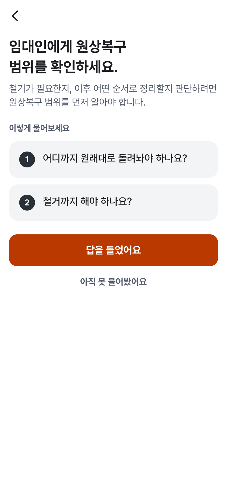

### 사용 흐름

무슨 일을 해야 하는지와 실제로 물어볼 질문을 읽습니다. 예를 들어 임대인에게 연락해 원상복구 범위와 철거 여부를 확인하고, 결과 알려주기로 돌아옵니다.

### 필요한 이유와 UI/UX 의도

“확인하세요”만 있으면 사용자는 무엇을 물을지 다시 생각해야 합니다. 대상과 질문을 함께 주어 행동으로 옮길 수 있게 합니다. 질문이 서버에 없으면 없는 상태를 그대로 다룹니다.

### 기술 연결

상세도 GET /cases로 현재 판단을 다시 조회합니다. 이전 화면의 오래된 Next Action을 그대로 들고 쓰지 않습니다. 프론트가 질문이나 지원 조건을 새로 만들어 넣지 않습니다. 완료된 Case는 홈으로 돌려보냅니다.

### 테스트 포인트

질문 없음·이유 없음 처리, 판단 대기·실패일 때 낡은 상세 미표시, 서버 조회 실패 복구, 새 판단으로 바뀐 뒤 상세 재진입, 외부 실행을 버튼 클릭만으로 완료 처리하지 않기를 확인합니다.

### 발표할 말

“리본이 임대인에게 대신 연락하는 기능은 아닙니다. 사장님이 물어볼 말을 준비해 드리고, 실제로 알아본 답을 다시 받아 계획을 바꿉니다.”

근거: `frontend/src/pages/TaskPage.tsx` · `frontend/src/types/api.ts` · `frontend/src/hooks/useCase.ts`

## 13 임대인 답변을 보기로 고르기

/results   RESTORATION_ANSWER

### 사용 흐름

서버가 선택형을 허용한 할 일에서 원상복구 범위와 철거 필요 여부를 각각 고릅니다. 둘 다 선택해야 보낼 수 있습니다. “직접 쓸게요”로 글 입력으로 바꿀 수 있으며 전환 중 답을 보존합니다.

### 필요한 이유와 UI/UX 의도

분류가 정해진 답은 짧게 고르게 해 입력 부담과 해석 시간을 줄입니다. 보기를 미리 선택하지 않고 임대인에게 들은 말투로 씁니다. “아직 안 정해졌대요”를 알려진 사실과 구분합니다.

### 기술 연결

result_input_kind를 BE가 내려줍니다. restoration_answer는 엄격한 enum 두 값으로 전송합니다. 선택형은 Info LLM 재해석 없이 사실 후보를 만듭니다. PARTIAL인데 구체 범위가 없으면 세부 내용을 다시 묻습니다. 전체 판단에서 모델 호출이 모두 사라지는 것은 아닙니다.

### 테스트 포인트

미선택 전송 차단, 선택형·자유글 혼합 및 불완전 요청 거부, 현재 행동이 아닐 때 422, UNKNOWN이 기존 확정값을 지우지 않기, 일부 복구 상세 되묻기, 실패 후 동일 답 재시도를 확인합니다.

### 발표할 말

“두 값으로 표현할 수 있는 답은 직접 고르도록 했습니다. 일부라고만 하면 어디인지는 모르기 때문에 상세 질문은 남깁니다.”

근거: `frontend/src/pages/ResultInputPage.tsx` · `backend/app/be/services/case.py` · `backend/app/agent/info_agent/agent.py` · `backend/app/agent/schemas.py`

## 14 임대인 답변을 글로 전달하기

/results   TEXT

### 사용 흐름

“카운터랑 싱크대는 빼고, 간판도 떼야 한대요. 바닥 타일은 그대로 둬도 된대요”처럼 받은 답을 적습니다. 추가 질문 상태에서는 질문별 답을 적습니다. 정정 화면에서는 직접 입력을 사용합니다.

### 필요한 이유와 UI/UX 의도

보기로 표현하기 어려운 범위와 예외를 전달할 길입니다. 질문에 모두 답하도록 강제하면 모르는 답을 지어낼 수 있어, 추가 질문은 일부만 답해도 보낼 수 있게 합니다.

### 기술 연결

최대 2,000자이며 추가 질문에서는 질문과 답을 묶은 전체 길이를 검사합니다. 초과하면 자르지 않고 전송을 막습니다. Info는 입력에 근거가 있는 값만 추출하고 범위·철거 여부·상세를 구분합니다.

### 테스트 포인트

공백만 입력, 2,000자 경계와 질문 결합 후 초과, 미확정 표현, 서로 다른 범위·대상, 재전송 시 입력 유지, 불필요한 개인정보 포함과 명령형 문서·입력의 가드레일을 확인합니다.

### 발표할 말

“자유글은 임대인 답변처럼 사람마다 말이 다른 자리에 씁니다. 모델이 문장 속 사실을 구조화하지만, 없던 사실을 채워 넣는 것은 코드 검사로 막습니다.”

근거: `frontend/src/pages/ResultInputPage.tsx` · `frontend/src/lib/resultSubmit.ts` · `backend/app/agent/info_agent/agent.py` · `backend/app/agent/guardrails.py`

## 15 반영한 내용 확인과 바로잡기

/replan

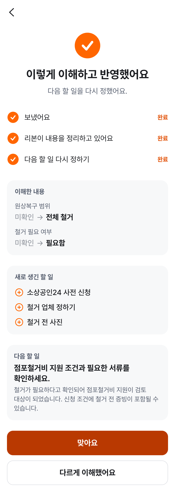

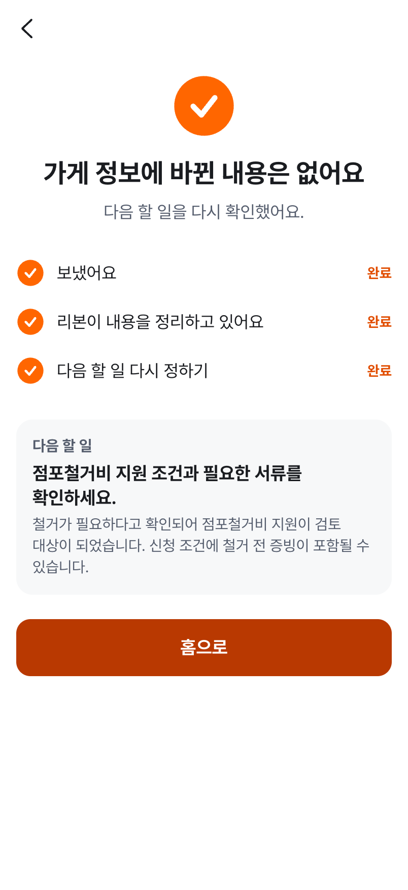

### 사용 흐름

검수를 거쳐 저장된 뒤 “이렇게 이해하고 반영했어요”와 변경값·다음 할 일을 보여줍니다. 맞으면 진행하고, 다르게 이해했으면 다시 적습니다. 바뀐 값이 없는 경우도 별도로 안내합니다.

### 필요한 이유와 UI/UX 의도

AI가 내 말을 어떻게 읽었는지 사용자가 확인할 수 있어야 합니다. 값의 변화와 새로 열린 할 일을 함께 보여줘 입력이 실제 계획에 어떤 영향을 주었는지 설명합니다.

### 기술 연결

정상 UPDATED는 이미 BE가 반영한 결과입니다. 맞아요 버튼이 저장을 승인하는 구조는 아닙니다. /replan은 history 번호로 상태를 다시 조회하며, 더 최신 판단이 있으면 409로 오래된 결과를 구분합니다. 정정 내용에서 나온 사실 후보가 확정값과 충돌하면 충돌 확인으로 이어질 수 있습니다.

### 테스트 포인트

UPDATED·NO_CHANGE 구분, 이전 값 미확인 표시, 신규 할 일 중복 제거, 새로고침으로 history 재조회, 이전 판단 409, 잘못된 번호, 정정 버튼의 글 입력 연결을 확인합니다.

### 발표할 말

“이 장면은 저장 전 승인 화면이 아닙니다. 반영한 내용을 투명하게 보여주고, 다르게 이해했을 때 다시 바로잡을 수 있게 한 화면입니다.”

근거: `frontend/src/pages/ReplanPage.tsx` · `frontend/src/adapters/results.ts` · `backend/app/be/services/decision_record.py`

## 16 기존 기록과 다를 때 충돌 확인

/confirm

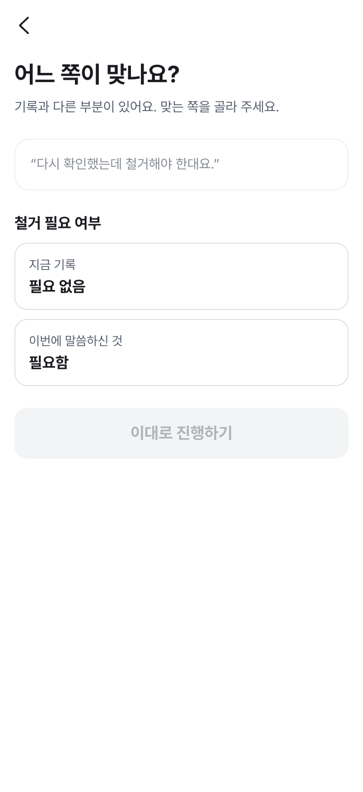

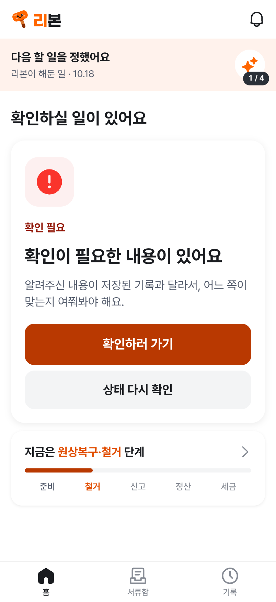

### 사용 흐름

기존 철거 필요 없음과 새 답 철거 필요처럼 확정값이 어긋나면 기존·새 값을 함께 보여줍니다. 항목마다 어느 쪽을 쓸지 고릅니다. 기본 선택은 없으며 전부 고른 뒤 다시 판단합니다.

### 필요한 이유와 UI/UX 의도

새 문장이 들어왔다는 이유만으로 기존 기록을 덮으면 중요한 상태가 사라집니다. 사용자에게 충돌을 명시하고 선택의 주체를 남기는 안전장치입니다. 일반 결과 입력마다 이 단계를 거치지는 않습니다.

### 기술 연결

충돌 발생 시 Case는 미변경입니다. POST /cases/results/decision 뒤 검수된 결과를 하나의 트랜잭션으로 반영하고 충돌을 닫습니다. 실패하면 미해결 충돌을 남겨 다시 선택할 수 있습니다. 낡은 충돌·다른 Case 참조는 거부합니다.

### 테스트 포인트

하나라도 미선택이면 버튼 잠금, 기존값 유지·새값 채택 각각, 여러 충돌, 잘못된 참조, 동시에 두 결정 제출, 재판단 실패 시 값·충돌 원자성, 새로고침·직접 주소 접근을 확인합니다.

### 발표할 말

“기존에 확정된 사실과 다른 말이 들어오면 멈춥니다. 사용자가 고른 뒤에도 새 계획은 다시 검수하므로, 선택과 계획 검증을 분리했습니다.”

근거: `frontend/src/pages/ConfirmChangePage.tsx` · `backend/app/be/services/conflict_decision.py` · `backend/app/be/services/decision_record.py`

## 17 5단계 로드맵으로 전체 흐름 보기

/roadmap

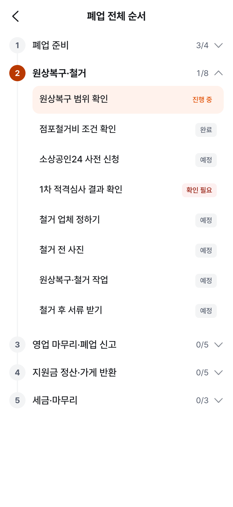

### 사용 흐름

폐업 준비 → 원상복구·철거 → 영업 마무리·폐업 신고 → 지원금 정산·가게 반환 → 세금·마무리의 5단계를 보여줍니다. 현재 단계만 처음 펼치며 각 할 일을 누르면 맞는 입력 장면으로 갑니다.

### 필요한 이유와 UI/UX 의도

홈의 한 가지 행동만으로 전체 진행을 잃지 않도록 전체 목록을 제공합니다. 현재 코드에는 26개 작업 정의가 있고, 가게 상황에 따라 해당 없음·확인 필요 등으로 달라집니다. 모든 가게에 26개를 하라고 요구하지 않습니다.

### 기술 연결

GET /cases/roadmap은 저장된 Case·절차 진행·체크·서류 상태를 읽어 계산합니다. 조회 자체는 모델을 부르거나 상태를 저장하지 않습니다. NOT_STARTED·IN_PROGRESS·COMPLETED·NOT_APPLICABLE·NEEDS_CONFIRMATION을 구분합니다.

### 테스트 포인트

자가·직원 없음·대출 없음·철거 불필요·심사 미확인 조합, 현재 단계 선택, 해당 없음 작업 직접 주소 진입, 미지원 업종, 작업별 종류와 링크, 확인 필요와 완료의 혼동을 확인합니다.

### 발표할 말

“이 다섯 칸은 작업을 묶는 구조입니다. 실제 철거와 영업 종료의 실행 순서를 단계 번호만 보고 결정하면 안 됩니다. 선후관계와 안내 문구는 별도 점검 과제입니다.”

근거: `backend/app/agent/roadmap.py` · `frontend/src/pages/RoadmapPage.tsx` · `frontend/src/lib/taskFlows.ts`

## 18 체크 작업과 증빙이 필요한 작업

/roadmap/:taskId   CHECK · ATTACH

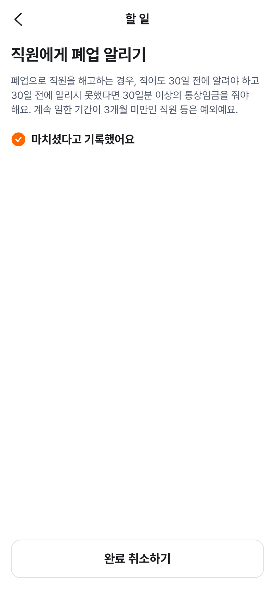

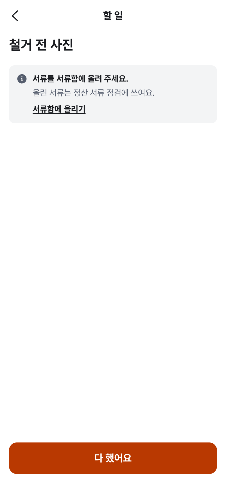

### 사용 흐름

알림·업체 선정 같은 작업은 “다 했어요”로 기록하고 완료를 취소할 수 있습니다. 철거 전 사진·업체 서류·증명원 작업은 서류함에 자료를 올리는 길을 먼저 제공합니다.

### 필요한 이유와 UI/UX 의도

작업을 했다는 자기 보고와 증빙 보관을 연결합니다. 서버가 확인 필요라고 준 작업은 “다 했어요”를 잠가 확인되지 않은 조건을 완료로 넘어가지 않게 합니다. 완료 취소는 별도 동작입니다.

### 기술 연결

PUT /cases/checklists/{task_id}로 저장합니다. 화면은 성공 응답 뒤에만 체크를 바꿉니다. 공식 절차(PROCEDURE)는 동일한 체크로 끝내지 않고 결과 보고를 통해 판단합니다. ATTACH에서 체크했다고 파일이 저절로 생기지 않습니다.

### 테스트 포인트

저장 성공 뒤 체크, 실패 시 이전 체크 유지, 중복 클릭 잠금, 확인 필요 작업 422, 완료 취소, 해당 없음 작업 접근 차단, 파일 없는 체크와 실제 업로드 구분을 확인합니다.

### 발표할 말

“체크는 사장님이 마쳤다고 알린 기록입니다. 공식 신고 완료나 증빙 검증과 같은 뜻으로 쓰지 않습니다.”

근거: `frontend/src/pages/TaskFlowPage.tsx` · `frontend/src/lib/roadmapActions.ts` · `backend/app/be/services/case.py`

## 19 철거비 1차 심사 결과 기록

/roadmap/support_approval

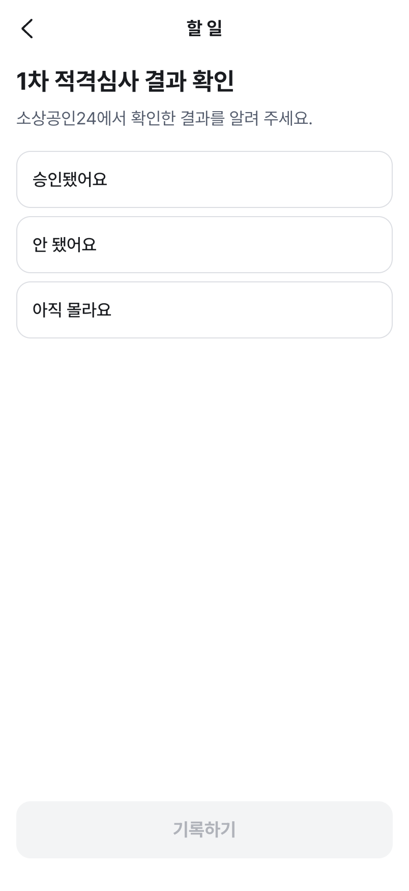

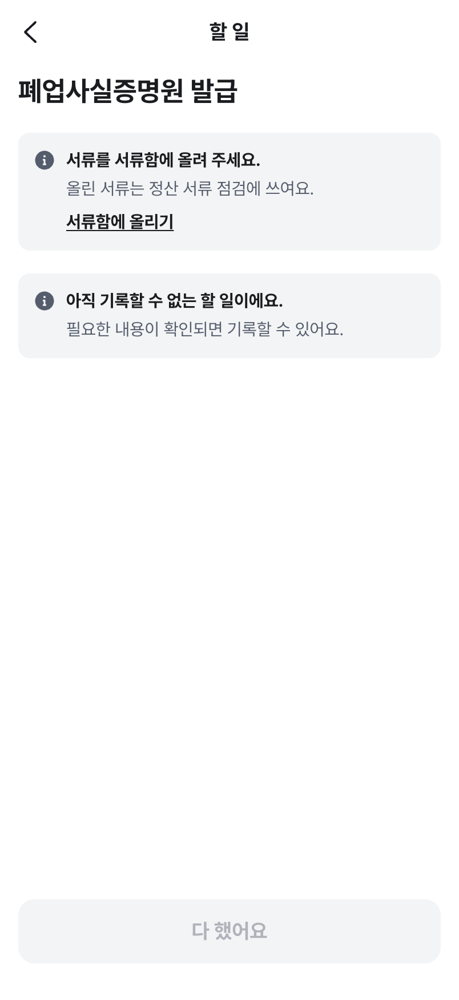

### 사용 흐름

사장님이 소상공인24에서 확인한 승인·미승인·아직 모름을 고릅니다. 결과에 따라 뒤 정산 작업의 해당 여부가 달라집니다. 미확인 상태의 정산 작업은 완료 버튼이 잠깁니다.

### 필요한 이유와 UI/UX 의도

AI가 지원 자격을 스스로 확정하는 것과 외부 기관의 심사 결과를 사용자가 알려주는 것을 구분합니다. 처음 열었을 때 어느 답도 미리 고르지 않습니다.

### 기술 연결

PUT /cases/support-approval의 approved는 true·false·null입니다. 의미는 1차 적격심사 결과이고, 정산 검토 통과나 지원금 지급 완료가 아닙니다. BE의 현재 지원사업 catalog는 비어 있으며 MVP Graph는 Support Agent를 실행하지 않습니다.

### 테스트 포인트

세 값 저장, 미선택 전송 잠금, null을 미승인으로 처리하지 않기, 심사 결과 변경 후 로드맵 갱신, 확인 필요 작업 체크 차단, 지원 자격·금액·현재 접수를 단정하지 않기를 확인합니다.

### 발표할 말

“승인 여부는 리본이 판정한 값이 아닙니다. 사장님이 기관에서 받은 1차 결과를 기록하며, 최종 지급과는 다른 단계입니다.”

근거: `frontend/src/pages/TaskFlowPage.tsx` · `backend/app/be/models/case.py` · `backend/app/be/services/agent_runtime.py` · `backend/app/agent/graph.py`

## 20 통합 폐업 신고를 위한 정보 기록

/roadmap/closure_submission

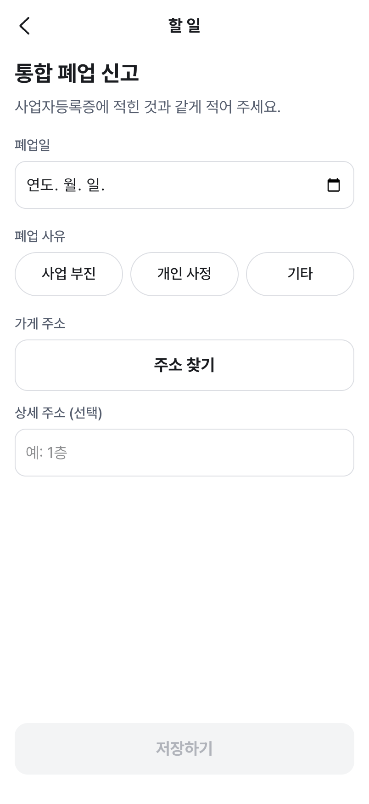

### 사용 흐름

실제 폐업일·폐업 사유·도로명 주소·상세 주소를 입력합니다. 저장한 값은 다시 열었을 때 채워 보여주고 신고 요약에 씁니다. 주소 찾기는 외부 우편번호 화면을 열어 선택합니다.

### 필요한 이유와 UI/UX 의도

신고 시점의 실제 정보는 가입 시의 예상 시기와 다릅니다. 이미 입력한 값은 다시 쓰지 않게 하고, 무엇을 신고할지 한 번 더 확인할 수 있게 합니다.

### 기술 연결

PUT /cases/closure-report로 저장하고 GET /cases에서 다시 읽습니다. 다음 우편번호 스크립트는 주소 찾기를 열 때 로드합니다. 이 API는 정보를 기록하는 기능이며 세무서·지자체의 신고 접수 API가 아닙니다.

### 테스트 포인트

필수값 누락 422, 과거 저장값 재진입, 저장 실패 시 입력 유지, 사유 enum·주소 길이, 주소 서비스 실패, 예상 폐업일 미변경, 정보 저장만으로 공식 신고 완료를 만들지 않기를 확인합니다.

### 발표할 말

“신고에 쓸 정보를 정리하고 다시 보여주는 기능입니다. 기관 접수까지 자동으로 해주는 기능으로 설명하지 않겠습니다.”

근거: `frontend/src/pages/TaskFlowPage.tsx` · `frontend/src/lib/postcode.ts` · `backend/app/be/services/case.py` · `backend/tests/test_case_closure_report.py`

## 21 보증금 반환 결과 남기기

/roadmap/deposit_settlement

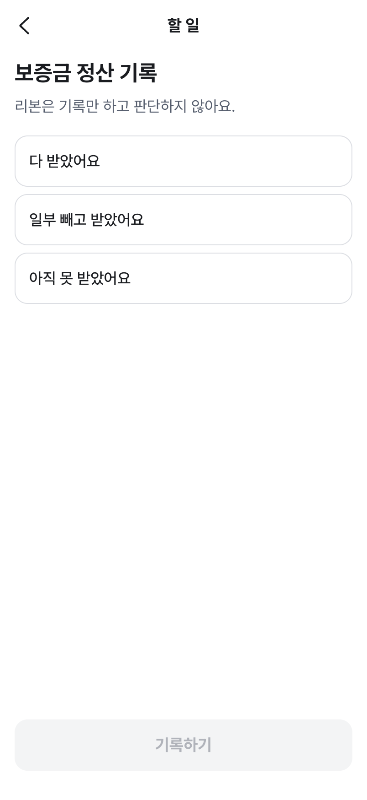

### 사용 흐름

전부 받음·일부 받음·받지 못함을 골라 기록합니다. 저장한 결과는 작업을 다시 열었을 때 보여줍니다. 가게 반환 등 공식 절차의 결과 보고와 구분합니다.

### 필요한 이유와 UI/UX 의도

가게를 돌려주었다는 사실과 돈을 돌려받았다는 사실은 같지 않습니다. 별도 값으로 남겨 미정산 상황을 놓치지 않게 합니다. 지금 화면은 반환 금액이나 분쟁 판단을 받지 않습니다.

### 기술 연결

PUT /cases/deposit-return의 결과는 FULL·PARTIAL·NONE입니다. Case의 deposit_return_result에 저장합니다. 현재 모델 주석상 이 값은 기록용이며 AI 판단 입력으로 쓰지 않습니다.

### 테스트 포인트

세 값 저장·재진입 복원, 미선택 전송 차단, 저장 실패, 자가 등 해당 없음 작업 진입, 보증금 기록과 반환 절차 완료를 자동 연결하지 않기를 확인합니다.

### 발표할 말

“보증금은 결과를 기록하는 범위입니다. 일부만 받았을 때 법률적 해결책을 자동 판단하거나 반환을 보장하는 서비스는 아직 아닙니다.”

근거: `frontend/src/pages/TaskFlowPage.tsx` · `backend/app/be/models/case.py` · `backend/tests/test_case_closure_report.py`

## 22 서류함에서 사진과 PDF 모으기

/docs

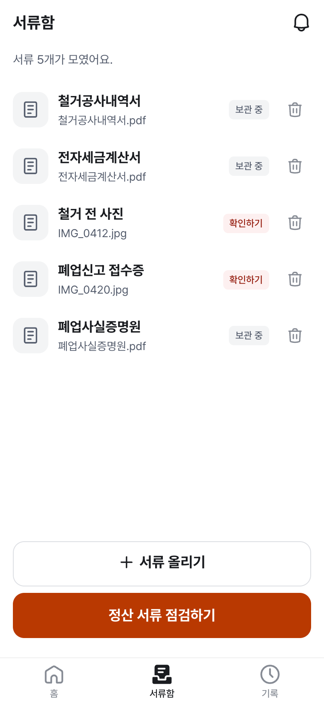

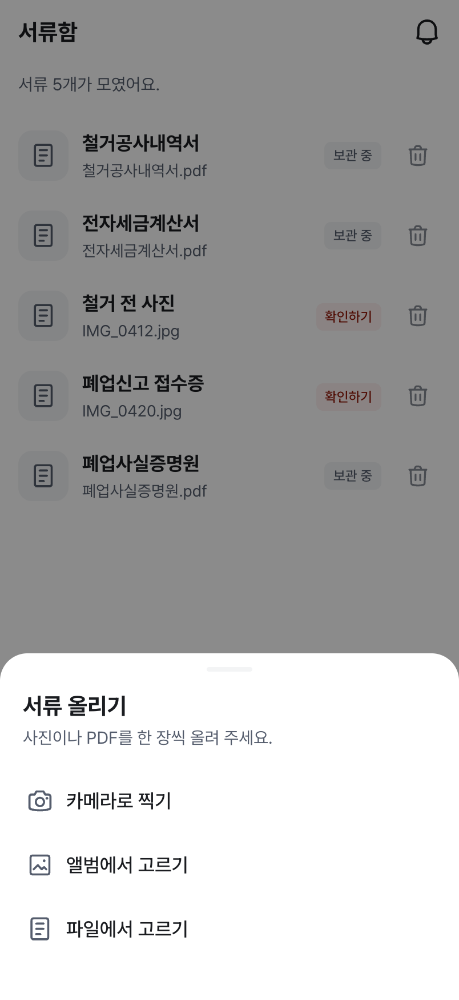

### 사용 흐름

서류 올리기 시트에서 사진이나 PDF를 한 장씩 올립니다. 종류·파일 이름·읽어낸 값·확인 필요 여부가 목록에 나타납니다. 필요 없는 서류는 삭제할 수 있습니다.

### 필요한 이유와 UI/UX 의도

사진과 파일이 여기저기 흩어지면 빠진 자료를 알기 어렵습니다. 종류와 확인 필요를 함께 보여줘 “파일이 있다”와 “점검에 쓸 수 있다”를 구분합니다. 확실하지 않은 판독은 사용자 확인으로 넘깁니다.

### 기술 연결

GET·POST·DELETE /cases/documents를 사용합니다. 지원 형식은 PDF·PNG·JPG/JPEG, 20,000,000바이트 이하, 암호 없는 30쪽 이하입니다. FE 업로드 제한은 110초입니다. 서류 데이터는 Case별 파일 저장소에 보관합니다.

### 테스트 포인트

빈 파일·초과 크기·손상·암호·쪽수·지원하지 않는 형식, 다른 Case 자료 격리, 업로드 실패·시간 초과 후 재조회, 삭제 뒤 지난 점검 무효화, 안전 검사 차단 안내를 확인합니다.

### 발표할 말

“올렸다는 사실만으로 서류가 확정되지는 않습니다. 서버가 읽은 종류와 값을 확인할 수 있고, 애매한 판독은 사장님에게 다시 확인받습니다.”

근거: `frontend/src/pages/DocsPage.tsx` · `frontend/src/hooks/useDocuments.ts` · `backend/app/be/routers/document.py` · `backend/app/agent/document_tool/preparation.py`

## 23 서류에서 읽은 값 확인과 재판단

서류 확인 시트

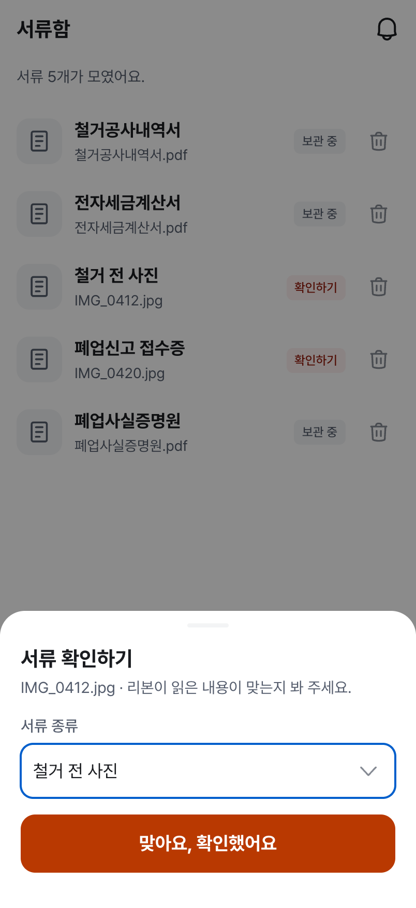

### 사용 흐름

확인하기 배지를 누르면 서류 종류와 읽어낸 값을 확인·수정합니다. 예를 들어 잘못 읽은 날짜나 원상복구 조항을 바로잡은 뒤 확인합니다. 수정한 값과 원래 추출값은 구분합니다.

### 필요한 이유와 UI/UX 의도

OCR과 모델은 잘못 읽을 수 있습니다. 확인되지 않은 판독값을 확정 사실로 쓰지 않도록 사람이 고칠 수 있는 경로를 둡니다. 서류 한 장이 다음 할 일에 영향을 줬는지도 연결해야 합니다.

### 기술 연결

POST /cases/documents/{id}/confirm 후, 확인된 원상복구 조항이 새로 생기거나 바뀌면 DOCUMENT_SUBMITTED 판단을 예약합니다. 같은 조항·금액 서류만 추가·삭제는 그 사유로 재판단하지 않습니다. 판단 중이면 보류했다가 이어 처리합니다.

### 테스트 포인트

서류 소유권, 미확인 값은 확정 근거에서 제외, 원래 추출값 보존, 조항 변경 때만 재판단, 같은 조항 중복 호출 방지, 기준 파일 저장 실패 시 유령 PENDING이 남지 않기를 확인합니다.

### 발표할 말

“현재 최신 코드에서는 서류 확인과 재판단이 연결돼 있습니다. 다만 모든 업로드가 모델 판단을 다시 부르는 것은 아니고 원상복구 조항의 변화가 있을 때입니다.”

근거: `backend/app/be/routers/document.py` · `backend/app/be/services/document.py` · `backend/app/agent/document_tool/models.py` · `backend/tests/test_document_api.py`

## 24 정산 서류를 점검하고 누락 찾기

/docs/check

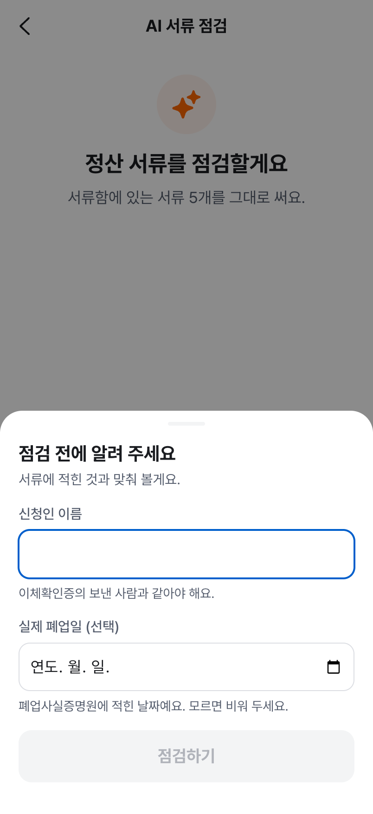

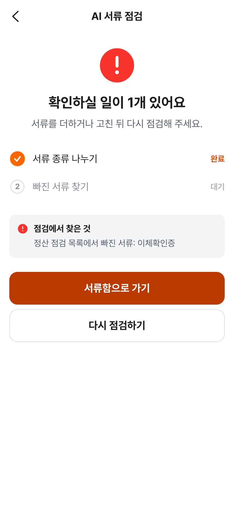

### 사용 흐름

점검 전에 신청인 이름과 실제 폐업일을 확인합니다. 누락·금액·거래처·신청인·날짜가 어긋나면 문제 목록을 보여줍니다. 서류함에서 보완한 뒤 다시 점검합니다.

### 필요한 이유와 UI/UX 의도

파일 목록만으로는 제출 준비 상태를 알 수 없습니다. 이체확인증 누락처럼 구체적으로 무엇을 고칠지 알려줘야 보완할 수 있습니다. 실제 폐업일이 없으면 예상 달을 대신 쓰지 않습니다.

### 기술 연결

업로드 때 OCR·모델로 종류와 값을 읽고, POST /cases/documents/check는 결정 가능한 코드 규칙으로 대조합니다. 현재 정산 경로는 공사내역서·세금계산서·이체확인증·전후 사진·폐업사실증명원을 점검합니다. 카드 결제 대체 서류 경로는 아직 없습니다.

### 테스트 포인트

누락 후 추가 재점검, 공급가액+세액과 총액 대조, 거래처·수취인 불일치, 공백 신청인, 증명원 날짜 불일치, 같은 전후 사진, 동일 종류 복수 서류, 통장 사본을 필수로 요구하지 않기를 확인합니다.

### 발표할 말

“화면 이름에는 AI가 들어가지만 금액이 같은지 확인하는 계산은 코드로 합니다. 모델은 문서 읽기에 쓰고, 명확한 대조는 재현 가능한 규칙에 맡겼습니다.”

근거: `frontend/src/pages/DocsCheckPage.tsx` · `backend/app/agent/document_tool/checks.py` · `backend/tests/test_document_checks.py`

## 25 점검 통과와 정산 제출 파일 받기

/docs/check   /docs/done

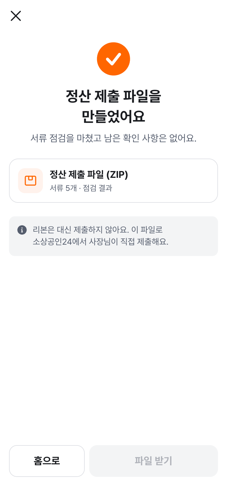

### 사용 흐름

점검 통과 뒤 결과 보기로 ZIP 화면에 갑니다. 실제 서버에서 파일 받기를 누르면 점검된 서류와 결과를 묶은 제출 파일을 받습니다. 미리보기에서는 다운로드를 꺼 둡니다.

### 필요한 이유와 UI/UX 의도

누락이나 불일치가 남아 있는데 제출 파일부터 받지 않게 합니다. “리본은 대신 제출하지 않아요”를 표시해 파일 준비와 기관 제출을 구분합니다. 사진 속 서류 수는 예시 수이며 고정 개수가 아닙니다.

### 기술 연결

GET /cases/documents/settlement.zip은 COMPLETE와 문서 digest·가림 정책·산출물 무결성을 확인합니다. 서류가 바뀌면 이전 점검은 무효가 되어 다시 점검해야 합니다. 인증 헤더를 실어 blob을 받아 내려줍니다.

### 테스트 포인트

미통과 직접 접근 차단, 점검 뒤 서류 변경 422, 가림 정책 변경과 파일 변조 차단, ZIP 내부 구성, 다운로드 실패 복구, 다운로드만으로 제출 완료를 기록하지 않기를 확인합니다.

### 발표할 말

“여기서 보장하는 것은 서비스 점검을 통과한 묶음 파일입니다. 기관 접수와 최종 심사·지원금 지급은 별도 절차입니다.”

근거: `frontend/src/pages/DocsDonePage.tsx` · `backend/app/agent/document_tool/checks.py` · `backend/tests/test_document_api.py`

## 26 기록에서 진행의 맥락 복원

/log

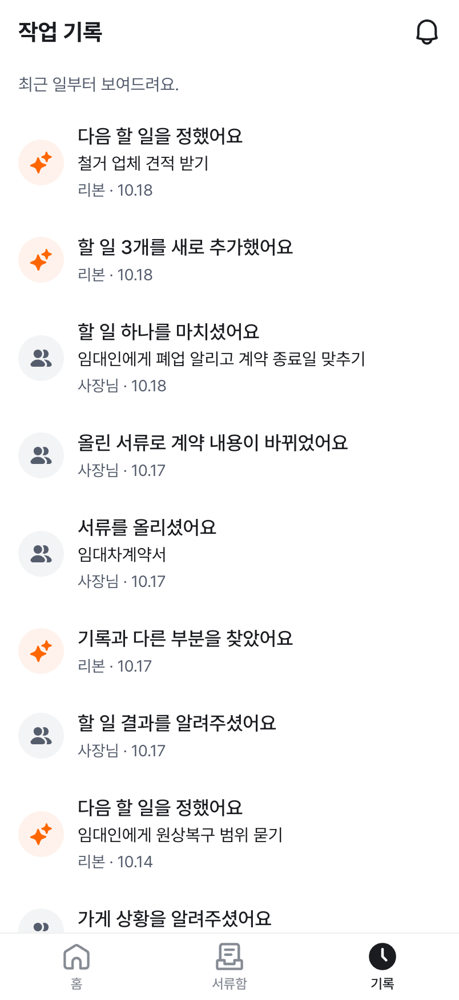

### 사용 흐름

사장님이 한 일과 리본이 판단한 일을 최근 순서로 봅니다. 홈의 활동 띠는 같은 기록 중 리본이 한 일에서 가져옵니다. 기록이 없을 때는 빈 상태를 보여줍니다.

### 필요한 이유와 UI/UX 의도

가끔 들어오는 서비스에서는 지난번에 무엇을 했는지 기억하기 어렵습니다. 입력과 판단 결과를 한 흐름으로 남겨 재방문 때 맥락을 복원합니다. 불필요한 원문을 기록 탭에 반복 노출하지 않습니다.

### 기술 연결

GET /cases/logs를 별도로 조회합니다. 진단·결과 전달·판단·서류·체크 기록이 각 저장값에서 조립됩니다. UI의 작업 기록과 개발용 Langfuse 추적은 목적과 내용이 다릅니다.

### 테스트 포인트

시간 순서, 빈 목록, 조회 실패 재시도, 다른 회원 기록 격리, 동일 이벤트 중복·점검 중복 기록 방지, 서류 변경과 조항 변경 기록 문구, 원문 과다 노출을 확인합니다.

### 발표할 말

“기록은 개발자를 위한 로그가 아니라 사장님이 진행을 다시 이해하기 위한 이력입니다. 내부 모델 추적은 별도 도구에서 관리합니다.”

근거: `frontend/src/pages/LogPage.tsx` · `frontend/src/hooks/useLogs.ts` · `backend/app/be/services/case.py` · `backend/tests/test_case_logs.py`

## 27 판단 대기와 추가 정보 요청

/case   /results

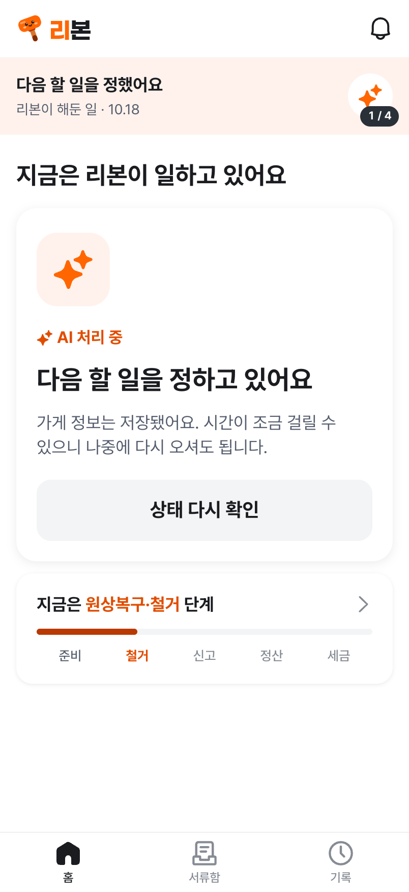

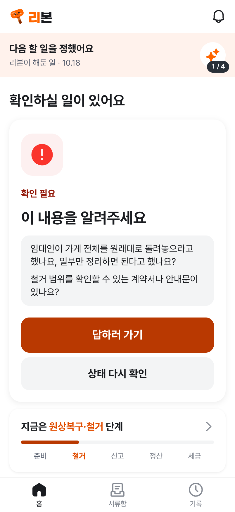

### 사용 흐름

판단 중이면 작업 중임을 표시합니다. 오래 걸리면 상태 확인과 안내를 제공하고 무한 대기처럼 보이지 않게 합니다. 정보가 부족하면 실행 지시 대신 추가 질문을 보여주고 결과 입력으로 연결합니다.

### 필요한 이유와 UI/UX 의도

서버가 요청을 받았다는 것과 판단이 끝났다는 것은 다릅니다. 모르는 내용이 있는데 다음 행동을 지어내지 않고 사용자가 채울 질문으로 바꿉니다. 근거 없는 진행률을 표시하지 않습니다.

### 기술 연결

PENDING은 3초 간격으로 조회하며 최대 10분 뒤 자동 대기를 멈춥니다. 화면이 보이지 않으면 반복 조회를 줄이고 복귀하면 확인합니다. NEEDS_MORE_INFO에는 실행할 Next Action을 임의로 넣지 않습니다.

### 테스트 포인트

대기→완료 전환, 10분 초과, 숨긴 탭·복귀, 요청 중복 방지, 화면 이탈 뒤 늦은 응답, 질문만 있는 상태, 이전 할 일을 새 할 일처럼 재사용하지 않기를 확인합니다.

### 발표할 말

“기다리는 동안에도 저장과 판단을 구분합니다. 정보가 부족한 경우는 오류가 아니라 다음 판단에 필요한 질문을 받는 정상 경로입니다.”

근거: `frontend/src/hooks/useCase.ts` · `frontend/src/lib/resultSubmit.ts` · `frontend/src/pages/CurrentCasePage.tsx`

## 28 실패의 이유에 맞는 복구 경로

/case   FAILED

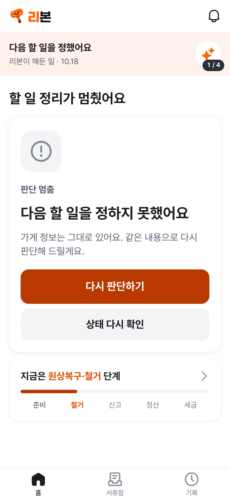

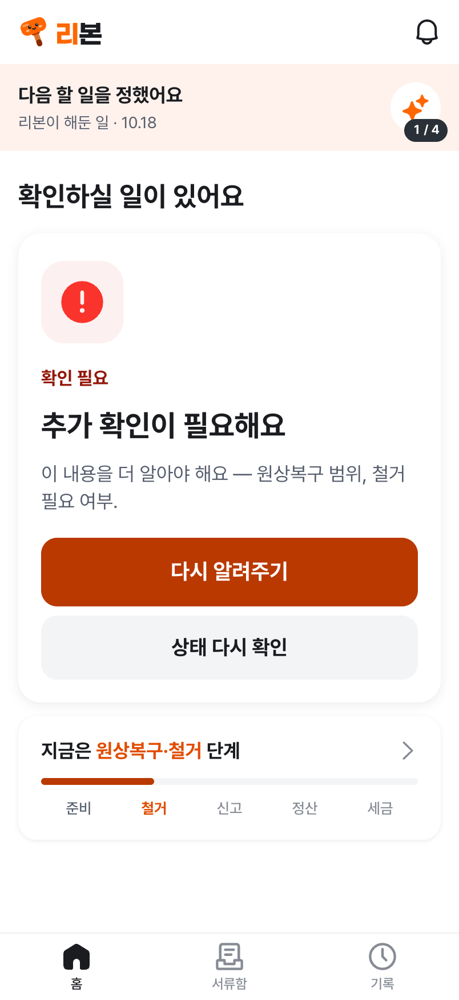

### 사용 흐름

다시 해볼 수 있는 실패는 다시 판단하기, 정보가 더 필요한 실패는 다시 알려주기로 안내합니다. 서비스 쪽 확인이 필요한 경우에는 무의미한 반복 제출을 권하지 않습니다.

### 필요한 이유와 UI/UX 의도

모든 실패에 “다시 시도”를 붙이면 해결되지 않는 요청을 반복합니다. 입력과 가게 정보는 지키고, 사용자가 할 수 있는 행동만 안내해야 합니다. 실패한 판단을 성공한 계획처럼 보이지 않게 합니다.

### 기술 연결

recovery_action_code와 retryable로 경로를 정합니다. POST /cases/retry는 허용된 가입·사용자 결과·서류 판단 실패를 같은 이력과 보관된 입력으로 재개합니다. 결과 입력 화면 안에는 재전송 경로도 있습니다. 충돌 선택은 별도 확인 흐름에서 다시 받습니다. 완료 Case·허용되지 않은 상태는 서버가 거부합니다.

### 테스트 포인트

RETRY·RESUBMIT_INPUT·CONTACT_SUPPORT 등 분기, 같은 실패 재클릭 중복 방지, 실제 재시도 대상 이력, 입력 유지, 무단 재시도 409, 서버 재시작으로 남은 PENDING 복구를 확인합니다.

### 발표할 말

“실패는 한 종류가 아닙니다. 같은 입력으로 다시 해도 되는지, 내용을 더 받아야 하는지, 서비스가 고쳐야 하는지를 나눠 보여줍니다.”

근거: `frontend/src/lib/judgmentRetry.ts` · `frontend/src/pages/CurrentCasePage.tsx` · `backend/app/be/services/case.py` · `backend/tests/test_case_retry.py`

## 29 미지원 업종과 서비스 완료

/roadmap   /case

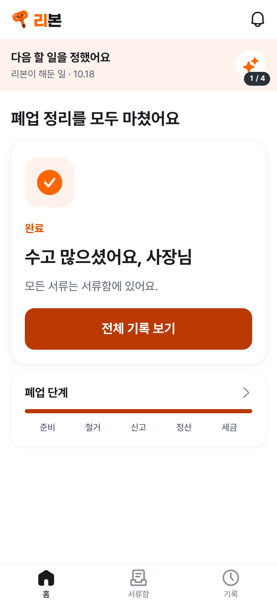

### 사용 흐름

개인 카페 밖의 업종은 로드맵 지원 준비 중을 알립니다. 마지막 VAT 작업 체크로 Case가 COMPLETED가 되면 홈은 할 일 대신 완료 카드와 전체 기록 보기를 보여줍니다.

### 필요한 이유와 UI/UX 의도

제대로 제공하지 못하는 업종에 그럴듯한 순서를 보여주지 않습니다. 완료 상태에서는 마지막 판단이 남아 있어도 새로 실행해야 할 일로 오해하지 않게 합니다.

### 기술 연결

지원 여부는 서버 로드맵의 supported 값으로 판단합니다. Case 완료는 현재 구현에서 특정 체크에 연결된 서비스 상태입니다. 모든 외부 신고·금전 정산·법적 의무를 검증해 끝났다는 의미는 아닙니다.

### 테스트 포인트

미지원 업종의 빈 단계·안내, 완료 시 마지막 판단보다 완료 카드 우선, 완료 Case 재시도 거부, 상세와 결과 입력 진입 차단, 세금 체크 취소 시 동작은 코드·테스트 기준으로 확인합니다.

### 발표할 말

“완료는 현재 서비스의 진행 상태입니다. 기관의 모든 의무가 끝났다는 보증과 구분하고, 미지원 업종에는 제공 범위를 분명히 밝힙니다.”

근거: `backend/app/agent/roadmap.py` · `backend/app/be/services/case.py` · `frontend/src/pages/CurrentCasePage.tsx`

## 30 알림 화면과 아직 연결되지 않은 경험

/notifications

### 사용 흐름

홈·서류함·기록의 종 버튼에서 알림으로 이동합니다. 현재는 알림이 없다는 빈 상태만 보여줍니다. 실제 알림 API나 발송·구독 흐름은 연결돼 있지 않습니다.

### 필요한 이유와 UI/UX 의도

자리만 있는 화면을 이미 동작하는 알림 기능으로 설명하면 시연 범위를 과장하게 됩니다. 현 단계에서는 빈 상태와 돌아가기 경험을 확인하는 화면입니다.

### 기술 연결

NotificationsPage에 API 미연결 TODO가 있습니다. 푸시·이메일·카카오 알림이나 마감 알림 자동 발송은 이 화면의 구현 근거로 주장할 수 없습니다.

### 테스트 포인트

종 버튼 이동, 빈 상태 문구·뒤로가기, 비로그인 접근 차단, 작은 화면·스크린리더 접근을 확인합니다. 실제 알림 생성·읽음·삭제·발송 테스트는 API 구현 후 추가할 항목입니다.

### 발표할 말

“알림은 지금은 빈 상태 UI까지입니다. 오늘 시연의 핵심 기능은 상태를 받아 다음 할 일을 바꾸는 반복 흐름과 서류 점검입니다.”

근거: `frontend/src/pages/NotificationsPage.tsx` · `frontend/src/routes.tsx`

## 31 전체 기술 구조와 책임 분리

FE → API → Agent → 저장 → 화면

### Frontend

React 19·TypeScript·Vite·Tailwind로 모바일 화면을 만듭니다. React Router가 이동을, Zustand가 진단 중 답을 관리합니다. types/api → adapters → types/view → components로 서버 응답과 화면 데이터를 분리합니다. 절차 우선순위를 FE에서 계산하지 않습니다.

### Backend

FastAPI·SQLModel·PyMySQL·MySQL 8.0.46을 사용합니다. 인증·소유권·요청 검증·Case 상태·동시 제출·트랜잭션·저장을 담당합니다. 사용자 입력을 snapshot으로 조립해 Agent를 호출하고 검수 결과를 실제 DB에 반영합니다.

### AI 실행

LangGraph가 Procedure → Info → Supervisor → Review 경로와 재작업을 연결합니다. httpx로 OpenAI 호환 endpoint를 호출합니다. 모든 구성요소가 매번 모델을 부르는 것은 아닙니다. 검수된 정리본과 선택형 입력은 코드 경로를 사용합니다.

### 데이터와 파일

정형 상태·판단 이력·근거·충돌·절차 진행은 MySQL, 업로드한 서류·가림 PDF·문서 context와 점검 파일은 Case별 디렉터리에 둡니다. 배포 Compose에는 DB와 서류 볼륨이 각각 있습니다.

### 왜 이렇게 나눴나

같은 사실을 화면과 모델이 각자 확정하지 않게 하고, 검수한 변경을 누가 실제로 저장하는지 명확히 하기 위해서입니다. Agent는 변경 후보를 반환하고 BE만 영속 상태를 바꿉니다.

근거: `frontend/package.json` · `backend/requirements.txt` · `backend/app/main.py` · `backend/app/be/services/judgment.py` · `docker-compose.prod.yml`

## 32 긴 AI 판단을 요청과 분리하는 방법

접수 → PENDING → 배경 판단 → 상태 조회

### 접수

결과 입력에 최신 case_history_id를 실어 보냅니다. 서버는 인증·Case 소유권·현재 상태를 확인하고 새 입력과 PENDING 이력을 저장합니다. 요청 DB 커넥션을 먼저 반환하고 접수 결과를 돌려줍니다.

### 배경 판단

FastAPI BackgroundTasks가 입력 읽기 → 모델 대기 → 결과 저장을 실행합니다. 읽을 때와 쓸 때만 DB 세션을 열고, 긴 모델 대기 중에는 DB 커넥션을 붙잡지 않습니다. 별도의 내구성 작업 큐를 운영하는 구조는 아닙니다.

### 결과 받기

화면은 3초마다 GET /cases/results/status 또는 GET /cases를 조회합니다. 사용자가 화면을 떠나도 서버 판단은 이어질 수 있습니다. 돌아오면 서버의 저장 상태를 다시 읽습니다. 최대 10분 뒤 자동 조회는 멈추고 안내합니다.

### 경합과 저장

같은 Case의 접수·충돌 결정·서류 판단이 겹치지 않게 잠금을 사용합니다. 저장 직전에 현재 사실과 변경 후보를 다시 비교해 오래된 snapshot이 최신 값을 덮지 못하게 합니다. 검수 기록·변경·충돌 해결은 함께 저장합니다.

### 중단 복구

프로세스 재시작 시 남은 PENDING을 실패 상태로 풀어 다시 시도할 길을 줍니다. 작업이 영구 보관된 큐에서 자동 재실행되는 것은 아닙니다. 운영 규모가 커지면 내구성 큐·작업 중복 방지·관측을 확장할 수 있습니다.

근거: `backend/app/be/routers/case.py` · `backend/app/be/services/judgment.py` · `backend/app/be/services/decision_record.py` · `backend/tests/test_double_submit.py` · `backend/tests/test_abandoned_judgment.py`

## 33 AI 구성요소가 각각 하는 일

판단을 나누되 저장 주체는 하나

### Procedure Tool

검수된 공식 자료와 절차 목록에서 현재 Case에 연결되는 근거와 제약을 반환합니다. 요청 중 인터넷을 검색하거나 다른 문서로 빈 근거를 대신하지 않습니다. 문서의 freshness·버전·내용 hash를 확인합니다.

### Info

입력에 있는 원상복구 범위·철거 여부·진행 보고 등을 근거와 함께 구조화합니다. 처음 판단과 충돌 확인 뒤에는 가능한 경우 검수 정리본을 사용합니다. 선택형 답변은 재해석 없이 처리합니다. 자유글 경로에는 사실 추출 모델을 사용합니다.

### Supervisor

코드가 검증한 행동 후보와 선행조건을 바탕으로 지금 할 Next Action 하나를 고릅니다. 근거가 부족하면 질문을 반환합니다. 선택 결과를 코드가 다시 검사하므로 후보 밖의 행동과 임의 상태 발명을 허용하지 않습니다.

### Review

정상 계획은 반드시 Review 경계를 통과합니다. 모델이 만든 사실·문장이 없고 첫 검수인 등 제한된 조건에서는 code-only Review를, 그 밖에는 모델 검수와 코드 검사를 사용합니다. “모든 판단마다 별도 Review LLM을 부른다”는 설명은 현재 코드와 다릅니다.

### Support와 재작업

지원금 Agent 구현은 남아 있지만 현재 MVP Graph는 호출하지 않습니다. 검수 반려는 정해진 단계부터 최대 2회 재작업하며, Supervisor가 고칠 수 없는 특정 blocker 목록 반려는 바로 실패합니다. 실패하면 검수 전 초안을 내보내지 않습니다.

근거: `backend/app/agent/graph.py` · `backend/app/agent/info_agent/agent.py` · `backend/app/agent/supervisor/agent.py` · `backend/app/agent/review_tool/tool.py`

## 34 데이터와 근거를 남기는 이유

Case · 이력 · 공식 자료 · 충돌 · 검수 증명

### Case와 CaseHistory

Case에는 현재 확정된 가게 상태를 둡니다. CaseHistory에는 어떤 입력이 어느 판단을 만들었는지, 판단 상태·다음 행동·복구 정보·새 작업 비교용 목록 등을 남깁니다. 현재값과 변화 이력을 분리해 재접속과 변경 설명에 씁니다.

### 공식 자료와 Evidence

공식 문서 본문은 official_document의 문서·버전별 행에 보관하고 Case별 Evidence가 참조합니다. 같은 안내문을 Case마다 복사하지 않으면서 과거 판단의 근거를 보존합니다. 버전이 바뀌어도 과거 행을 덮어쓰지 않습니다.

### 출처 연결

근거에는 source_ref·source_version·content_hash·freshness 등을 둡니다. EvidenceLineage는 파생 근거가 무엇을 바탕으로 만들어졌는지 연결합니다. 오래된 자료와 다른 Case의 근거를 섞어 쓰지 않도록 검사합니다.

### 충돌과 검수 증명

ConflictReference는 기존값과 새 후보·사용자 해결 상태를 보관합니다. ReviewProof와 DecisionRecord는 어떤 Case·snapshot·초안이 PASS를 받았는지 연결합니다. 다른 실행이나 바뀐 초안에 이전 PASS를 붙이면 거부합니다.

### 현재 한계

DecisionRecord가 있어도 판단 당시 전체 snapshot·절차 목록·모든 grounded_claims를 DB에 영구 보존하는 구조는 아직 아닙니다. 완전한 사후 재현이 된다고 단정하지 않습니다. 공식 자료 버전 갱신 후 기존 Case 재적재 운영도 필요합니다.

근거: `backend/app/be/models/case.py` · `backend/app/be/models/case_history.py` · `backend/app/be/models/evidence.py` · `backend/app/be/services/decision_record.py`

## 35 문서 처리의 기술 흐름

파일 검증 → OCR·가림 → 분류·추출 → 확인 → 규칙 점검

### 파일 입구와 OCR

형식·파일 크기·암호·쪽수·페이지 크기를 검사합니다. PyMuPDF에서 로컬 한국어·영어 OCR을 사용하며, PDF 작업은 API 프로세스별 1개 worker로 분리합니다. 스캔 문서의 판독 경로에는 가린 이미지 기반 모델 판독도 있습니다.

### 모델 입력과 제출 파일

모델에 전달할 텍스트·이미지는 로컬 가림을 거칩니다. 제출용 PDF는 현재 API에서 주민번호 뒷자리 가림 정책을 사용해 기관 제출에 필요한 계좌·사업자번호는 남깁니다. 모델용 가림과 제출용 가림이 같다고 설명하지 않습니다.

### 안전 검사와 추출

문서 안의 지시문을 시스템 지시로 취급하지 않도록 검사하고, 종류와 값은 근거에 맞춰 추출·검수합니다. 불확실한 값은 needs_confirmation으로 남겨 사장님이 확인합니다. 원본 파일·OCR 원문을 추적 도구로 보내지 않습니다.

### 캐시와 재점검

문서 hash·모델·프롬프트·가림 정책·OCR 설정 등을 캐시 키에 포함합니다. 같은 조건의 같은 파일은 재사용할 수 있습니다. 점검은 현재 문서 digest와 연결되므로 서류가 바뀌면 기존 통과를 재사용하지 않습니다.

### 정확도와 정책 범위

OCR 판독과 모델 추출에는 오류가 있을 수 있습니다. 코드 점검 통과는 현재 지원하는 정산 서류 간 일관성 검사이며 공식 기관 적격 판정이 아닙니다. 카드 결제 대체 서류 종류와 최신 정책 자동 갱신은 현재 지원 범위에 없습니다.

근거: `backend/app/agent/document_tool/preparation.py` · `backend/app/agent/document_tool/documents.py` · `backend/app/agent/document_tool/safety.py` · `backend/app/agent/document_tool/checks.py`

## 36 성능과 신뢰성을 위해 바꾼 점

최신 코드에서 설명할 수 있는 개선

### 모델을 덜 부르는 자리

선택형 원상복구 답변은 Info 모델 해석을 생략합니다. 검수 정리본이 충분한 첫 판단·충돌 확인 뒤의 Info 처리도 코드로 채웁니다. 제한된 검수 조건에서는 Review를 코드 검사로 처리합니다. 자유글과 근거가 필요한 모델 판단은 별도 경로로 남아 있습니다.

### DB 병목 줄이기

모델을 기다리는 동안 요청 커넥션과 판단 읽기 세션을 반환합니다. pool_size=10·max_overflow=20이며 실제 운영 프로세스 수와 DB 한도를 함께 보아야 합니다. 조회별 절차·로드맵 자료를 묶어 읽는 회귀 테스트도 있습니다.

### 대기와 시간 제한

화면은 3초마다 완료를 확인합니다. 일반 API 요청 기본 15초·업로드 110초·화면 판단 대기 10분입니다. Agent는 기본 실행 제한 420초와 모델 호출 40회 예산을 공유합니다. 이 숫자는 처리시간 보장이나 실제 평균 호출 수가 아닙니다.

### 실패 시 멈추는 장치

근거 누락·오래된 자료·유효하지 않은 상태 전이·호출 한도·검수 실패에서 안전 실패로 끝냅니다. 사용자가 할 수 있는 복구 종류를 따로 내려줍니다. 실패를 이전 성공 판단으로 가리지 않습니다.

### 어떻게 성과를 말할까

이번 실행에서 확인한 것은 자동 테스트·빌드와 실제 UI 캡처입니다. 실제 LLM 호출 성능과 비용은 새로 측정하지 않았습니다. 과거 실측은 해당 날짜·모델·입력·설정과 묶어 인용해야 하며 오늘 버전의 지연이나 정확도를 보증하지 않습니다.

근거: `backend/app/be/db.py` · `backend/app/be/services/judgment.py` · `backend/app/agent/llm.py` · `backend/app/agent/runtime.py` · `frontend/src/lib/resultSubmit.ts`

## 37 UI와 접근성의 설계 의도

중장년 사용자의 읽기와 다음 행동을 고려

### 한 번에 이해할 단위

한 화면에 강한 행동 하나, 진단 질문 한 장, 짧고 직접적인 한국어를 사용합니다. 홈의 할 일과 전체 로드맵을 나눕니다. 질문의 이유가 필요한 곳에는 “왜 여쭤보냐면” 같은 설명을 둡니다.

### 모르는 것을 남길 수 있게

모름·아직 미정·해당 없음·실패를 같은 빈칸으로 처리하지 않습니다. 확인이 필요한 상태에는 체크를 잠그고 이유를 안내합니다. 서버가 확정하지 않은 후보를 확정값처럼 그리지 않습니다.

### 선택과 저장의 신뢰

충돌과 중요한 선택은 미리 골라두지 않습니다. 저장 중에는 버튼과 입력을 잠그고 성공 응답 뒤에 표시를 바꿉니다. 실패하면 입력을 남겨 재작성 부담을 줄입니다. 늦게 도착한 응답이 떠난 화면으로 끌고 가지 않게 합니다.

### 시각과 움직임

Pretendard와 의미 기반 색·글자 토큰을 사용합니다. 입력 글자는 16px 이상으로 두고, 앱은 reducedMotion 사용자 설정을 따릅니다. 역할·라벨·키보드 포커스·시트 닫기 같은 상호작용은 컴포넌트에서 다룹니다.

### 다음 확인

실제 목표 사용자를 대상으로 글자 확대, 키보드·스크린리더, 오래된 휴대폰, 느린 네트워크에서 수행 시간을 확인해야 합니다. 이번 설명의 UI/UX 의도는 사용자 테스트로 효과가 입증됐다는 뜻이 아닙니다.

근거: `frontend/docs/ui-guidelines.md` · `frontend/src/styles/tokens.css` · `frontend/src/components/ui/QuestionScreen.tsx` · `frontend/src/App.tsx`

## 38 완성 범위와 남은 과제

멘토님께 현재 수준을 정확히 설명하기

### 현재 연결된 핵심

로그인, 조건별 진단, Case 저장과 첫 판단, 선택형·자유글 결과 입력, 추가 질문, 충돌 확인, 검수 후 저장, 로드맵·체크·심사 결과·폐업 정보·보증금, 서류 업로드·확인·점검·ZIP, 조항 변경 재판단, 작업 기록, 실패 복구가 코드에 연결돼 있습니다.

### 제공 범위

개인 카페 로드맵을 제공합니다. 외부 기관 제출·임대인 연락·실제 철거는 사장님이 합니다. 지원금 자동 추천·자격 판정·금액 확정·실시간 접수 여부 판단은 현재 MVP 실행 경로의 기능이 아닙니다. 알림은 빈 상태 UI입니다.

### 우선 점검할 UX

5단계 표시에서 철거가 영업 마무리보다 앞에 보입니다. 단계 순서를 실제 실행 지시로 오해하지 않게 조정할 필요가 있습니다. 정상 반영 후 확인은 사후 정정 구조이며 저장 전 승인 대기는 아닙니다. 완료 체크와 실제 모든 외부 의무 완료도 구분해야 합니다.

### 우선 점검할 운영

BackgroundTasks는 내구성 큐가 아닙니다. 문서 볼륨·DB 백업과 자료 버전 갱신, 공통 PC 토큰 취급, 정책 근거 검수, 장애 복구를 운영해야 합니다. 현재 /health는 상태 문자열만 돌려주므로 DB 접속까지 보장하지 않습니다. dev 시작은 테이블 초기화 코드가 있어 운영 DB에 실행하면 안 됩니다.

### 멘토님께 받을 피드백

홈의 한 가지 할 일이 실행 가능한 수준인지, 5단계가 순서를 오해하게 하는지, 사후 정정이 충분한지, 발표 범위에서 어떤 기술 선택이 과한지, 실제 사용자 검증을 어떤 시나리오부터 할지 피드백을 요청합니다.

근거: `backend/app/main.py` · `backend/app/agent/roadmap.py` · `frontend/src/pages/ReplanPage.tsx` · `backend/app/be/services/agent_runtime.py`

## 39 10분 발표 진행 대본

화면을 넘기며 말할 순서

### 0분부터 1분 문제와 대상

“폐업을 정했어도 할 일이 많고 순서가 불명확합니다. 리본은 개인 카페의 현재 상태를 모아 지금 할 일 하나를 안내하고, 현실의 답을 받으면 다시 계획합니다.” 대상과 개인 카페 지원 범위를 먼저 말합니다.

### 1분부터 3분 시작과 첫 행동

로그인 → 업종·상황·임차·직원·보험·시기 진단 → 홈을 보여줍니다. “질문은 가게 상황에 따라 줄고, 모르는 것은 모름으로 남깁니다. 홈에서는 임대인에게 원상복구 범위를 확인하라는 한 가지 행동을 줍니다.”

### 3분부터 5분 핵심 반복

상세의 질문 → 결과 입력 → 반영 결과를 보여줍니다. “선택형과 자유글을 함께 제공합니다. 일부라고만 답하면 구체 범위를 묻습니다. 반영 내용을 보고 다르면 바로잡을 수 있습니다.” 충돌 화면을 한 번 보여 자동 덮어쓰기 방지를 설명합니다.

### 5분부터 7분 로드맵과 서류

로드맵에서 전체 진행과 작업별 입력을 설명합니다. 서류함 → 이체확인증 누락 → 보완 → 점검 통과 → ZIP 화면을 보여줍니다. “문서 읽기는 OCR·모델, 금액 대조는 코드입니다. 외부 제출은 사용자가 합니다.”

### 7분부터 10분 기술과 검증

FE→API→Graph→검수→DB 저장 흐름, 배경 판단과 폴링, 근거·충돌·실패 보호를 설명합니다. 이번 자동 테스트 수와 빌드 결과를 보여주고, 알림·카드 대체 서류·지원금 자동 판정 등 미완 범위를 말한 뒤 UX 순서·정정 구조의 피드백을 받습니다.

근거: `frontend/src/routes.tsx` · `backend/app/agent/graph.py`

## 40 멘토 예상 질문과 답변

구현을 근거로 짧게 답하기

### 챗봇과 다른 점은 무엇인가요

“한 번 답하고 끝나는 대화보다 가게의 확정 상태와 진행을 저장하는 데 중심을 뒀습니다. 현실에서 실행한 결과가 새 사실·충돌·진행 상태가 되고, 로드맵과 다음 행동으로 다시 이어집니다.”

### 왜 Agent와 코드 규칙을 함께 쓰나요

“임대인 답변을 읽고 상황별 다음 후보를 고르는 일에는 모델을 씁니다. 타입·소유권·금액 대조·상태 전이·중복 제출·근거 일치는 코드로 확인합니다. 이미 정해진 보기의 해석은 모델을 생략합니다.”

### 여러 Agent가 자율적으로 대화하나요

“현재는 LangGraph로 정한 실행 흐름입니다. 최종 계획은 Supervisor가 고르고 Info와 Tool이 근거를 준비합니다. Support는 MVP에서 호출하지 않으며 각 구성요소가 자율적으로 서로 호출하는 구조가 아닙니다.”

### AI가 틀리면 어떻게 되나요

“추출 근거·후보·검수 일치를 코드로 검사하고, 확정 사실과 다르면 사용자 선택을 받습니다. 부족하면 질문하거나 실패로 끝냅니다. 이런 장치가 정확도를 보장하지는 않아 실제 LLM 평가와 사용자 검증은 별도로 해야 합니다.”

### 왜 WebSocket이나 작업 큐를 쓰지 않았나요

“현재는 배경 작업과 3초 폴링으로 연결했습니다. 구현 규모에 맞춘 선택이지만 내구성 큐가 없어 재시작 시 실패 복구를 합니다. 동시 사용과 재실행 요구가 커지면 작업 큐를 다음 확장으로 검토하겠습니다.”

근거: `backend/app/agent/graph.py` · `backend/app/be/services/judgment.py` · `frontend/src/lib/resultSubmit.ts`

## 41 시연 준비와 실패했을 때 이어가기

실서버 시연과 화면 설명용 시연을 구분

### 실서버 시연 준비

카카오 redirect URI·FE API 경로·BE 환경을 맞춥니다. 발표 계정의 Case 상태와 검수 절차 자료 버전, OCR 한국어 데이터, 서류 볼륨, 필요한 스키마 변경을 확인합니다. 기존 Case에서 시작할지 새 계정에서 진단할지 미리 정합니다.

### 화면 설명용 빠른 시작

frontend에서 npm run dev로 시작하고 /login의 가짜 로그인을 사용합니다. /case?mock=done → /task?mock=done → /results?mock=result-choice → /replan?mock=done 경로로 화면을 봅니다. 이 흐름의 판단 결과는 미리보기 예시입니다.

### 서류와 예외 장면

/docs?mock=docs → /docs/check?mock=docs-issues → /docs/check?mock=docs-complete → /docs/done?mock=docs-complete 순서로 넘깁니다. /confirm?mock=conflict, /case?mock=judgment-failed, /roadmap?mock=roadmap-unsupported로 예외를 설명합니다. Mock ZIP 다운로드는 의도적으로 꺼져 있습니다.

### 모델 응답이 늦을 때

접수 상태·처리 화면을 먼저 설명하고 PDF의 반영 결과 사진으로 이어갑니다. 미리보기의 성공을 실제 모델 성공으로 말하지 않습니다. 이번 문서 제작에서는 실제 모델 호출을 새로 실행하지 않았습니다.

### 발표 직전 확인

설명서 HTML과 PDF를 미리 열어 둡니다. 휴대폰 폭에서 로그인·뒤로가기·탭 이동을 확인하고, 실서버 데모는 한 번의 주요 반복과 서류 누락 장면을 우선 준비합니다. 이미지·ZIP과 테스트 표를 오프라인에서 쓸 수 있도록 같이 보관합니다.

근거: `frontend/README.md` · `frontend/src/lib/mockSwitch.ts` · `frontend/src/pages/DocsDonePage.tsx`

## 42 전체 작업 목록 1부터 13

단계별 26개 정의와 입력 방식

### 해당 여부는 서버가 정함

이 표는 전체 작업 정의입니다. 가게마다 해당 없음·확인 필요·진행 상태가 달라집니다. 실행의 우선순위는 현재 판단을 확인해야 하며 단계 번호만으로 실제 실행 순서를 확정하지 않습니다.

| 단계 | 작업 ID | 작업 이름 | 입력과 연결 |
| --- | --- | --- | --- |
| 1 | intake | 상황 진단 | 진단 정보 안내 |
| 1 | closure_date | 폐업 날짜 정하기 | 시기 정보 안내 |
| 1 | notify_landlord | 임대인에게 폐업 알리고 계약 종료일 맞추기 | 체크와 완료 취소 |
| 1 | notify_employees | 직원에게 폐업 알리기 | 체크와 완료 취소 |
| 1 | check_loan | 은행에 폐업 후 상환 조건 확인 | 체크와 완료 취소 |
| 2 | restoration | 원상복구 범위 확인 | 결과 전달과 재판단 |
| 2 | support_conditions | 점포철거비 조건 확인 | 체크와 완료 취소 |
| 2 | support_application | 소상공인24 사전 신청 | 체크와 완료 취소 |
| 2 | support_approval | 1차 적격심사 결과 확인 | 1차 심사 결과 선택 |
| 2 | choose_contractor | 철거 업체 정하기 | 체크와 완료 취소 |
| 2 | before_photo | 철거 전 사진 | 서류함 연결 후 체크 |
| 2 | restoration_work | 원상복구·철거 작업 | 결과 전달과 재판단 |
| 2 | contractor_documents | 철거 후 서류 받기 | 서류함 연결 후 체크 |

근거: `backend/app/agent/roadmap.py` · `frontend/src/lib/taskFlows.ts`

## 43 전체 작업 목록 14부터 26

단계별 26개 정의와 입력 방식

### 해당 여부는 서버가 정함

이 표는 전체 작업 정의입니다. 가게마다 해당 없음·확인 필요·진행 상태가 달라집니다. 실행의 우선순위는 현재 판단을 확인해야 하며 단계 번호만으로 실제 실행 순서를 확정하지 않습니다.

| 단계 | 작업 ID | 작업 이름 | 입력과 연결 |
| --- | --- | --- | --- |
| 3 | dispose_stock | 재고·장비 처분 | 체크와 완료 취소 |
| 3 | terminate_contracts | 렌탈·공과금 해지 | 체크와 완료 취소 |
| 3 | employee_payments | 직원 임금·퇴직급여 정산 | 결과 전달과 재판단 |
| 3 | employee_insurance | 4대보험 상실·탈퇴 신고 | 결과 전달과 재판단 |
| 3 | closure_submission | 통합 폐업 신고 | 폐업 정보 기록 |
| 4 | closure_certificate | 폐업사실증명원 발급 | 서류함 연결 후 체크 |
| 4 | document_check | AI 서류 점검 | 서류 점검 |
| 4 | settlement_submission | 소상공인24 정산 제출 | 체크와 완료 취소 |
| 4 | return_premises | 가게 반환 | 결과 전달과 재판단 |
| 4 | deposit_settlement | 보증금 정산 기록 | 보증금 반환 결과 |
| 5 | vat_submission | 부가세 폐업 확정신고 | 체크와 완료 취소 |
| 5 | income_tax | 종합소득세 신고 여부 확인 | 체크와 완료 취소 |
| 5 | post_closure_support | 폐업 후 지원 안내 확인 | 체크와 완료 취소 |

근거: `backend/app/agent/roadmap.py` · `frontend/src/lib/taskFlows.ts`

## 44 API와 화면 연결 첫 번째

인증과 Case 판단

### 판단 결과 6종

결과 제출 응답의 result는 PENDING·UPDATED·NO_CHANGE·NEEDS_MORE_INFO·CONFLICT·FAILED입니다. 조회 시 judgment_status의 DONE과 결과 제출의 UPDATED는 같은 이름의 enum이 아닙니다. 타입과 표시를 adapter에서 구분합니다.

### HTTP와 업무 결과

HTTP 성공은 요청을 처리했다는 뜻이고, AI 업무 결과는 본문으로 확인합니다. 401은 인증, 404는 Case·이력 부재, 409는 낡은 판단·동시 진행·충돌 등 상태 문제, 422는 입력·업무 조건 불일치로 나눠 다룹니다.

| 방식 | API | 화면 | 역할 |
| --- | --- | --- | --- |
| GET | /login/form | 로그인 | 카카오로 redirect, state 전달 |
| POST | /login | 콜백 | code 교환, 토큰은 응답 헤더 |
| POST | /reissue | API 공통 | Refresh-Token으로 재발급 |
| POST | /logout | 인증 | 서비스 로그아웃 |
| POST | /cases | 진단 완료 | Case·첫 PENDING 생성, 배경 판단 |
| GET | /cases | 진입·홈·상세 | 현재 확정 상태와 판단 상태 |
| GET | /cases/results | 결과 입력 | 질문·충돌·선택형 가능 여부 |
| POST | /cases/results | 결과 입력 | 입력 접수, 최신 이력 검증 |
| GET | /cases/results/status | 처리·반영 결과 | history 번호로 판단 결과 확인 |
| POST | /cases/results/decision | 충돌 확인 | 항목별 선택 접수 후 재판단 |
| POST | /cases/retry | 실패 복구 | 허용 실패 이력을 PENDING으로 재개 |
| GET | /cases/logs | 홈 활동·기록 | 사용자와 리본 작업 이력 |

근거: `backend/app/be/routers/auth.py` · `backend/app/be/routers/case.py`

## 45 API와 화면 연결 두 번째

로드맵과 서류

### 문서 API의 범위

업로드와 점검은 별도 요청입니다. 문서를 올렸다고 점검 통과나 기관 제출이 되지 않습니다. 원상복구 조항의 변경은 별도의 판단을 예약할 수 있지만, 금액 대조만으로 계획을 다시 돌리는 것은 아닙니다.

### 소유권과 연결 기준

Case ID를 사용자가 자유롭게 골라 조작하게 하지 않고 인증된 회원의 Case를 찾습니다. 문서 UUID와 숫자 Case ID 연결, 최신 history와 충돌 참조의 일치 검사를 서버에서 수행합니다.

| 방식 | API | 화면 | 역할 |
| --- | --- | --- | --- |
| GET | /cases/roadmap | 전체 순서 | 5단계·26개 작업 정의의 상태 조회 |
| PUT | /cases/checklists/{task_id} | 개별 작업 | 사용자 체크 기록·취소 |
| PUT | /cases/support-approval | 심사 결과 | true·false·null의 1차 결과 기록 |
| PUT | /cases/closure-report | 폐업 정보 | 실제 폐업일·사유·주소 저장 |
| PUT | /cases/deposit-return | 보증금 | FULL·PARTIAL·NONE 기록 |
| GET | /cases/documents | 서류함·점검 | 문서와 현재 점검 상태 조회 |
| POST | /cases/documents | 서류 올리기 | multipart 파일, 선택적 종류 hint |
| POST | /cases/documents/{document_id}/confirm | 서류 확인 | 종류·확인값 저장, 조항 변경 재판단 |
| DELETE | /cases/documents/{document_id} | 서류 빼기 | 문서 제거 및 이전 점검 무효화 |
| POST | /cases/documents/check | 서류 점검 | 신청인·실제 폐업일로 규칙 대조 |
| GET | /cases/documents/settlement.zip | 제출 파일 | 통과·현재 digest 확인 후 ZIP |
| GET | /health | 운영 상태 | status 문자열, DB 접속 검사는 아님 |

근거: `backend/app/be/routers/case.py` · `backend/app/be/routers/document.py`

## 46 이번 버전의 검증 결과

2026년 11월 7일 로컬 검증

### Frontend

npm test: 46개 파일, 658개 테스트 통과. npm run build: TypeScript 검사와 Vite 빌드 성공. npm run lint: 통과. jsdom의 문서 이동 미지원 출력은 있었지만 테스트 실패는 없었습니다.

### Backend

backend에서 Python 3.12 환경으로 python -m pytest tests -q 실행. 1,098 passed, 7 skipped, 7 warnings, 163.78초. 격리 MySQL 컨테이너를 사용하는 API·서비스·동시성 테스트도 포함합니다. 건너뛴 7개는 PERF=1에서만 실행하는 커넥션 부하 5개와 로드맵 성능 비교 2개입니다.

### UI 캡처

최신 소스의 로컬 Vite 화면을 402×874 CSS 픽셀, 2배 해상도에서 실행했습니다. 로그인·진단 9종·주요 화면·시트·실패·미지원·완료 등 47장과 긴 화면 원본을 함께 보관합니다. 캡처 실행의 브라우저 pageerror는 0건입니다.

### 해석의 범위

자동 테스트는 모델 응답을 대체해 코드 계약과 보호 동작을 검증합니다. 실제 모델 정확도·응답 비용·운영 카카오 로그인·실제 사장님 사용성은 이번에 새로 측정하지 않았습니다. 빌드는 주 JS chunk 587.57kB 경고가 있어 초기 로딩 최적화 과제로 남깁니다.

### 테스트 표를 읽는 법

뒤의 92개는 기능별 점검 시나리오입니다. “자동화 연관” 84개는 관련 테스트 파일이 있는 점검 묶음이며 개별 수동 시나리오 전부를 이번에 브라우저로 수행했다는 뜻은 아닙니다. “수동 추가 권장” 8개는 실계정·실제 모델·사용자 확인이 필요합니다. P0는 핵심 상태·데이터 보호, P1은 사용성·경계 점검입니다.

근거: `frontend/package.json` · `backend/tests/test_pool_capacity.py` · `backend/tests/test_roadmap_query_perf.py` · `docs/final-guide/validation.txt`

## 47 테스트 시나리오 1부터 8

정상 흐름 · 경계값 · 예외 · 복구

| ID | 기능 | 등급 | 조건과 동작 | 기대 결과 | 구분 |
| --- | --- | --- | --- | --- | --- |
| TC-001 | 인증과 진입 | P0 | 비로그인으로 /case 직접 열기 | 로그인으로 보내고 보호된 내용 미표시 | 자동화 연관 |
| TC-002 | 인증과 진입 | P0 | 콜백 state 누락·불일치·같은 state 재사용 | 로그인 거부 및 사용한 state 폐기 | 자동화 연관 |
| TC-003 | 인증과 진입 | P0 | 여러 API가 동시에 401 반환 | 공유 재발급 한 번 후 새 토큰으로 재요청 | 자동화 연관 |
| TC-004 | 인증과 진입 | P0 | 재발급 중 로그아웃 또는 다른 세션으로 로그인 | 늦은 재발급이 종료·새 세션을 덮지 않음 | 자동화 연관 |
| TC-005 | 인증과 진입 | P1 | Case 없음·있음으로 루트 진입 | 각각 진단·홈으로 분기 | 자동화 연관 |
| TC-006 | 인증과 진입 | P1 | 저장소 쓰기 불가 | 메모리 대체로 현재 탭 조작 유지 | 자동화 연관 |
| TC-007 | 상황 진단 | P0 | 업종 미선택 | 다음 버튼 비활성화 | 자동화 연관 |
| TC-008 | 상황 진단 | P0 | 가게 상황 아무것도 해당 안 됨 | 빈 선택을 명시적 없음으로 저장 | 자동화 연관 |

관련 테스트: frontend/src/lib/api.test.ts · frontend/src/pages/LoginCallbackPage.test.tsx · frontend/src/components/RequireAuth.test.tsx · frontend/src/stores/useDiagnosisStore.test.ts / frontend/src/pages/CaseCreatePage.test.tsx · frontend/src/lib/diagnosisSteps.test.ts · frontend/src/adapters/case.test.ts · backend/tests/test_case_create_fields.py

근거: 

## 48 테스트 시나리오 9부터 16

정상 흐름 · 경계값 · 예외 · 복구

| ID | 기능 | 등급 | 조건과 동작 | 기대 결과 | 구분 |
| --- | --- | --- | --- | --- | --- |
| TC-009 | 상황 진단 | P0 | 임차를 자가로 답 변경 | 월세·복구 조항 질문 제외 및 낡은 값 전송 방지 | 자동화 연관 |
| TC-010 | 상황 진단 | P0 | 직원 있음, 인원 0명 | 다음 이동 차단 | 자동화 연관 |
| TC-011 | 상황 진단 | P1 | 직원 수 합계 상한·하한 입력 | 유효 범위 유지, 초과 서버 검증 거부 | 자동화 연관 |
| TC-012 | 상황 진단 | P0 | 현재 0명, 과거 고용 있음 | 과거 고용 이력 보존 | 자동화 연관 |
| TC-013 | 상황 진단 | P0 | 보험 모름 또는 일부 미확인 | 미가입 false로 확정하지 않음 | 자동화 연관 |
| TC-014 | 상황 진단 | P1 | 뒷 질문 주소 직접 진입·새로고침 | 첫 미응답 질문으로 조정, 저장 답 복원 | 자동화 연관 |
| TC-015 | 상황 진단 | P0 | 생성 실패 또는 인증 만료 | 진단 답 유지, 재로그인 뒤 이어 제출 가능 | 자동화 연관 |
| TC-016 | 상황 진단 | P1 | Case 생성 재전송 409 | 기존 Case를 조회해 홈으로 이어감 | 자동화 연관 |

관련 테스트: frontend/src/pages/CaseCreatePage.test.tsx · frontend/src/lib/diagnosisSteps.test.ts · frontend/src/adapters/case.test.ts · backend/tests/test_case_create_fields.py

근거: 

## 49 테스트 시나리오 17부터 24

정상 흐름 · 경계값 · 예외 · 복구

| ID | 기능 | 등급 | 조건과 동작 | 기대 결과 | 구분 |
| --- | --- | --- | --- | --- | --- |
| TC-017 | 홈과 상태 조회 | P0 | DONE에 행동·이유 응답 | 지금 할 일 카드 표시 | 자동화 연관 |
| TC-018 | 홈과 상태 조회 | P0 | PENDING → DONE | 3초 조회 뒤 실제 완료 결과 표시 | 자동화 연관 |
| TC-019 | 홈과 상태 조회 | P1 | 조회 중 화면 숨김·복귀 | 불필요 반복 억제, 복귀 시 최신 확인 | 자동화 연관 |
| TC-020 | 홈과 상태 조회 | P0 | 기존 화면 후 재조회 실패 | 지난 값 보존·낡음 안내·변경 동작 잠금 | 자동화 연관 |
| TC-021 | 홈과 상태 조회 | P0 | 화면 떠난 뒤 늦은 응답 도착 | 떠난 화면 상태·이동을 덮지 않음 | 자동화 연관 |
| TC-022 | 홈과 상태 조회 | P1 | 대기 10분 초과 | 자동 조회 중단·장시간 안내 | 자동화 연관 |
| TC-023 | 홈과 상태 조회 | P0 | 완료 Case에 마지막 DONE 판단 남음 | 완료 카드 우선, 실행 상세 제한 | 자동화 연관 |
| TC-024 | 선택형과 자유글 결과 | P0 | 원상복구·철거 선택 중 하나 미선택 | 전송 버튼 잠금 | 자동화 연관 |

관련 테스트: frontend/src/hooks/useCase.test.tsx · frontend/src/pages/CurrentCasePage.test.tsx · frontend/src/pages/TaskPage.test.tsx / frontend/src/pages/ResultInputPage.test.tsx · backend/tests/test_case_results.py · backend/tests/test_procedure_digests.py

근거: 

## 50 테스트 시나리오 25부터 32

정상 흐름 · 경계값 · 예외 · 복구

| ID | 기능 | 등급 | 조건과 동작 | 기대 결과 | 구분 |
| --- | --- | --- | --- | --- | --- |
| TC-025 | 선택형과 자유글 결과 | P0 | 선택형 답 둘을 유효한 현재 행동에 제출 | 선택값과 원문 이력 보존, PENDING 접수 | 자동화 연관 |
| TC-026 | 선택형과 자유글 결과 | P0 | 선택형+input_text 혼합 또는 불완전 객체 | 요청 검증 실패 | 자동화 연관 |
| TC-027 | 선택형과 자유글 결과 | P0 | 현재 할 일이 원상복구 확인이 아닌 선택형 제출 | 422로 거부 | 자동화 연관 |
| TC-028 | 선택형과 자유글 결과 | P0 | PARTIAL이고 구체 복구 범위 없음 | 상세 범위 추가 질문 | 자동화 연관 |
| TC-029 | 선택형과 자유글 결과 | P0 | 선택값 UNKNOWN, 기존 확정값 존재 | 기존 확정값 삭제·덮어쓰기 없음 | 자동화 연관 |
| TC-030 | 선택형과 자유글 결과 | P1 | 보기↔직접 글 전환 | 고른 답과 작성 글 각각 보존 | 자동화 연관 |
| TC-031 | 선택형과 자유글 결과 | P0 | 공백 또는 2,000자 초과, 질문 결합 후 초과 | 전송 차단, 자르지 않음 | 자동화 연관 |
| TC-032 | 선택형과 자유글 결과 | P0 | 임대인 답변 실패 후 다시 제출 | 입력 유지, 허용된 동일 선택값 재시도만 접수 | 자동화 연관 |

관련 테스트: frontend/src/pages/ResultInputPage.test.tsx · backend/tests/test_case_results.py · backend/tests/test_procedure_digests.py

근거: 

## 51 테스트 시나리오 33부터 40

정상 흐름 · 경계값 · 예외 · 복구

| ID | 기능 | 등급 | 조건과 동작 | 기대 결과 | 구분 |
| --- | --- | --- | --- | --- | --- |
| TC-033 | 선택형과 자유글 결과 | P0 | 오래된 history·PENDING 중 제출·미해결 충돌 | 409로 거부 | 자동화 연관 |
| TC-034 | 반영과 충돌 | P0 | 원상복구 확정값과 반대 사실 입력 | CONFLICT, 선택 전 Case 미변경 | 자동화 연관 |
| TC-035 | 반영과 충돌 | P0 | 충돌 하나라도 선택 안 함 | 결정 전송 비활성화 | 자동화 연관 |
| TC-036 | 반영과 충돌 | P0 | 기존 유지·새 값 채택 각각 결정 | 선택한 값으로 재판단 후 일관되게 반영 | 자동화 연관 |
| TC-037 | 반영과 충돌 | P0 | 다른 Case 충돌 참조·낡은 결정 | 거부하고 타인 자료 미노출 | 자동화 연관 |
| TC-038 | 반영과 충돌 | P0 | 충돌 결정 뒤 재판단 실패 | 미결 충돌 유지, 값·해결 상태 일부 저장 없음 | 자동화 연관 |
| TC-039 | 반영과 충돌 | P0 | 두 제출 또는 두 충돌 결정을 동시에 실행 | 한 건만 접수 | 자동화 연관 |
| TC-040 | 반영과 충돌 | P1 | 같은 내용 다시 입력 | NO_CHANGE와 새 변경 구분 | 자동화 연관 |

관련 테스트: frontend/src/pages/ResultInputPage.test.tsx · backend/tests/test_case_results.py · backend/tests/test_procedure_digests.py / frontend/src/pages/ConfirmChangePage.test.tsx · frontend/src/pages/ReplanPage.test.tsx · backend/tests/test_conflict_decision.py · backend/tests/test_double_submit.py

근거: 

## 52 테스트 시나리오 41부터 48

정상 흐름 · 경계값 · 예외 · 복구

| ID | 기능 | 등급 | 조건과 동작 | 기대 결과 | 구분 |
| --- | --- | --- | --- | --- | --- |
| TC-041 | 반영과 충돌 | P0 | /replan 새로고침·오래된 history 조회 | 상태 재조회, 낡은 결과 409 안내 | 자동화 연관 |
| TC-042 | 로드맵과 체크 | P0 | 자가·직원 없음·대출 없음 조합 | 관련 작업 해당 없음·조건 반영 | 자동화 연관 |
| TC-043 | 로드맵과 체크 | P0 | 복구·철거 여부 모름 | 확인 필요를 완료와 구분 | 자동화 연관 |
| TC-044 | 로드맵과 체크 | P0 | 심사 결과 null인 정산 체크 제출 | 확인 필요 상태와 체크 거부 | 자동화 연관 |
| TC-045 | 로드맵과 체크 | P1 | 사용자 체크 저장 실패 | 완료로 미리 바꾸지 않고 재시도 | 자동화 연관 |
| TC-046 | 로드맵과 체크 | P1 | 완료 체크 취소 | 서버 결과에 맞게 해제 | 자동화 연관 |
| TC-047 | 로드맵과 체크 | P0 | 공식 절차를 일반 체크로 끝내려 함 | 허용된 체크 작업만 저장 | 자동화 연관 |
| TC-048 | 로드맵과 체크 | P1 | 없는 작업·해당 없음 작업 주소 직접 접근 | 로드맵으로 복귀 | 자동화 연관 |

관련 테스트: frontend/src/pages/ConfirmChangePage.test.tsx · frontend/src/pages/ReplanPage.test.tsx · backend/tests/test_conflict_decision.py · backend/tests/test_double_submit.py / backend/tests/test_roadmap.py · backend/tests/test_case_checklist.py · frontend/src/pages/TaskFlowPage.test.tsx · frontend/src/pages/RoadmapPage.test.tsx

근거: 

## 53 테스트 시나리오 49부터 56

정상 흐름 · 경계값 · 예외 · 복구

| ID | 기능 | 등급 | 조건과 동작 | 기대 결과 | 구분 |
| --- | --- | --- | --- | --- | --- |
| TC-049 | 로드맵과 체크 | P1 | 프랜차이즈·일반 음식점 | 지원 준비 중 안내, 가짜 단계 미표시 | 자동화 연관 |
| TC-050 | 심사·신고·보증금 기록 | P0 | 심사 true·false·null 각각 저장 | 승인·미승인·미확인 구분 | 자동화 연관 |
| TC-051 | 심사·신고·보증금 기록 | P0 | 신고일·사유·주소 유효 입력 | 저장 후 다시 열어 값 복원 | 자동화 연관 |
| TC-052 | 심사·신고·보증금 기록 | P0 | 신고 필수값 누락·이상 enum | 422로 거부 | 자동화 연관 |
| TC-053 | 심사·신고·보증금 기록 | P0 | 실제 폐업일 저장 | 계획 시기 필드를 덮지 않음 | 자동화 연관 |
| TC-054 | 심사·신고·보증금 기록 | P0 | 보증금 FULL·PARTIAL·NONE | 정확한 기록 저장·재진입 | 자동화 연관 |
| TC-055 | 심사·신고·보증금 기록 | P0 | 정보 기록 또는 ZIP 받기만 수행 | 기관의 신고·제출 완료로 승격하지 않음 | 자동화 연관 |
| TC-056 | 문서 업로드와 확인 | P0 | 빈 파일·20MB 초과·비지원 확장자 | 읽기 시작 전 안전 거부 | 자동화 연관 |

관련 테스트: backend/tests/test_roadmap.py · backend/tests/test_case_checklist.py · frontend/src/pages/TaskFlowPage.test.tsx · frontend/src/pages/RoadmapPage.test.tsx / backend/tests/test_case_closure_report.py · backend/tests/test_roadmap.py · frontend/src/pages/TaskFlowPage.test.tsx / backend/tests/test_document_api.py · backend/tests/test_document_service.py · backend/tests/test_document_tool.py · backend/tests/test_document_preparation.py

근거: 

## 54 테스트 시나리오 57부터 64

정상 흐름 · 경계값 · 예외 · 복구

| ID | 기능 | 등급 | 조건과 동작 | 기대 결과 | 구분 |
| --- | --- | --- | --- | --- | --- |
| TC-057 | 문서 업로드와 확인 | P0 | 암호·손상·30쪽 초과 PDF | 안전한 오류·기존 서류 보존 | 자동화 연관 |
| TC-058 | 문서 업로드와 확인 | P0 | 다른 회원이 문서 ID로 접근 | 다른 Case 파일·추출값 격리 | 자동화 연관 |
| TC-059 | 문서 업로드와 확인 | P0 | OCR 애매한 값 또는 UNKNOWN 종류 | 확인 필요, 사용자 확인 전 확정 근거 제외 | 자동화 연관 |
| TC-060 | 문서 업로드와 확인 | P0 | 문서 종류·추출값 사용자 수정 | 원 추출값 보존하고 확인값 구분 | 자동화 연관 |
| TC-061 | 문서 업로드와 확인 | P0 | 새 원상복구 조항·확인 후 변경 | DOCUMENT_SUBMITTED 판단 예약 | 자동화 연관 |
| TC-062 | 문서 업로드와 확인 | P0 | 같은 조항·금액 서류만 추가·삭제 | 불필요한 조항 재판단을 만들지 않음 | 자동화 연관 |
| TC-063 | 문서 업로드와 확인 | P0 | 판단·충돌 대기 중 조항 업로드 | 서류 보존, 선행 작업 끝난 뒤 이어 판단 | 자동화 연관 |
| TC-064 | 문서 업로드와 확인 | P0 | 판단 기준 파일 저장 실패 | PENDING만 남기지 않고 이후 재시도 가능 | 자동화 연관 |

관련 테스트: backend/tests/test_document_api.py · backend/tests/test_document_service.py · backend/tests/test_document_tool.py · backend/tests/test_document_preparation.py

근거: 

## 55 테스트 시나리오 65부터 72

정상 흐름 · 경계값 · 예외 · 복구

| ID | 기능 | 등급 | 조건과 동작 | 기대 결과 | 구분 |
| --- | --- | --- | --- | --- | --- |
| TC-065 | 문서 업로드와 확인 | P1 | 같은 파일·같은 처리 설정 재업로드 | 캐시 재사용, 정책 변경 시 과거 캐시 무효화 | 자동화 연관 |
| TC-066 | 서류 점검과 ZIP | P0 | 이체확인증 누락 → 추가 후 재점검 | 누락 안내 후 유효 자료가 맞으면 통과 | 자동화 연관 |
| TC-067 | 서류 점검과 ZIP | P0 | 공급가액+세액·총액·이체금액 불일치 | 금액 문제 안내 및 ZIP 차단 | 자동화 연관 |
| TC-068 | 서류 점검과 ZIP | P0 | 거래처·수취인·신청인·공급받는 자 불일치 | 임의로 동일인 처리하지 않음 | 자동화 연관 |
| TC-069 | 서류 점검과 ZIP | P0 | 빈 신청인·실제 폐업일 미확인·증명원 날짜 다름 | 확인 항목 남기고 통과 금지 | 자동화 연관 |
| TC-070 | 서류 점검과 ZIP | P0 | 철거 전후 동일 사진·동일 종류 복수 서류 | 구체 문제 안내 | 자동화 연관 |
| TC-071 | 서류 점검과 ZIP | P1 | 통장 사본만 누락 | 필수 정산 서류로 요구하지 않음 | 자동화 연관 |
| TC-072 | 서류 점검과 ZIP | P0 | 미통과 상태 ZIP 직접 요청 | 422 또는 유효하지 않음 안내 | 자동화 연관 |

관련 테스트: backend/tests/test_document_api.py · backend/tests/test_document_service.py · backend/tests/test_document_tool.py · backend/tests/test_document_preparation.py / backend/tests/test_document_checks.py · backend/tests/test_document_api.py · frontend/src/pages/DocsCheckPage.test.tsx · frontend/src/pages/DocsDonePage.test.tsx

근거: 

## 56 테스트 시나리오 73부터 80

정상 흐름 · 경계값 · 예외 · 복구

| ID | 기능 | 등급 | 조건과 동작 | 기대 결과 | 구분 |
| --- | --- | --- | --- | --- | --- |
| TC-073 | 서류 점검과 ZIP | P0 | 점검 뒤 서류·가림 정책·PDF 변경 | 기존 통과·변조 산출물 내보내기 차단 | 자동화 연관 |
| TC-074 | 서류 점검과 ZIP | P0 | 통과 후 실제 ZIP 다운로드 | 문서와 요약이 포함된 정상 ZIP | 자동화 연관 |
| TC-075 | AI·근거·동시성·복구 | P0 | 근거 없는 사실·절차·후보 밖 행동 생성 | 검증 거부 또는 안전 실패 | 자동화 연관 |
| TC-076 | AI·근거·동시성·복구 | P0 | 오래된 공식 자료·근거 ID 발명 | 근거 교체 없이 거부·질문/실패 | 자동화 연관 |
| TC-077 | AI·근거·동시성·복구 | P0 | 다른 snapshot·다른 실행의 Review PASS 재사용 | 무결성 검사 거부 | 자동화 연관 |
| TC-078 | AI·근거·동시성·복구 | P0 | code-only 조건 밖의 자유글 판단 | 필요한 모델 Review 경로 유지 | 자동화 연관 |
| TC-079 | AI·근거·동시성·복구 | P0 | Review 반려·상한 소진 | 재작업 제한, 미검수 초안 반환 금지 | 자동화 연관 |
| TC-080 | AI·근거·동시성·복구 | P0 | 모델 호출 예산·실행 시간 초과 | 안전 실패와 복구 분류 | 자동화 연관 |

관련 테스트: backend/tests/test_document_checks.py · backend/tests/test_document_api.py · frontend/src/pages/DocsCheckPage.test.tsx · frontend/src/pages/DocsDonePage.test.tsx / backend/tests/test_procedure_digests.py · backend/tests/test_procedure_only_graph.py · backend/tests/test_llm_limits.py · backend/tests/test_judgment_holds_no_connection.py · backend/tests/test_abandoned_judgment.py · backend/tests/test_case_retry.py

근거: 

## 57 테스트 시나리오 81부터 88

정상 흐름 · 경계값 · 예외 · 복구

| ID | 기능 | 등급 | 조건과 동작 | 기대 결과 | 구분 |
| --- | --- | --- | --- | --- | --- |
| TC-081 | AI·근거·동시성·복구 | P0 | 모델 대기 중 별도 DB 조회 | 판단이 DB 커넥션을 점유하지 않음 | 자동화 연관 |
| TC-082 | AI·근거·동시성·복구 | P0 | 판단 중 다른 요청이 상태 변경 | 저장 직전 최신값 대조로 오래된 덮어쓰기 방지 | 자동화 연관 |
| TC-083 | AI·근거·동시성·복구 | P0 | 재시작 후 남은 PENDING | 복구 가능한 실패로 전환 | 자동화 연관 |
| TC-084 | AI·근거·동시성·복구 | P0 | 허용 재시도 버튼 동시 두 번 | 판단 하나만 다시 실행 | 자동화 연관 |
| TC-085 | 실사용 추가 점검 | P0 | 실제 카카오 계정으로 운영 주소 로그인 | 실제 redirect·동의·JWT·새로고침 동작 | 수동 추가 권장 |
| TC-086 | 실사용 추가 점검 | P0 | 대표 자유글·선택형·충돌을 실제 LLM으로 반복 | 정답·안전 실패·시간·호출·비용을 분리 기록 | 수동 추가 권장 |
| TC-087 | 실사용 추가 점검 | P0 | 실제 스캔·사진 서류를 다양한 품질로 입력 | OCR·추출 오류와 수정 경험 확인 | 수동 추가 권장 |
| TC-088 | 실사용 추가 점검 | P1 | 목표 사용자에게 첫 할 일 설명 후 수행 요청 | 누구에게 무엇을 물을지 스스로 설명 가능 | 수동 추가 권장 |

관련 테스트: backend/tests/test_procedure_digests.py · backend/tests/test_procedure_only_graph.py · backend/tests/test_llm_limits.py · backend/tests/test_judgment_holds_no_connection.py · backend/tests/test_abandoned_judgment.py · backend/tests/test_case_retry.py / 실계정·실제 모델·실제 서류·사용자 관찰이 필요

근거: 

## 58 테스트 시나리오 89부터 92

정상 흐름 · 경계값 · 예외 · 복구

| ID | 기능 | 등급 | 조건과 동작 | 기대 결과 | 구분 |
| --- | --- | --- | --- | --- | --- |
| TC-089 | 실사용 추가 점검 | P1 | 글자 200% 확대·키보드·스크린리더·동작 줄이기 | 핵심 흐름·시트·포커스·버튼 접근 유지 | 수동 추가 권장 |
| TC-090 | 실사용 추가 점검 | P1 | 저사양 휴대폰·불안정 네트워크·복귀 | 입력 보존·재전송·현재 상태 안내 | 수동 추가 권장 |
| TC-091 | 실사용 추가 점검 | P1 | 단계 번호만 보고 실제 수행 순서 설명 요청 | 영업 종료와 철거의 순서를 오해하지 않음 | 수동 추가 권장 |
| TC-092 | 실사용 추가 점검 | P1 | 최신 정책·카드 결제 서류 사례 검토 | 현재 미지원과 자료 갱신 과제 식별 | 수동 추가 권장 |

관련 테스트: 실계정·실제 모델·실제 서류·사용자 관찰이 필요

근거: 

## 59 참조 자료와 최신화 기록

코드가 현재 동작의 기준

### 소스 기준

origin/develop 4e64e0eedca5c2de3f88310f5190ff0ee1e43379를 fetch 후 현재 작업 브랜치에 fast-forward 반영했습니다. 이전 6553d16 대비 82개 커밋입니다. 문서 작성 중 서비스 기능 코드는 변경하지 않았습니다.

### 기존 작업 보존

업데이트 전 미커밋 변경은 git stash의 before-mentor-guide-latest-20261107에 보존했습니다. 복원 시 최신 구현과 충돌하거나 이미 반영된 내용은 최신 코드로 유지했습니다. 이전 변경 원문은 reports 대신 stash와 작업 당시 /tmp 패치에 남아 있으며, stash를 삭제하지 않았습니다.

### 구현 근거

각 페이지 하단에 경로를 적었습니다. API 목록은 app.main의 실제 OpenAPI에서 검증했습니다. 원고 content.py, 생성기 build_guide.py, 캡처 capture_screens.py, 화면 목록 screenshots.json, API 목록 api-inventory.json을 함께 둡니다.

### 기존 문서와의 관계

docs/hero-scenario.md의 날짜별 결정 기록은 보존하고 맨 위에 최신 구현 확인을 추가했습니다. docs/tech-stack.md와 루트 README도 현재 구현과 설명서 링크로 갱신했습니다. 과거 실측은 해당 시점의 결과이며 오늘 성능으로 사용하지 않습니다.

### 다시 만드는 방법

capture_screens.py는 로컬 5173 포트와 macOS Chrome, build_guide.py는 ReportLab·Pillow와 NanumBarunGothic.ttf를 사용합니다. 환경 의존 경로가 있어 다른 PC에서는 실행 경로를 바꿔야 합니다. 완성 HTML은 화면 이미지를 포함해 단일 파일로 오프라인 열람할 수 있습니다.

근거: `frontend/src/routes.tsx` · `backend/app/main.py` · `docs/hero-scenario.md` · `docs/tech-stack.md`